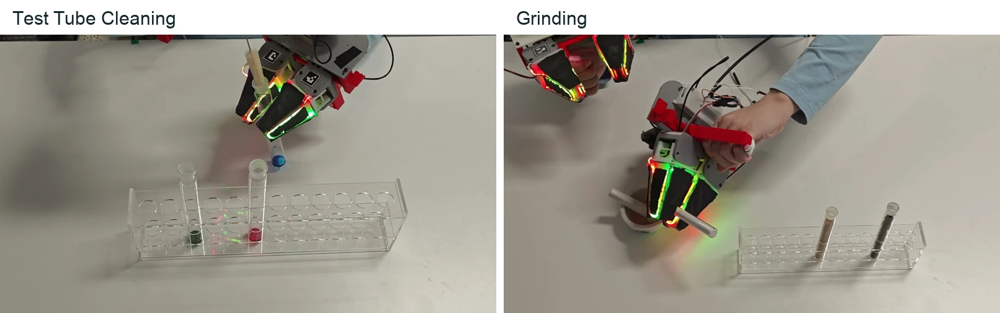

<!-- Generated by scripts/generate.py; edit data/works.json and data/media.json. -->

[← Back to the Awesome index](../../../README.md) · [Interactive website](https://chang-xinhai.github.io/Awesome-RGBDT-Manipulation/?collection=benchmark&item=maniskill-vitac-2026#library)

# ManiSkill-ViTac 2026

ManiSkill-ViTac Challenge 2026: Real-world Language-guided Bimanual Vision-Tactile Manipulation Challenge

**2026 · CVPR 2026 Embodied AI Workshop challenge · Tsinghua University**

**[Project](https://callmeray.github.io/Mani_ViTac_Challenge_2026_page/)** · [Code](https://github.com/chaoyiL/ManiSkill-vitac) · [Data](https://cloud.tsinghua.edu.cn/d/0831b0fa9aed41c98e3b/)

Real-world language-conditioned bimanual challenge covering transparent tube handling and sustained grinding contact.

*ManiSkill-ViTac Challenge2026 organizers · [Figure source](https://callmeray.github.io/Mani_ViTac_Challenge_2026_page/) · Original rights retained.*

| Field | Reported value and source scope |
| :-- | :-- |
| Record type | benchmark |
| Simulator | Not applicable — 2026 challenge uses physical robot evaluation [1](https://callmeray.github.io/Mani_ViTac_Challenge_2026_page/)  |
| Simulator version and scope | Not applicable [1](https://callmeray.github.io/Mani_ViTac_Challenge_2026_page/) [2](https://github.com/chaoyiL/ManiSkill-vitac)  |
| Task count and scope | 2 physical bimanual tasks [1](https://callmeray.github.io/Mani_ViTac_Challenge_2026_page/)  |
| Task-list scope | Complete two-task 2026 challenge. [1](https://callmeray.github.io/Mani_ViTac_Challenge_2026_page/)  |
| Capability dimensions | Color/language grounding · Transparent-object handling · Rack insertion · Compliant cleaning · Material selection · Sustained contact force [1](https://callmeray.github.io/Mani_ViTac_Challenge_2026_page/)  |
| Metrics | Final score is the sum of both task performances from the same submission; best complete submission determines team result. [1](https://callmeray.github.io/Mani_ViTac_Challenge_2026_page/)  |
| Robots | Bimanual physical platforms; exact robot models require challenge documentation. [1](https://callmeray.github.io/Mani_ViTac_Challenge_2026_page/)  |
| Sensors and observations | Wrist cameras, tactile images, wrist poses and language instructions; no external depth input established by released overview. [1](https://callmeray.github.io/Mani_ViTac_Challenge_2026_page/)  |
| Data collection method | Bimanual visuo-tactile teleoperation on the ViTaMIn-B platform, recording synchronized visual, tactile and proprioceptive streams. [1](https://callmeray.github.io/Mani_ViTac_Challenge_2026_page/) [3](https://callmeray.github.io/Mani_ViTac_Challenge_2026_page/)  |
| Demonstrations and data | Sample datasets released 16 April 2026; full demonstration dataset released for Stage 2. Exact trajectory scale Not reported on overview. [1](https://callmeray.github.io/Mani_ViTac_Challenge_2026_page/)  |
| Evaluation protocol | Technical-brief selection then multiple physical policy submissions; both tasks evaluated per submission; final rankings announced 1 June 2026. [1](https://callmeray.github.io/Mani_ViTac_Challenge_2026_page/)  |
| Evaluated baselines | Not reported on challenge overview. [1](https://callmeray.github.io/Mani_ViTac_Challenge_2026_page/)  |
| Observations / modalities | RGB · Tactile · Proprioception · Language |
| Evaluation domain | Real world |
| Embodiment | Bimanual · Parallel-jaw gripper |
| Release: code | Available [2](https://github.com/chaoyiL/ManiSkill-vitac)  |
| Release: weights | Not verified [2](https://github.com/chaoyiL/ManiSkill-vitac)  |
| Release: data | Available [2](https://github.com/chaoyiL/ManiSkill-vitac)  |
| Release: license | Not verified [2](https://github.com/chaoyiL/ManiSkill-vitac)  |
| Release: notes | Official code and sample/full-data entry points linked by challenge page. [2](https://github.com/chaoyiL/ManiSkill-vitac)  |

**Task names — Complete two-task 2026 challenge.:**

- Test Tube Cleaning
- Grinding

**Scope and qualifications**

- A real-world challenge rather than a ready-made simulation benchmark.
- Dataset access and task scoring details must be read from the edition-specific documentation.

**Primary evidence**

1. [Official project](https://callmeray.github.io/Mani_ViTac_Challenge_2026_page/) — Public project page.
2. [Official repository](https://github.com/chaoyiL/ManiSkill-vitac) — Current public repository; implementation scope may differ from paper.
3. [Data collection method and scope](https://callmeray.github.io/Mani_ViTac_Challenge_2026_page/) — Original method/data protocol reviewed for the collection mechanism. Data volume, evaluation rollouts and downstream training remain separate; undisclosed or unresolved interfaces are labeled explicitly.
