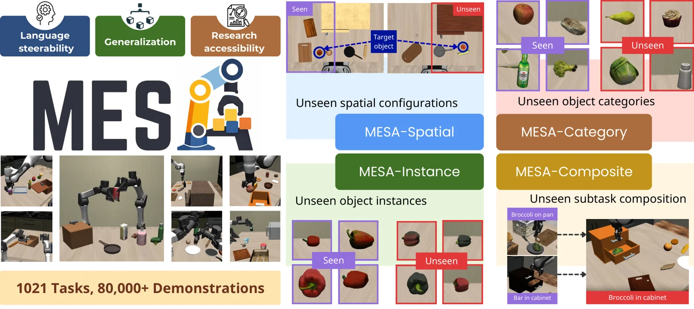

<!-- Generated by scripts/generate.py; edit data/works.json and data/media.json. -->

[← Back to the Awesome index](../../../README.md) · [Interactive website](https://chang-xinhai.github.io/Awesome-RGBDT-Manipulation/?collection=benchmark&item=mesa-bench#library)

# MESA

MESA: An Evaluation Framework for Compositional, Semantic, and Spatial Generalization in Robotics

**2026-11-03 · CoRL 2026 · Georgia Institute of Technology**

**[Paper](https://arxiv.org/abs/2611.05567)** · [Project](https://pairlab.github.io/MESA/) · [Code](https://github.com/pairlab/mesa-env) · [Data](https://huggingface.co/collections/albertwilcox/mesa)

A manipulation evaluation framework and task-generation pipeline isolate spatial, object and compositional generalization.

*MESA authors · [Figure source](https://arxiv.org/abs/2611.05567) · Original rights retained.*

| Field | Reported value and source scope |
| :-- | :-- |
| Record type | benchmark |
| Simulator | MuJoCo / robosuite [1](https://arxiv.org/abs/2611.05567)  |
| Simulator version and scope | Not verified [1](https://arxiv.org/abs/2611.05567)  |
| Task count and scope | 1,021 task configurations across suites [1](https://arxiv.org/abs/2611.05567)  |
| Task-list scope | The project teaser reports 1,021 tasks across the combined MESA/BiMESA; category and held-out split counts are separate. [1](https://arxiv.org/abs/2611.05567)  |
| Capability dimensions | Spatial, object-instance, category and compositional generalization. [1](https://arxiv.org/abs/2611.05567)  |
| Metrics | Success under in-distribution and held-out evaluation splits. [1](https://arxiv.org/abs/2611.05567)  |
| Robots | Single-arm and bimanual platforms. [1](https://arxiv.org/abs/2611.05567)  |
| Sensors and observations | RGB and proprioception for evaluated policies; interfaces may vary by baseline. [1](https://arxiv.org/abs/2611.05567)  |
| Data collection method | MESA-Gen expands source demonstrations with MimicGen-style generation. [1](https://arxiv.org/abs/2611.05567)  |
| Demonstrations and data | Author reports 80,000+ generated demonstrations across benchmark suites. [1](https://arxiv.org/abs/2611.05567)  |
| Evaluation protocol | Five suites isolate in-distribution and four generalization axes. [1](https://arxiv.org/abs/2611.05567)  |
| Evaluated baselines | Diffusion policies, VLM approaches and pretrained VLAs. [1](https://arxiv.org/abs/2611.05567)  |
| Observations / modalities | RGB · Proprioception · Language |
| Evaluation domain | Simulation |
| Embodiment | Not reported |
| Release: code | Available — simulation environment and generation code [2](https://github.com/pairlab/mesa-env)  |
| Release: weights | Listed in official collection; individual artifacts not independently audited [2](https://github.com/pairlab/mesa-env)  |
| Release: data | Listed — official data and assets collection [2](https://github.com/pairlab/mesa-env)  |
| Release: license | MIT for repository; third-party assets and model terms separate [2](https://github.com/pairlab/mesa-env)  |
| Release: notes | Simulator dependencies and external assets required; public code contains source and task definitions. [2](https://github.com/pairlab/mesa-env)  |

**Task names — The project teaser reports 1,021 tasks across the combined MESA/BiMESA; category and held-out split counts are separate.:**

Task names not reported or not verified in the cited sources.

**Scope and qualifications**

- Single-arm and bimanual suites differ; 1,021 task configurations cover the combined benchmark, not 1,021 independent task categories.

**Primary evidence**

1. [Author paper or official project: methods and evaluation scope](https://arxiv.org/abs/2611.05567)
2. [Official repository: release inventory and scope](https://github.com/pairlab/mesa-env) — Release availability, assets and third-party licenses are independently scoped; no end-to-end reproduction is implied.
