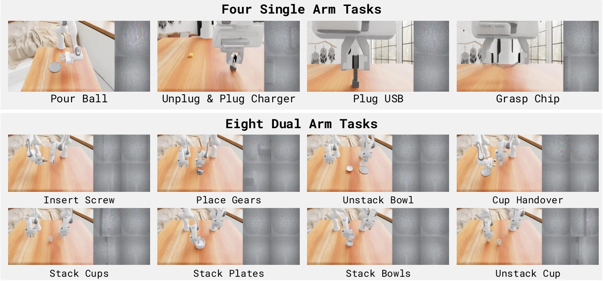

<!-- Generated by scripts/generate.py; edit data/works.json and data/media.json. -->

[← Back to the Awesome index](../../../README.md) · [Interactive website](https://chang-xinhai.github.io/Awesome-RGBDT-Manipulation/?collection=benchmark&item=n0-foundation#library)

# NeoReal / NeoSim

𝒩₀-Foundation: Towards the Age of Tactile Intelligence

**2026-08-30 · Preprint · N₀-Foundation report · NeoteAI; Fudan University TEAI**

**[Paper](https://arxiv.org/abs/2608.29601)** · [Project](https://research.neoteai.com/n0-foundation/) · [Code](https://github.com/neoteai/N0-Foundation) · [Data](https://huggingface.co/datasets/NeoteAIEmbodied/OpenNeoData) · [Weights](https://huggingface.co/NeoteAI/NeoForce)

Ten physical NeoReal tasks and twelve NeoSim task settings test contact regulation, assembly, fragile-object handling and bimanual coordination.

*NeoteAI / Fudan TEAI authors · [Figure source](https://arxiv.org/html/2608.29601v2#S6) · Original rights retained.*

| Field | Reported value and source scope |
| :-- | :-- |
| Record type | benchmark |
| Simulator | NeoSim: UniVTAC on NVIDIA Isaac Sim / Isaac Lab with TacEx; NeoReal: physical robots. [3](https://arxiv.org/html/2608.29601v2#S6) [5](https://github.com/neoteai/N0-Foundation/blob/main/neosim/docs/EnvironmentLock.md)  |
| Simulator version and scope | Paper does not pin versions. Released NeoSim EnvironmentLock lists Isaac Sim 4.5.0.0, Isaac Lab v2.1.1, TacEx 0.1.0 and pyuipc 0.9.0; scope is the released known-good node, not an assumed paper setting. [3](https://arxiv.org/html/2608.29601v2#S6) [5](https://github.com/neoteai/N0-Foundation/blob/main/neosim/docs/EnvironmentLock.md)  |
| Task count and scope | NeoReal: 10 physical tasks; NeoSim: 12 simulated task settings (4 single-arm, 8 dual-arm). These are two suites, not 22 independent skill families. [3](https://arxiv.org/html/2608.29601v2#S6)  |
| Task-list scope | Complete named paper suites, with suite prefixes. Extra implementation task files are not added to the paper evaluation count. [3](https://arxiv.org/html/2608.29601v2#S6)  |
| Capability dimensions | Force regulation · Tight-clearance insertion · Fragile-object handling · Deformable-object shaping · Sustained surface contact · Bimanual coordination [3](https://arxiv.org/html/2608.29601v2#S6)  |
| Metrics | Per-task binary success; NeoReal also reports an ordered milestone-progress score. [3](https://arxiv.org/html/2608.29601v2#S6)  |
| Robots | NeoReal single-arm Flexiv Rizon 4s; dual-arm Piper or ARX X5. NeoSim has single- and dual-arm setups; exact paper robot variants are not inferred from unrelated dataset embodiments. [3](https://arxiv.org/html/2608.29601v2#S6)  |
| Sensors and observations | External/wrist RGB, tactile fingers and robot states. NeoSim records tactile RGB/marker motion/gel depth and derives contact-force fields. Gel deformation depth is not an external scene-depth camera; not every baseline consumes touch. [3](https://arxiv.org/html/2608.29601v2#S6)  |
| Data collection method | NeoSim: scripted cuRobo experts with planner/success filtering. NeoReal task-demo interface is Not reported; separate NeoData pretraining combines robot teleoperation and TacUMI capture. [3](https://arxiv.org/html/2608.29601v2#S6) [11](https://arxiv.org/abs/2608.29601)  |
| Demonstrations and data | NeoReal policies: 400,000+ NeoData pretraining episodes then 300 task-specific demonstrations. NeoSim: 100 successful scripted/cuRobo demonstrations per task. OpenNeoData is a separately gated 5,000-hour corpus, not the task-demo total. [3](https://arxiv.org/html/2608.29601v2#S6) [7](https://huggingface.co/datasets/NeoteAIEmbodied/OpenNeoData)  |
| Evaluation protocol | NeoReal: 20 randomized trials/task and a 5-minute limit, with milestone and failure rules. NeoSim: 100 fixed evaluation seeds/task disjoint from collection, remote policy inference on RTX 4090. Paper real training uses 8 A100; simulated task-policy training uses 4 A100. [3](https://arxiv.org/html/2608.29601v2#S6)  |
| Evaluated baselines | ACT · Diffusion Policy · π0.5 · Xiaomi-Robotics-0 · InternVLA-A1 · StarVLA-α · Fast-WAM · GigaWorld Policy · LingBot-VA [3](https://arxiv.org/html/2608.29601v2#S6)  |
| Observations / modalities | RGB · Tactile |
| Evaluation domain | Real world · Simulation |
| Embodiment | Parallel-jaw gripper · Bimanual |
| Release: code | Available — NeoSim collection/evaluation implementation [4](https://github.com/neoteai/N0-Foundation/tree/main/neoforce) [5](https://github.com/neoteai/N0-Foundation/blob/main/neosim/docs/EnvironmentLock.md)  |
| Release: weights | Not applicable — benchmark; baseline checkpoint completeness not verified [6](https://huggingface.co/NeoteAI/NeoForce)  |
| Release: data | Gated — OpenNeoData; separate task demonstrations follow their release documentation [7](https://huggingface.co/datasets/NeoteAIEmbodied/OpenNeoData)  |
| Release: license | NeoSim code MIT, including NOTICE for UniVTAC/TacEx; data and documentation retain separate terms. [7](https://huggingface.co/datasets/NeoteAIEmbodied/OpenNeoData) [8](https://github.com/neoteai/N0-Foundation/blob/main/neoforce/LICENSE) [9](https://github.com/neoteai/N0-Foundation/blob/main/neosim/LICENSE)  |
| Release: notes | Published evaluation suites and the larger implementation task registry are scoped separately. |

**Task names — Complete named paper suites, with suite prefixes. Extra implementation task files are not added to the paper evaluation count.:**

- NeoReal — Cardboard Box Folding
- NeoReal — Bag Packing
- NeoReal — Cable Winding
- NeoReal — Board Wiping
- NeoReal — Cup Stacking
- NeoReal — Socket Plugging
- NeoReal — Board Insertion
- NeoReal — Bottle Standing
- NeoReal — Fruit Collection
- NeoReal — Towel Folding
- NeoSim — Pour Ball
- NeoSim — Unplug and Plug Charger
- NeoSim — Plug USB
- NeoSim — Grasp Chip
- NeoSim — Insert Screw
- NeoSim — Place Gears
- NeoSim — Unstack Bowl
- NeoSim — Cup Handover
- NeoSim — Stack Cups
- NeoSim — Stack Plates
- NeoSim — Stack Bowls
- NeoSim — Unstack Cup

**Scope and qualifications**

- NeoForce is a supporting encoder, not a standalone action policy or a new 30,000-hour encoder-training run.
- NeoSim gel-depth maps describe local tactile deformation, not an observed external depth camera stream.
- The project page is dated July 25; this catalog uses the first arXiv manuscript date and preserves that difference.
- The full NeoData corpus, the released OpenNeoData subset and per-benchmark task demonstrations must not be summed.

**Primary evidence**

1. [Original report and arXiv history](https://arxiv.org/abs/2608.29601) — First arXiv manuscript 30 August; revised 20 September 2026.
2. [NeoForce method and Appendix D](https://arxiv.org/html/2608.29601v2#S5) — Encoder training subset, converter, supervision and downstream use are distinct.
3. [NeoReal / NeoSim with Appendices E–F](https://arxiv.org/html/2608.29601v2#S6) — Full paper task names, protocols, hardware and evaluated baseline subsets.
4. [Released NeoForce implementation](https://github.com/neoteai/N0-Foundation/tree/main/neoforce)
5. [Released NeoSim environment lock](https://github.com/neoteai/N0-Foundation/blob/main/neosim/docs/EnvironmentLock.md)
6. [NeoForce model release](https://huggingface.co/NeoteAI/NeoForce) — Public API lists neoforce.pt and the tactile converter checkpoint.
7. [OpenNeoData card and access terms](https://huggingface.co/datasets/NeoteAIEmbodied/OpenNeoData)
8. [NeoForce MIT license](https://github.com/neoteai/N0-Foundation/blob/main/neoforce/LICENSE)
9. [NeoSim MIT license](https://github.com/neoteai/N0-Foundation/blob/main/neosim/LICENSE)
10. [Root documentation license](https://github.com/neoteai/N0-Foundation/blob/main/LICENSE)
11. [Data collection method and scope](https://arxiv.org/abs/2608.29601) — NeoSim appendix describes scripted cuRobo collection; NeoData pretraining capture is not treated as the NeoReal task collector.
