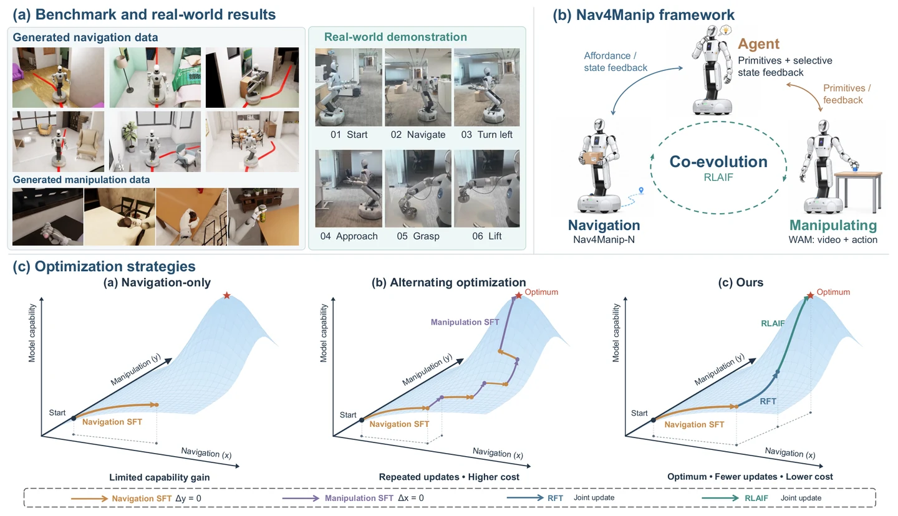

<!-- Generated by scripts/generate.py; edit data/works.json and data/media.json. -->

[← Back to the Awesome index](../../../README.md) · [Interactive website](https://chang-xinhai.github.io/Awesome-RGBDT-Manipulation/?collection=benchmark&item=nav4manip#library)

# Nav-N-Manip

Nav4Manip: From Navigation to Dexterous Mobile Manipulation through Co-Evolution

**2026-11-25 · Preprint · Peking University; Galbot and collaborators**

**[Paper](https://arxiv.org/abs/2611.34655)** · [Project](https://nav4manip.github.io/)

Tests whether mobile navigation stops where a dexterous executor can pick up an object.

*Yusen Feng and coauthors · [Figure source](https://arxiv.org/html/2611.34655v1) · Original rights retained.*

| Field | Reported value and source scope |
| :-- | :-- |
| Record type | policy |
| Simulator | EmbodiedGen-generated indoor layouts [1](https://arxiv.org/html/2611.34655v1)  |
| Simulator version and scope | Not reported [1](https://arxiv.org/html/2611.34655v1)  |
| Task count and scope | Scenario-specific episodes and goals; no single published total in paper summary [1](https://arxiv.org/html/2611.34655v1)  |
| Task-list scope | Examples of paper goals, not a complete task manifest [1](https://arxiv.org/html/2611.34655v1)  |
| Capability dimensions | Mobile approach · Endpoint feasibility · Dexterous object manipulation [1](https://arxiv.org/html/2611.34655v1)  |
| Metrics | Navigation and manipulation success, end-to-end completion and collision behavior. [1](https://arxiv.org/html/2611.34655v1)  |
| Robots | Galbot G3 mobile manipulator; real demonstration uses Sharpa dexterous hands. [1](https://arxiv.org/html/2611.34655v1)  |
| Sensors and observations | Designated head RGB and wrist RGB at the handoff; setup mounts stereo-capable hardware. [1](https://arxiv.org/html/2611.34655v1)  |
| Data collection method | Paired navigation trajectories and validated endpoints are generated from scripted/agent paths; dexterous manipulation recordings separately use leader–follower arm teleoperation. [1](https://arxiv.org/html/2611.34655v1)  |
| Demonstrations and data | Reported paired navigation–manipulation trajectories, endpoint outcomes and affordance supervision. [1](https://arxiv.org/html/2611.34655v1)  |
| Evaluation protocol | Hold navigation/motion interfaces fixed and compare separately tuned and co-evolved approaches under matched task settings. [1](https://arxiv.org/html/2611.34655v1)  |
| Evaluated baselines | Navigation-only, alternating training, paired feedback, and direct agent navigation in a separate subset. [1](https://arxiv.org/html/2611.34655v1)  |
| Observations / modalities | RGB · Proprioception · Language |
| Evaluation domain | Simulation · Real world |
| Embodiment | Mobile manipulator · Dexterous hand · Bimanual |
| Release: code | Not verified |
| Release: weights | Not applicable |
| Release: data | Not verified |
| Release: license | Not verified |
| Release: notes | Paper and project supply the benchmark and data protocol; no verified public task downloads. |

**Task names — Examples of paper goals, not a complete task manifest:**

- Pick target from a shelf
- Navigate around clutter
- Deliver the object to a recipient

**Scope and qualifications**

- Stereo head camera hardware does not imply measurable depth is used in the navigation or manipulation policy interface.

**Primary evidence**

1. [Original paper and evaluation settings](https://arxiv.org/html/2611.34655v1)
2. [Official project with task and method examples](https://nav4manip.github.io/)
