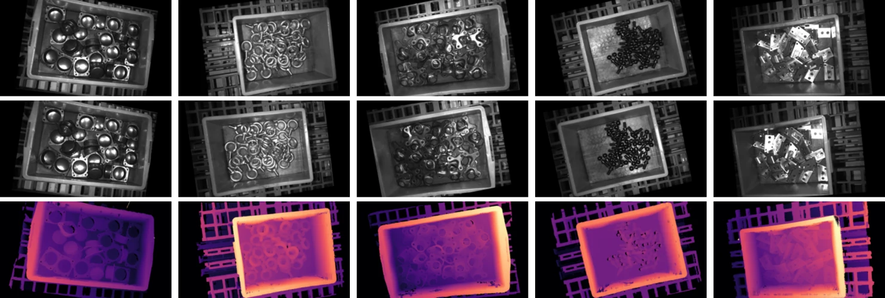

<!-- Generated by scripts/generate.py; edit data/works.json and data/media.json. -->

[← Back to the Awesome index](../../../README.md) · [Interactive website](https://chang-xinhai.github.io/Awesome-RGBDT-Manipulation/?collection=benchmark&item=nbs#library)

# NBS · SimpleProc and XYZ-IBD Stereo

NBS: No Bias Stereo

**2026-08-28 · Preprint · Intrinsic (Google) and Texas A&M University**

**[Paper](https://arxiv.org/abs/2608.28933)** · [Project](https://intrinsic-experimental.github.io/nbs-website/) · [Data](https://intrinsic-experimental.github.io/nbs-website/static/data/NBS_No_Bias_Stereo_Supplementary_Material.zip)

A ViT-based stereo model studies large public/private training mixtures separately from synthetic and industrial evaluation sets.

*NBS authors · [Figure source](https://arxiv.org/html/2608.28933v1) · Original rights retained.*

| Field | Reported value and source scope |
| :-- | :-- |
| Record type | Perception benchmark |
| Simulator | SimpleProc for synthetic evaluations [1](https://arxiv.org/html/2608.28933v1)  |
| Simulator version and scope | Not reported [1](https://arxiv.org/html/2608.28933v1)  |
| Task count and scope | Supporting dataset or perception evaluation [1](https://arxiv.org/html/2608.28933v1)  |
| Task-list scope | Listed uses of the resource, with no closed-loop robot task count. [1](https://arxiv.org/html/2608.28933v1)  |
| Capability dimensions | Training and evaluation data [1](https://arxiv.org/html/2608.28933v1)  |
| Metrics | EPE and bad-p disparity thresholds. [1](https://arxiv.org/html/2608.28933v1)  |
| Robots | Not applicable [1](https://arxiv.org/html/2608.28933v1)  |
| Sensors and observations | Synthetic rectified RGB; selected industrial RGB views paired with structured-light reference geometry. [1](https://arxiv.org/html/2608.28933v1)  |
| Data collection method | SimpleProc procedural rendering plus a separate repackaging of original industrial captures from XYZ-IBD. [1](https://arxiv.org/html/2608.28933v1)  |
| Demonstrations and data | SimpleProc-S has 661 scenes and SimpleProc-M has 530 scenes. XYZ-IBD stereo subset has 55 pairs after artifact filtering. The supplement supplies SimpleProc seeds and the processed industrial subset. [1](https://arxiv.org/html/2608.28933v1) [3](https://intrinsic-experimental.github.io/nbs-website/static/data/NBS_No_Bias_Stereo_Supplementary_Material.zip)  |
| Evaluation protocol | Out-of-distribution perception tests; separate from the high-resolution training mixture and the ETH3D-specific training. [1](https://arxiv.org/html/2608.28933v1)  |
| Evaluated baselines | FoundationStereo, S²M², Selective-IGEV, CREStereo and CroCo in the paper. [1](https://arxiv.org/html/2608.28933v1)  |
| Observations / modalities | RGB |
| Evaluation domain | Simulation · Real world |
| Embodiment |  |
| Release: code | Not verified [2](https://intrinsic-experimental.github.io/nbs-website/) [3](https://intrinsic-experimental.github.io/nbs-website/static/data/NBS_No_Bias_Stereo_Supplementary_Material.zip)  |
| Release: weights | Not verified [2](https://intrinsic-experimental.github.io/nbs-website/) [3](https://intrinsic-experimental.github.io/nbs-website/static/data/NBS_No_Bias_Stereo_Supplementary_Material.zip)  |
| Release: data | Available — author supplement contains processed industrial evaluation and seeds for SimpleProc. Internal training data will not be released. [2](https://intrinsic-experimental.github.io/nbs-website/) [3](https://intrinsic-experimental.github.io/nbs-website/static/data/NBS_No_Bias_Stereo_Supplementary_Material.zip)  |
| Release: license | Not verified [2](https://intrinsic-experimental.github.io/nbs-website/) [3](https://intrinsic-experimental.github.io/nbs-website/static/data/NBS_No_Bias_Stereo_Supplementary_Material.zip)  |
| Release: notes | Public benchmark artifacts are independently available. No model implementation or checkpoint was identified in the primary release. [2](https://intrinsic-experimental.github.io/nbs-website/) [3](https://intrinsic-experimental.github.io/nbs-website/static/data/NBS_No_Bias_Stereo_Supplementary_Material.zip)  |

**Task names — Listed uses of the resource, with no closed-loop robot task count.:**

- SimpleProc-S disparity
- SimpleProc-M disparity
- XYZ-IBD stereo disparity

**Scope and qualifications**

- The 2.4M figure is the count of internal synthetic scenes, not the size of the supplement.

**Primary evidence**

1. [Original author paper or dataset description](https://arxiv.org/html/2608.28933v1)
2. [Author source and artifact entry points](https://intrinsic-experimental.github.io/nbs-website/)
3. [Author-hosted benchmark supplement](https://intrinsic-experimental.github.io/nbs-website/static/data/NBS_No_Bias_Stereo_Supplementary_Material.zip)
4. [Paper training stages and provenance](https://arxiv.org/html/2608.28933v1#S3.SS4)
