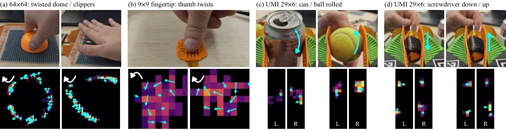

<!-- Generated by scripts/generate.py; edit data/works.json and data/media.json. -->

[← Back to the Awesome index](../../../README.md) · [Interactive website](https://chang-xinhai.github.io/Awesome-RGBDT-Manipulation/?collection=benchmark&item=opentac#library)

# OpenTac

OpenTac: An Open Ecosystem for Customizable, Scalable, and Transferable 3D Tactile Sensing

**2026-10-22 · Preprint · Johns Hopkins University**

**[Paper](https://arxiv.org/abs/2610.31661)** · [Project](https://opentac.github.io/) · [Code](https://github.com/opentac/opentac)

An open flex-PCB tactile ecosystem combines custom CAD, shear-sensitive bumps, reusable readout, simulation, transfer and policy-learning examples.

*OpenTac authors · [Figure source](https://arxiv.org/abs/2610.31661) · Original rights retained.*

| Field | Reported value and source scope |
| :-- | :-- |
| Record type | evaluation-tool |
| Simulator | OpenTac-Sim [1](https://arxiv.org/abs/2610.31661)  |
| Simulator version and scope | Not applicable [1](https://arxiv.org/abs/2610.31661)  |
| Task count and scope | Not a closed-loop benchmark [1](https://arxiv.org/abs/2610.31661)  |
| Task-list scope | Sensor/tool characterization and downstream demonstrations, not a standard policy task suite. [1](https://arxiv.org/abs/2610.31661)  |
| Capability dimensions | Contact sensing · Force estimation [1](https://arxiv.org/abs/2610.31661)  |
| Metrics | Sensor calibration, force/response accuracy and scoped downstream demonstrations. [1](https://arxiv.org/abs/2610.31661)  |
| Robots | Examples include UMI gripper skins, SO-101 and bimanual YAM policy tasks, and Dexmate Vega-1Pro slip control; more than 30 designs fabricated. [1](https://arxiv.org/abs/2610.31661)  |
| Sensors and observations | Piezoresistive flex-PCB taxels with printed shear bumps; normal and two shear components. Adaptive partial 16-taxel updates reach1,286 frames/s on1,024 taxels; full raster67 frames/s. [1](https://arxiv.org/abs/2610.31661)  |
| Data collection method | Sensor calibration and physical contact trials; downstream policy demonstrations are described separately. [1](https://arxiv.org/abs/2610.31661)  |
| Demonstrations and data | Not verified — no complete sensor-characterization or policy-training corpus established. [1](https://arxiv.org/abs/2610.31661)  |
| Evaluation protocol | Hardware characterization and scoped robot demonstrations; not a common cross-policy leaderboard. [1](https://arxiv.org/abs/2610.31661)  |
| Evaluated baselines | Sensor/component comparisons, not a roster of standardized robot policies. [1](https://arxiv.org/abs/2610.31661)  |
| Observations / modalities | Tactile |
| Evaluation domain | Real world |
| Embodiment |  |
| Release: code | Available [2](https://opentac.github.io/) [3](https://github.com/opentac/opentac)  |
| Release: weights | Not applicable [2](https://opentac.github.io/) [3](https://github.com/opentac/opentac)  |
| Release: data | Not verified [2](https://opentac.github.io/) [3](https://github.com/opentac/opentac)  |
| Release: license | MIT original software; CERN-OHL-P-2.0 hardware design; CC BY4.0 documentation/media, verified separate LICENSE files. [2](https://opentac.github.io/) [3](https://github.com/opentac/opentac)  |
| Release: notes | Actual CAD, firmware/readout, simulation and transfer source and fabrication designs released. Policy checkpoints and a full training/characterization corpus are not verified; source tool availability is not their release. [2](https://opentac.github.io/) [3](https://github.com/opentac/opentac)  |

**Task names — Sensor/tool characterization and downstream demonstrations, not a standard policy task suite.:**

Task names not reported or not verified in the cited sources.

**Scope and qualifications**

- Partial-frame acquisition rate is not full-array frame rate or a robot policy control rate.
- CoRL2026 live demo announcement is not an accepted conference-paper venue.
- CAD simulation animations and fabricated sensor experiments retain separate scope.

**Primary evidence**

1. [Primary manuscript and first-submission history](https://arxiv.org/abs/2610.31661) — Current primary manuscript reviewed; first-public date uses arXiv v1. Observations, training privileges and deployed interfaces retain their separate scopes.
2. [Official project source and actual artifact inventory](https://opentac.github.io/) — Reviewed 26 October 2026. Availability and licensing apply only to the described released component, independently of paper results.
3. [Official code source and actual artifact inventory](https://github.com/opentac/opentac) — Reviewed 26 October 2026. Availability and licensing apply only to the described released component, independently of paper results.
