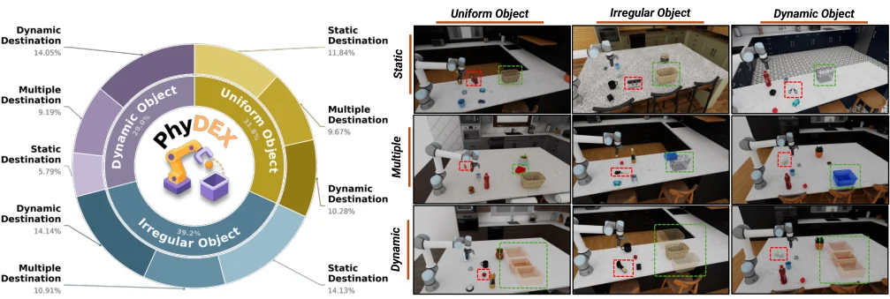

<!-- Generated by scripts/generate.py; edit data/works.json and data/media.json. -->

[← Back to the Awesome index](../../../README.md) · [Interactive website](https://chang-xinhai.github.io/Awesome-RGBDT-Manipulation/?collection=benchmark&item=phydex#library)

# PhyDEX

PhyDEX: A Benchmark for Physical Reasoning in Vision-Language-Action Models via Dynamic Extrinsic Dexterity

**2026-11-19 · Preprint · University of Arkansas and collaborating universities**

**[Paper](https://arxiv.org/abs/2611.26565)**

Tests extrinsic dexterity through controlled object throwing and physical-property shifts, with separate simulation and small real-world validations.

*Hao Vo and coauthors · [Figure source](https://arxiv.org/html/2611.26565v1) · Original rights retained.*

| Field | Reported value and source scope |
| :-- | :-- |
| Record type | benchmark |
| Simulator | NVIDIA Isaac Sim [1](https://arxiv.org/html/2611.26565v1)  |
| Simulator version and scope | Not reported [1](https://arxiv.org/html/2611.26565v1)  |
| Task count and scope | 9 task types and 100 scenes; physical validation is separate. [1](https://arxiv.org/html/2611.26565v1)  |
| Task-list scope | Three object families and three destination families form nine task types. [1](https://arxiv.org/html/2611.26565v1)  |
| Capability dimensions | Training and evaluation data [1](https://arxiv.org/html/2611.26565v1)  |
| Metrics | Task success, staged failure cases and physical-parameter-ablation results. [1](https://arxiv.org/html/2611.26565v1)  |
| Robots | Isaac Sim arm configurations and separate physical UR10e with Robotiq 2F-85 [1](https://arxiv.org/html/2611.26565v1)  |
| Sensors and observations | Robot cameras and state; wrist F/T exists on the real apparatus. Ground-truth physical properties and point clouds are generator/ablation inputs. [1](https://arxiv.org/html/2611.26565v1)  |
| Data collection method | Automatically combine grasp generation, cuRobo planning and throw optimization under randomized mass/friction in Isaac Sim. [1](https://arxiv.org/html/2611.26565v1)  |
| Demonstrations and data | 35,357 simulated episodes (143.2 hours), nine tasks and 100 scenes reported. Separate real tests use three externally identical cubes. [1](https://arxiv.org/html/2611.26565v1)  |
| Evaluation protocol | Stratify extrinsic throwing by object mass distribution and destination geometry or motion. Physical properties provided to a separate ablation. [1](https://arxiv.org/html/2611.26565v1)  |
| Evaluated baselines | GR00T N1.7, DynamicVLA and ForceVLA on the stated paper setting. [1](https://arxiv.org/html/2611.26565v1)  |
| Observations / modalities | RGB · Proprioception · Force/Torque · Language |
| Evaluation domain | Simulation · Real world |
| Embodiment | UR10e and Robotiq 2F-85 · Humanoid simulation |
| Release: code | Not verified |
| Release: weights | Not verified |
| Release: data | Not verified |
| Release: license | Not verified |
| Release: notes | The paper describes the dataset and generator; the listed project page did not resolve during verification, and code or download was not confirmed. |

**Task names — Three object families and three destination families form nine task types.:**

- Uniform object with static, multiple or moving destination
- Irregular object with static, multiple or moving destination
- Dynamic mass with static, multiple or moving destination

**Scope and qualifications**

- Generator-visible point clouds and physical parameters are not general policy observations.
- Restrict comparisons to the same embodiment and protocol, particularly for real-world trials.

**Primary evidence**

1. [Original author paper or dataset description](https://arxiv.org/html/2611.26565v1)
