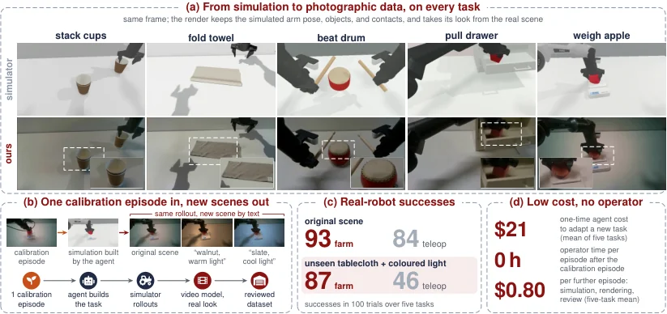

<!-- Generated by scripts/generate.py; edit data/works.json and data/media.json. -->

[← Back to the Awesome index](../../../README.md) · [Interactive website](https://chang-xinhai.github.io/Awesome-RGBDT-Manipulation/?collection=benchmark&item=pyrua-datafarm#library)

# PyRUA-DataFarm

PyRUA-DataFarm: LLM Agent as a Cost-Efficient Teleoperator for Real-Ready Robot Data

**2026-11-03 · Preprint · Peking University**

**[Paper](https://arxiv.org/abs/2611.05320)** · [Project](https://dagroup-pku.github.io/PyRUA-Lean/DataFarm) · [Code](https://github.com/DAGroup-PKU/PyRUA-Lean/tree/DataFarm)

An agent builds a simulation expert and uses real-image-conditioned rendering to create robot training demonstrations.

*PyRUA-DataFarm authors · [Figure source](https://arxiv.org/abs/2611.05320) · Original rights retained.*

| Field | Reported value and source scope |
| :-- | :-- |
| Record type | dataset |
| Simulator | Task-specific simulation [1](https://arxiv.org/abs/2611.05320)  |
| Simulator version and scope | Not verified [1](https://arxiv.org/abs/2611.05320)  |
| Task count and scope | 5 evaluated real tasks [1](https://arxiv.org/abs/2611.05320)  |
| Task-list scope | The five evaluated task families shown in the author teaser. [1](https://arxiv.org/abs/2611.05320)  |
| Capability dimensions | Agentic simulation construction, expert generation and multiview visual rendering. [1](https://arxiv.org/abs/2611.05320)  |
| Metrics | Generated episode acceptance and downstream real-robot success. [1](https://arxiv.org/abs/2611.05320)  |
| Robots | Robot arm and gripper in task-specific scenes. [1](https://arxiv.org/abs/2611.05320)  |
| Sensors and observations | Synchronized camera views and action labels; simulator states used internally. [1](https://arxiv.org/abs/2611.05320)  |
| Data collection method | One physical calibration episode per target scene, coding-agent simulator/expert construction, and separately validated rendered simulated trajectories. [1](https://arxiv.org/abs/2611.05320)  |
| Demonstrations and data | Synthetic robot demonstrations; full public training data release not verified. [1](https://arxiv.org/abs/2611.05320)  |
| Evaluation protocol | Five real tasks tested after training on generated data; teleoperation is a separate comparison. [1](https://arxiv.org/abs/2611.05320)  |
| Evaluated baselines | Teleoperation demonstrations and generated-data alternatives. [1](https://arxiv.org/abs/2611.05320)  |
| Observations / modalities | RGB · Proprioception · Language |
| Evaluation domain | Simulation · Real world |
| Embodiment | Not reported |
| Release: code | Partial — DataFarm branch contains pipeline code and task tooling [2](https://github.com/DAGroup-PKU/PyRUA-Lean/tree/DataFarm)  |
| Release: weights | External video and policy models; not verified [2](https://github.com/DAGroup-PKU/PyRUA-Lean/tree/DataFarm)  |
| Release: data | Not verified [2](https://github.com/DAGroup-PKU/PyRUA-Lean/tree/DataFarm)  |
| Release: license | Repository license; external model and dataset terms separate [2](https://github.com/DAGroup-PKU/PyRUA-Lean/tree/DataFarm)  |
| Release: notes | Public code and example artifacts do not establish release of every rendered training dataset or model. [2](https://github.com/DAGroup-PKU/PyRUA-Lean/tree/DataFarm)  |

**Task names — The five evaluated task families shown in the author teaser.:**

- Stack cups
- Fold towel
- Beat drum
- Pull drawer
- Weigh apple

**Scope and qualifications**

- This is a data-generation tool, not a new closed-loop benchmark or measured depth modality.
- Reported real-robot downstream evaluation and generated demonstrations have distinct roles and settings.

**Primary evidence**

1. [Author paper or official project: methods and evaluation scope](https://arxiv.org/abs/2611.05320)
2. [Official repository: release inventory and scope](https://github.com/DAGroup-PKU/PyRUA-Lean/tree/DataFarm) — Release availability, assets and third-party licenses are independently scoped; no end-to-end reproduction is implied.
