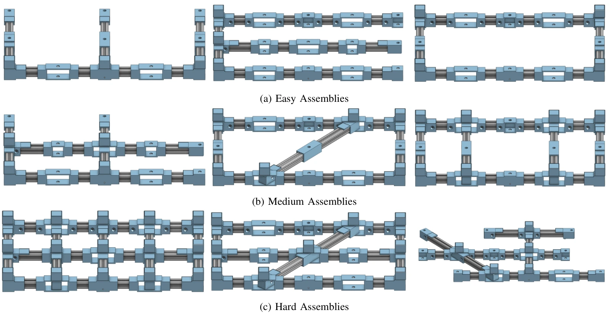

<!-- Generated by scripts/generate.py; edit data/works.json and data/media.json. -->

[← Back to the Awesome index](../../../README.md) · [Interactive website](https://chang-xinhai.github.io/Awesome-RGBDT-Manipulation/?collection=benchmark&item=ramp#library)

# RAMP

RAMP: A Benchmark for Evaluating Robotic Assembly Manipulation and Planning

**2023-05-16 · IEEE Robotics and Automation Letters 2024 · University of Oxford / Manufacturing Technology Centre / University of Birmingham**

**[Paper](https://arxiv.org/abs/2305.09644)** · [Project](https://sites.google.com/oxfordrobotics.institute/ramp) · [Code](https://github.com/applied-ai-lab/ramp-sim)

Accessible beam-and-peg assembly benchmark testing both planning and precise execution, with hardware plans and a digital twin.

*RAMP authors · [Figure source](https://arxiv.org/abs/2305.09644) · Original rights retained.*

| Field | Reported value and source scope |
| :-- | :-- |
| Record type | benchmark |
| Simulator | NVIDIA Isaac Sim [1](https://arxiv.org/abs/2305.09644) [2](https://sites.google.com/oxfordrobotics.institute/ramp)  |
| Simulator version and scope | Released ramp-sim README specifies NVIDIA Isaac Sim 2022.2.1. [1](https://arxiv.org/abs/2305.09644) [2](https://sites.google.com/oxfordrobotics.institute/ramp) [3](https://github.com/applied-ai-lab/ramp-sim)  |
| Task count and scope | Assemblies grouped into Easy, Medium and Hard; paper baseline evaluates 3 Easy assemblies [1](https://arxiv.org/abs/2305.09644) [2](https://sites.google.com/oxfordrobotics.institute/ramp)  |
| Task-list scope | Complete three currently selectable Easy simulation assemblies in released README; paper additionally defines Medium and Hard goal classes. [1](https://arxiv.org/abs/2305.09644) [2](https://sites.google.com/oxfordrobotics.institute/ramp)  |
| Capability dimensions | Task-and-motion planning · Peg insertion · Beam sliding · Regrasping · Diagnostics and fault recovery [1](https://arxiv.org/abs/2305.09644) [2](https://sites.google.com/oxfordrobotics.institute/ramp)  |
| Metrics | Correct fully seated peg completion percentage over time; completion time and repeats; partial assemblies count only valid connected components. [1](https://arxiv.org/abs/2305.09644) [2](https://sites.google.com/oxfordrobotics.institute/ramp)  |
| Robots | Single-arm physical baseline; kit extensible to other robot systems. [1](https://arxiv.org/abs/2305.09644) [2](https://sites.google.com/oxfordrobotics.institute/ramp)  |
| Sensors and observations | AprilTags aid state estimation; force-controlled manipulation primitives; sensor choice not fixed by the kit. [1](https://arxiv.org/abs/2305.09644) [2](https://sites.google.com/oxfordrobotics.institute/ramp)  |
| Demonstrations and data | Nine base beams, up to 15 pegs, printable joints, A2 reset template, XML goal descriptions and digital twin; no standard large demonstration dataset. [1](https://arxiv.org/abs/2305.09644) [2](https://sites.google.com/oxfordrobotics.institute/ramp)  |
| Evaluation protocol | Easy requires 3–4 peg insertions; Medium 4–8 with angled insertion/sliding/regrasping; Hard longer free-form designs. Baseline repeats three Easy designs five times. [1](https://arxiv.org/abs/2305.09644) [2](https://sites.google.com/oxfordrobotics.institute/ramp)  |
| Evaluated baselines | Rudimentary symbolic planner and Cartesian-impedance manipulation primitives. [1](https://arxiv.org/abs/2305.09644) [2](https://sites.google.com/oxfordrobotics.institute/ramp)  |
| Observations / modalities | RGB · Force/Torque · Proprioception |
| Evaluation domain | Real world · Simulation |
| Embodiment | Parallel-jaw gripper |
| Release: code | Available [3](https://github.com/applied-ai-lab/ramp-sim)  |
| Release: weights | Not applicable [3](https://github.com/applied-ai-lab/ramp-sim)  |
| Release: data | Available [3](https://github.com/applied-ai-lab/ramp-sim)  |
| Release: license | GPL-3.0 for ramp-sim/ramp-planner; CAD/material terms require separate inspection [3](https://github.com/applied-ai-lab/ramp-sim)  |
| Release: notes | Simulation, planning and assembly instructions provided in separate resources. [3](https://github.com/applied-ai-lab/ramp-sim)  |

**Task names — Complete three currently selectable Easy simulation assemblies in released README; paper additionally defines Medium and Hard goal classes.:**

- assembly_easy_1.xml
- assembly_easy_2.xml
- assembly_easy_3.xml

**Scope and qualifications**

- The paper baseline covers Easy assemblies; do not present it as a learned tactile benchmark.

**Primary evidence**

1. [Paper](https://arxiv.org/abs/2305.09644) — Published paper / arXiv record and manuscript.
2. [Official project](https://sites.google.com/oxfordrobotics.institute/ramp) — Public project page.
3. [Official repository](https://github.com/applied-ai-lab/ramp-sim) — Current public repository; implementation scope may differ from paper.
4. [Official source](https://github.com/applied-ai-lab/ramp-sim) — README names simulator version and three selectable XML goals.
