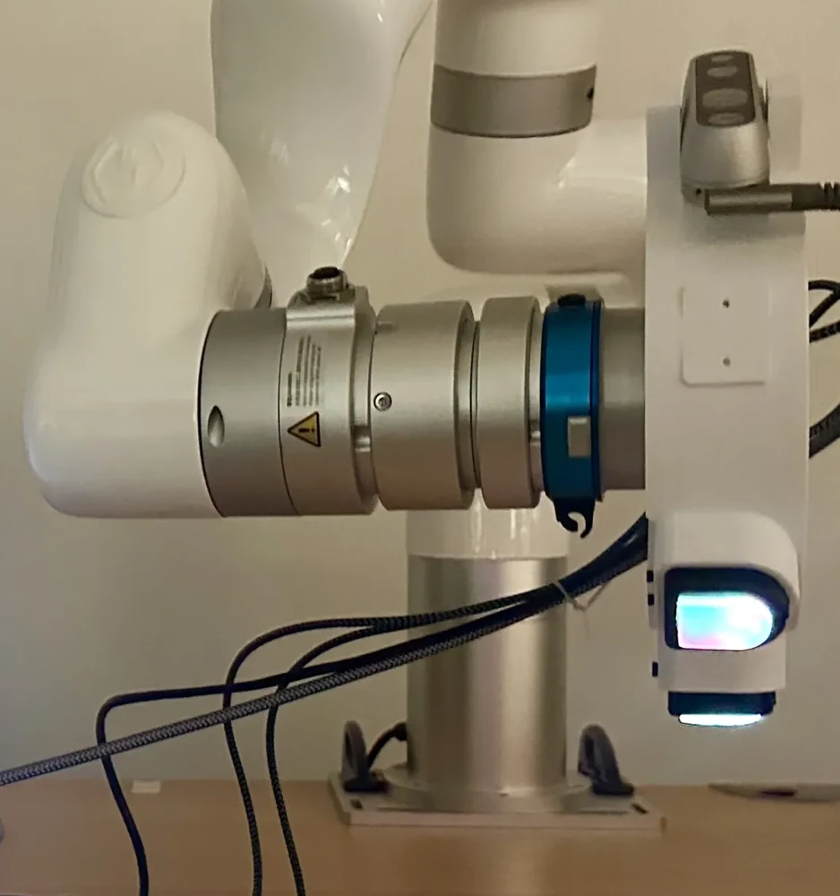

<!-- Generated by scripts/generate.py; edit data/works.json and data/media.json. -->

[← Back to the Awesome index](../../../README.md) · [Interactive website](https://chang-xinhai.github.io/Awesome-RGBDT-Manipulation/?collection=benchmark&item=rct#library)

# RCT

RCT: A Robot-Collected Touch-Vision-Language Dataset for Tactile Generalization

**2026-06-30 · Preprint · TU Dresden; ScaDS.AI Dresden/Leipzig; LASR Lab**

**[Paper](https://arxiv.org/abs/2606.31694)** · [Project](https://faerber-lab.github.io/RCT/) · [Code](https://github.com/faerber-lab/RCT) · [Data](https://figshare.com/s/a5ed417ba6602ccad0f6)

Pairs robot-collected tactile press sequences with material photographs and language labels to test generalization without frame leakage.

*Jingbo He, Michael Färber and Roberto Calandra · [Figure source](https://faerber-lab.github.io/RCT/#dataset) · Original rights retained.*

| Field | Reported value and source scope |
| :-- | :-- |
| Record type | dataset |
| Simulator | Not applicable [1](https://arxiv.org/html/2606.31694v1)  |
| Simulator version and scope | Not reported [1](https://arxiv.org/html/2606.31694v1)  |
| Task count and scope | 1,832 independent contact sequences, 29,279 tactile frames, 122 materials, 3 DIGIT sensors [1](https://arxiv.org/html/2606.31694v1)  |
| Task-list scope | Evaluation split families, not manipulation tasks [1](https://arxiv.org/html/2606.31694v1)  |
| Capability dimensions | Material retrieval · Sensor transfer · Leakage testing [1](https://arxiv.org/html/2606.31694v1)  |
| Metrics | Touch-to-vision retrieval and material/category evaluation under controlled splits. [1](https://arxiv.org/html/2606.31694v1)  |
| Robots | Robot arm presses samples through a rotating adapter carrying three DIGIT sensors. [1](https://arxiv.org/html/2606.31694v1)  |
| Sensors and observations | Optical tactile image, per-frame contact force and known indentation; independent material photograph and descriptions. [1](https://arxiv.org/html/2606.31694v1)  |
| Data collection method | Robot presses at multiple positions and across sensors. Each press is sampled at 0.10 mm steps; frames are grouped as one contact sequence. [1](https://arxiv.org/html/2606.31694v1) [3](https://faerber-lab.github.io/RCT/#download)  |
| Demonstrations and data | Author project reports 122 reference materials, metadata, fixed vocabulary and sequence labels. [1](https://arxiv.org/html/2606.31694v1)  |
| Evaluation protocol | Hold out full presses, material categories, sensors or positions rather than splitting adjacent frames at random. [1](https://arxiv.org/html/2606.31694v1)  |
| Evaluated baselines | Frozen visual/tactile representations and frame-random vs sequence-disjoint split sensitivity. [1](https://arxiv.org/html/2606.31694v1)  |
| Observations / modalities | RGB · Tactile · Force · Language |
| Evaluation domain | Real world |
| Embodiment |  |
| Release: code | Available — split generation, benchmark and leakage-audit source [4](https://github.com/faerber-lab/RCT#readme)  |
| Release: weights | Not verified |
| Release: data | Author-listed archive on Figshare [3](https://faerber-lab.github.io/RCT/#download)  |
| Release: license | Apache-2.0 code; CC BY 4.0 dataset per project [3](https://faerber-lab.github.io/RCT/#download) [4](https://github.com/faerber-lab/RCT#readme)  |
| Release: notes | Frame count and contact-sequence count reflect distinct units. |

**Task names — Evaluation split families, not manipulation tasks:**

- Held-out contact sequence
- Held-out position
- Held-out sensor
- Held-out material
- Held-out category

**Scope and qualifications**

- RGB refers to one reference photograph per material, not a synchronized camera stream at every tactile frame. Controlled indentation distance is a contact parameter, not scene-sensor depth. This is representation evaluation.

**Primary evidence**

1. [Original paper and evaluation settings](https://arxiv.org/html/2606.31694v1)
2. [Official project with task and method examples](https://faerber-lab.github.io/RCT/)
3. [Author release location and scope](https://faerber-lab.github.io/RCT/#download)
4. [Benchmark, leakage tests and declared licenses](https://github.com/faerber-lab/RCT#readme)
