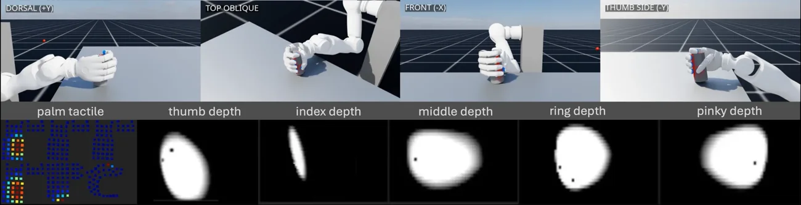

<!-- Generated by scripts/generate.py; edit data/works.json and data/media.json. -->

[← Back to the Awesome index](../../../README.md) · [Interactive website](https://chang-xinhai.github.io/Awesome-RGBDT-Manipulation/?collection=benchmark&item=revosim#library)

# RevoSim

RevoSim: Scalable Multimodal Tactile Simulation for Dexterous Manipulation

**2026-11-06 · Preprint · The Hong Kong University of Science and Technology (Guangzhou)**

**[Paper](https://arxiv.org/abs/2611.08939)** · [Project](https://braincotech.github.io/RevoSim-web/) · [Code](https://github.com/BrainCoTech/RevoSim)

Simulates distributed pressure and fingertip optical touch for BrainCo Revo dexterous hands.

*RevoSim authors · [Figure source](https://braincotech.github.io/RevoSim-web/) · Original rights retained.*

| Field | Reported value and source scope |
| :-- | :-- |
| Record type | simulator |
| Simulator | Isaac Lab / Isaac Sim GPU tactile simulator [1](https://arxiv.org/html/2611.08939v1)  |
| Simulator version and scope | Current repository specifies Isaac Sim 5.1.0 and Isaac Lab v2.3.2; paper setup may differ. [1](https://arxiv.org/html/2611.08939v1)  |
| Task count and scope | Two illustrative policy tasks, not a standardized benchmark [1](https://arxiv.org/html/2611.08939v1)  |
| Task-list scope | Paper illustrative sim-only learning tasks; not an exhaustive benchmark. [1](https://arxiv.org/html/2611.08939v1)  |
| Capability dimensions | Whole-hand pressure simulation · Optical tactile rendering · Marker displacement [1](https://arxiv.org/html/2611.08939v1)  |
| Metrics | Tactile rendering quality and throughput; illustrative policy task performance. [1](https://arxiv.org/html/2611.08939v1)  |
| Robots | BrainCo Revo3 dexterous hand in simulation. [1](https://arxiv.org/html/2611.08939v1)  |
| Sensors and observations | Paper 285 piezoresistive taxels and five vision-based tactile fingertips; current repository MT/MX layouts differ. [1](https://arxiv.org/html/2611.08939v1)  |
| Data collection method | Simulated contact dynamics produce synchronous pressure and optical tactile observations for reinforcement learning. [1](https://arxiv.org/html/2611.08939v1)  |
| Demonstrations and data | Simulation interaction rollouts; downloadable training data not verified. [1](https://arxiv.org/html/2611.08939v1)  |
| Evaluation protocol | Simulation-only tactile in-hand rotation and grasping demonstrations and throughput measurements. [1](https://arxiv.org/html/2611.08939v1)  |
| Evaluated baselines | Simulation throughput and sensor-output comparison; see original paper for settings. [1](https://arxiv.org/html/2611.08939v1)  |
| Observations / modalities | Tactile · Proprioception |
| Evaluation domain | Simulation |
| Embodiment |  |
| Release: code | Available — official simulator source [2](https://github.com/BrainCoTech/RevoSim)  |
| Release: weights | Not verified [2](https://github.com/BrainCoTech/RevoSim)  |
| Release: data | Not verified [2](https://github.com/BrainCoTech/RevoSim)  |
| Release: license | MIT repository code; Isaac and other dependency terms are separate. [2](https://github.com/BrainCoTech/RevoSim)  |
| Release: notes | Public source tree contains 65 Python files. Current repository MT/MX layouts list 519/387 tactile samples per hand and are distinct from the paper configuration. [2](https://github.com/BrainCoTech/RevoSim)  |

**Task names — Paper illustrative sim-only learning tasks; not an exhaustive benchmark.:**

- In-hand rotation
- Grasping

**Scope and qualifications**

- Tactile depth describes local sensor deformation rather than scene RGB-D. Paper results demonstrate policies in simulation; sim-to-real transfer is future work. Current repository layouts differ from the 285-taxel paper configuration.

**Primary evidence**

1. [Primary paper and first submission](https://arxiv.org/html/2611.08939v1)
2. [Official source and release](https://github.com/BrainCoTech/RevoSim)
