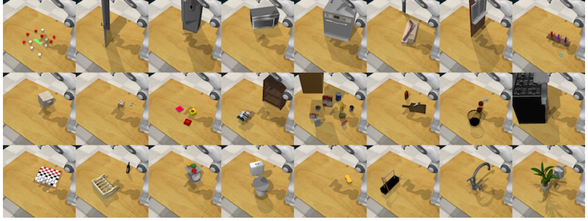

<!-- Generated by scripts/generate.py; edit data/works.json and data/media.json. -->

[← Back to the Awesome index](../../../README.md) · [Interactive website](https://chang-xinhai.github.io/Awesome-RGBDT-Manipulation/?collection=benchmark&item=rlbench#library)

# RLBench

RLBench: The Robot Learning Benchmark & Learning Environment

**2019-09-26 · IEEE Robotics and Automation Letters 2020 · Imperial College London**

**[Paper](https://arxiv.org/abs/1909.12271)** · [Project](https://sites.google.com/view/rlbench) · [Code](https://github.com/stepjam/RLBench)

Programmatic manipulation environment and demonstration generation benchmark with broad everyday tasks and common observation/action interfaces.

*RLBench authors · [Figure source](https://arxiv.org/abs/1909.12271) · Original rights retained.*

| Field | Reported value and source scope |
| :-- | :-- |
| Record type | benchmark |
| Simulator | CoppeliaSim via PyRep [1](https://arxiv.org/abs/1909.12271) [2](https://sites.google.com/view/rlbench)  |
| Simulator version and scope | Official installation specifies CoppeliaSim 4.1.0; use PyRep-compatible simulator build. [1](https://arxiv.org/abs/1909.12271) [2](https://sites.google.com/view/rlbench) [3](https://github.com/stepjam/RLBench)  |
| Task count and scope | Original paper: 100 tasks; current master source contains 106 task modules. [1](https://arxiv.org/abs/1909.12271) [2](https://sites.google.com/view/rlbench)  |
| Task-list scope | Complete 106 current-master task-module identifiers; not asserted to match exactly the original 100-task paper snapshot. [1](https://arxiv.org/abs/1909.12271) [2](https://sites.google.com/view/rlbench)  |
| Capability dimensions | Multi-task learning · Few-shot learning · Imitation learning · Reinforcement learning · Insertion / articulated manipulation [1](https://arxiv.org/abs/1909.12271) [2](https://sites.google.com/view/rlbench)  |
| Metrics | Task-specific binary success and episode return; few-shot/multi-task splits. [1](https://arxiv.org/abs/1909.12271) [2](https://sites.google.com/view/rlbench)  |
| Robots | Default Franka Panda; configurable additional robot arms. [1](https://arxiv.org/abs/1909.12271) [2](https://sites.google.com/view/rlbench)  |
| Sensors and observations | Multiple RGB-D cameras, masks and proprioception; privileged object states optional; no optical tactile observations in original suite. [1](https://arxiv.org/abs/1909.12271) [2](https://sites.google.com/view/rlbench)  |
| Data collection method | Scripted task experts and motion planning through manually designed waypoints generate demonstrations on demand. [1](https://arxiv.org/abs/1909.12271) [2](https://sites.google.com/view/rlbench) [4](https://arxiv.org/abs/1909.12271)  |
| Demonstrations and data | On-demand waypoint/script-generated expert demonstrations; number is user-selected. [1](https://arxiv.org/abs/1909.12271) [2](https://sites.google.com/view/rlbench)  |
| Evaluation protocol | Predefined task splits and variations; programmatic success/failure criteria; task-specific waypoints generate observations/actions. [1](https://arxiv.org/abs/1909.12271) [2](https://sites.google.com/view/rlbench)  |
| Evaluated baselines | Original benchmark behavior-cloning / RL examples; later 3D and VLA policies evaluated through downstream recipes. [1](https://arxiv.org/abs/1909.12271) [2](https://sites.google.com/view/rlbench)  |
| Observations / modalities | RGB · Depth · Proprioception · Language |
| Evaluation domain | Simulation |
| Embodiment | Parallel-jaw gripper |
| Release: code | Available [3](https://github.com/stepjam/RLBench)  |
| Release: weights | Not applicable [3](https://github.com/stepjam/RLBench)  |
| Release: data | Available [3](https://github.com/stepjam/RLBench)  |
| Release: license | MIT code; CoppeliaSim and asset terms separate [3](https://github.com/stepjam/RLBench)  |
| Release: notes | Simulation tasks and demonstration-generation scripts public. [3](https://github.com/stepjam/RLBench)  |

**Task names — Complete 106 current-master task-module identifiers; not asserted to match exactly the original 100-task paper snapshot.:**

- basketball_in_hoop
- beat_the_buzz
- block_pyramid
- change_channel
- change_clock
- close_box
- close_door
- close_drawer
- close_fridge
- close_grill
- close_jar
- close_laptop_lid
- close_microwave
- empty_container
- empty_dishwasher
- get_ice_from_fridge
- hang_frame_on_hanger
- hit_ball_with_queue
- hockey
- insert_onto_square_peg
- insert_usb_in_computer
- lamp_off
- lamp_on
- lift_numbered_block
- light_bulb_in
- light_bulb_out
- meat_off_grill
- meat_on_grill
- move_hanger
- open_box
- open_door
- open_drawer
- open_fridge
- open_grill
- open_jar
- open_microwave
- open_oven
- open_washing_machine
- open_window
- open_wine_bottle
- phone_on_base
- pick_and_lift
- pick_and_lift_small
- pick_up_cup
- place_cups
- place_hanger_on_rack
- place_shape_in_shape_sorter
- play_jenga
- plug_charger_in_power_supply
- pour_from_cup_to_cup
- press_switch
- push_button
- push_buttons
- put_all_groceries_in_cupboard
- put_books_on_bookshelf
- put_bottle_in_fridge
- put_groceries_in_cupboard
- put_item_in_drawer
- put_knife_in_knife_block
- put_knife_on_chopping_board
- put_money_in_safe
- put_plate_in_colored_dish_rack
- put_rubbish_in_bin
- put_shoes_in_box
- put_toilet_roll_on_stand
- put_tray_in_oven
- put_umbrella_in_umbrella_stand
- reach_and_drag
- reach_target
- remove_cups
- scoop_with_spatula
- screw_nail
- set_the_table
- setup_checkers
- setup_chess
- slide_block_to_target
- slide_cabinet_open
- slide_cabinet_open_and_place_cups
- solve_puzzle
- stack_blocks
- stack_chairs
- stack_cups
- stack_wine
- straighten_rope
- sweep_to_dustpan
- take_cup_out_from_cabinet
- take_frame_off_hanger
- take_item_out_of_drawer
- take_lid_off_saucepan
- take_money_out_safe
- take_off_weighing_scales
- take_plate_off_colored_dish_rack
- take_shoes_out_of_box
- take_toilet_roll_off_stand
- take_tray_out_of_oven
- take_umbrella_out_of_umbrella_stand
- take_usb_out_of_computer
- toilet_seat_down
- toilet_seat_up
- turn_oven_on
- turn_tap
- tv_on
- unplug_charger
- water_plants
- weighing_scales
- wipe_desk

**Scope and qualifications**

- Task variants and registered task modules are different counting units.
- Current task catalogue differs from the original publication snapshot.

**Primary evidence**

1. [Paper](https://arxiv.org/abs/1909.12271) — Published paper / arXiv record and manuscript.
2. [Official project](https://sites.google.com/view/rlbench) — Public project page.
3. [Official repository](https://github.com/stepjam/RLBench) — Current public repository; implementation scope may differ from paper.
4. [Data collection method and scope](https://arxiv.org/abs/1909.12271) — Original method/data protocol reviewed for the collection mechanism. Data volume, evaluation rollouts and downstream training remain separate; undisclosed or unresolved interfaces are labeled explicitly.
