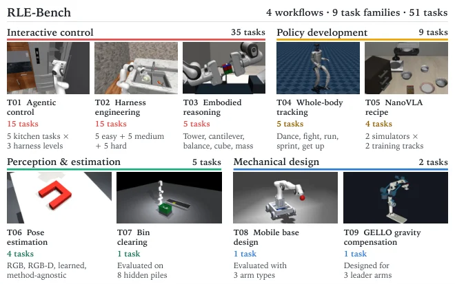

<!-- Generated by scripts/generate.py; edit data/works.json and data/media.json. -->

[← Back to the Awesome index](../../../README.md) · [Interactive website](https://chang-xinhai.github.io/Awesome-RGBDT-Manipulation/?collection=benchmark&item=rle-bench#library)

# RLE-Bench

RLE-Bench: A Qualifying Exam for Coding Agents as Robot Learning Engineers

**2026-09-28 · Preprint · Harvard University**

**[Paper](https://arxiv.org/abs/2609.34210)** · [Project](https://rle-bench.github.io/) · [Code](https://github.com/RLE-Bench/RLE-Bench)

A robotics-engineering benchmark tests coding agents on interactive control, policy learning, perception and mechanical design artifacts.

*RLE-Bench authors · [Figure source](https://arxiv.org/abs/2609.34210) · Original rights retained.*

| Field | Reported value and source scope |
| :-- | :-- |
| Record type | benchmark |
| Simulator | Task-specific simulation frameworks [1](https://arxiv.org/abs/2609.34210)  |
| Simulator version and scope | Not verified [1](https://arxiv.org/abs/2609.34210)  |
| Task count and scope | 51 tasks across 9 families and 4 workflows [1](https://arxiv.org/abs/2609.34210)  |
| Task-list scope | Nine task families shown in author Figure 2; the 51 individual tasks are not listed. [1](https://arxiv.org/abs/2609.34210)  |
| Capability dimensions | Interactive control, policy development, perception and estimation, and mechanical design. [1](https://arxiv.org/abs/2609.34210)  |
| Metrics | Task-specific artifact performance and aggregate RLE Index. [1](https://arxiv.org/abs/2609.34210)  |
| Robots | Simulation and engineering designs vary by task. [1](https://arxiv.org/abs/2609.34210)  |
| Sensors and observations | Task-dependent; pose-estimation variants include RGB-only and RGB-D. [1](https://arxiv.org/abs/2609.34210)  |
| Data collection method | Task-specific simulator interaction and agent-produced code, policies, perception and designs. [1](https://arxiv.org/abs/2609.34210)  |
| Demonstrations and data | Per-task inputs and generated artifacts; complete output corpus not independently verified. [1](https://arxiv.org/abs/2609.34210)  |
| Evaluation protocol | Agent-generated artifacts evaluated under task-specific resource limits and metrics. [1](https://arxiv.org/abs/2609.34210)  |
| Evaluated baselines | Coding-agent model and harness combinations. [1](https://arxiv.org/abs/2609.34210)  |
| Observations / modalities | RGB · Depth · Proprioception · Language |
| Evaluation domain | Simulation |
| Embodiment | Not reported |
| Release: code | Available — task implementations and evaluation harness [2](https://github.com/RLE-Bench/RLE-Bench)  |
| Release: weights | External model APIs; availability varies by task [2](https://github.com/RLE-Bench/RLE-Bench)  |
| Release: data | Not verified [2](https://github.com/RLE-Bench/RLE-Bench)  |
| Release: license | MIT for repository; assets and dependencies have separate licenses [2](https://github.com/RLE-Bench/RLE-Bench)  |
| Release: notes | The task-specific released code and configurations do not imply public access to all evaluated models and outputs. [2](https://github.com/RLE-Bench/RLE-Bench)  |

**Task names — Nine task families shown in author Figure 2; the 51 individual tasks are not listed.:**

- Agentic control
- Harness engineering
- Embodied reasoning
- Whole-body tracking
- NanoVLA recipe
- Pose estimation
- Bin clearing
- Mobile base design
- GELLO gravity compensation

**Scope and qualifications**

- This evaluates robot-learning engineering artifacts, not a uniform closed-loop manipulation policy leaderboard.
- RGB-D is one task-specific pose-estimation variant, not a sensor provided to every task.

**Primary evidence**

1. [Author paper: task families and evaluation](https://arxiv.org/abs/2609.34210)
2. [Official source repository and license](https://github.com/RLE-Bench/RLE-Bench)
