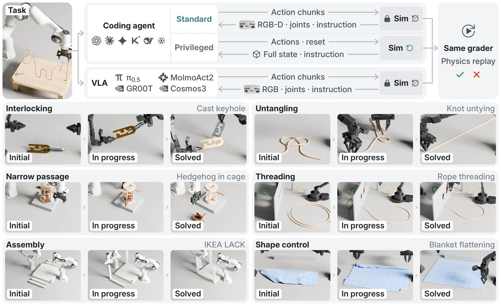

<!-- Generated by scripts/generate.py; edit data/works.json and data/media.json. -->

[← Back to the Awesome index](../../../README.md) · [Interactive website](https://chang-xinhai.github.io/Awesome-RGBDT-Manipulation/?collection=benchmark&item=roboarc#library)

# RoboARC

RoboARC: Physical Puzzles for Robotic Manipulation under Spatial Constraints

**2026-11-24 · Preprint · Northwestern University; Microsoft; UC Berkeley; Carnegie Mellon University**

**[Paper](https://arxiv.org/abs/2611.33390)** · [Project](https://roboarc.embodied-first-exam.ai/) · [Code](https://github.com/mll-lab-nu/RoboARC) · [Data](https://huggingface.co/datasets/RoboARC/RoboARC-outputs) · [Simulation Assets](https://huggingface.co/datasets/RoboARC/RoboARC-assets)

Spatial puzzle benchmark for coding agents and VLAs with versioned tasks, reference solutions, physics-based graders and separate observation regimes.

*Qineng Wang and coauthors · [Figure source](https://arxiv.org/html/2611.33390v1) · Original rights retained.*

| Field | Reported value and source scope |
| :-- | :-- |
| Record type | benchmark |
| Simulator | MuJoCo [1](https://arxiv.org/html/2611.33390v1) [3](https://github.com/mll-lab-nu/RoboARC#readme)  |
| Simulator version and scope | Not reported [1](https://arxiv.org/html/2611.33390v1) [3](https://github.com/mll-lab-nu/RoboARC#readme)  |
| Task count and scope | 90 tasks [1](https://arxiv.org/html/2611.33390v1) [3](https://github.com/mll-lab-nu/RoboARC#readme)  |
| Task-list scope | Representative task families. Full suite contains 78 puzzles in 19 families and 12 IKEA furniture tasks. [1](https://arxiv.org/html/2611.33390v1) [3](https://github.com/mll-lab-nu/RoboARC#readme)  |
| Capability dimensions | Constraint-dependent dexterity, spatial planning, and rigid/deformable manipulation. [1](https://arxiv.org/html/2611.33390v1) [3](https://github.com/mll-lab-nu/RoboARC#readme)  |
| Metrics | Physics-verified binary success, categorized failures and setup-specific gradients of access. [1](https://arxiv.org/html/2611.33390v1) [3](https://github.com/mll-lab-nu/RoboARC#readme)  |
| Robots | Three robot embodiments in simulation. Separate physical buzz-wire prototype experiment. [1](https://arxiv.org/html/2611.33390v1) [3](https://github.com/mll-lab-nu/RoboARC#readme)  |
| Sensors and observations | Standard coding agents use robot-camera RGB-D and joint readings, with no privileged state. The VLA comparisons use prescribed RGB policy adapters. [1](https://arxiv.org/html/2611.33390v1) [3](https://github.com/mll-lab-nu/RoboARC#readme)  |
| Data collection method | Each frozen scene includes manually/scaffolded task construction and a reference solution verified by deterministic replay; not a VLA imitation training corpus. [1](https://arxiv.org/html/2611.33390v1) [3](https://github.com/mll-lab-nu/RoboARC#readme)  |
| Demonstrations and data | Open task source, scenario assets and released agent output archives. [1](https://arxiv.org/html/2611.33390v1) [3](https://github.com/mll-lab-nu/RoboARC#readme)  |
| Evaluation protocol | Privileged simulation allows full state and resets; standard simulation allows real-sensor interfaces and one attempt; separate physical illustration. [1](https://arxiv.org/html/2611.33390v1) [3](https://github.com/mll-lab-nu/RoboARC#readme)  |
| Evaluated baselines | Seven coding agents across all 90 tasks and four VLA policy baselines on an 18-task one-arm subset. [1](https://arxiv.org/html/2611.33390v1) [3](https://github.com/mll-lab-nu/RoboARC#readme)  |
| Observations / modalities | RGB · Depth · Proprioception |
| Evaluation domain | Simulation · Real world |
| Embodiment | Parallel-jaw gripper · Bimanual |
| Release: code | Available — 90 tasks, graders, references and runtime [3](https://github.com/mll-lab-nu/RoboARC#readme)  |
| Release: weights | External policy and agent models; independently licensed [3](https://github.com/mll-lab-nu/RoboARC#readme)  |
| Release: data | Available — public result runs and benchmark asset bundles [3](https://github.com/mll-lab-nu/RoboARC#readme)  |
| Release: license | MIT benchmark source; simulator and task assets have independent licenses. [3](https://github.com/mll-lab-nu/RoboARC#readme)  |
| Release: notes | Public paper verified. Code, task weights and data are tracked separately. [3](https://github.com/mll-lab-nu/RoboARC#readme)  |

**Task names — Representative task families. Full suite contains 78 puzzles in 19 families and 12 IKEA furniture tasks.:**

- Narrow passage
- Threading rope
- Unlock interlocked claws
- Untangling
- IKEA assembly
- Blanket flattening

**Scope and qualifications**

- RoboARC is a distinct work from RoboARCade and has different tasks and authors.
- Model scores and the buzz-wire real-robot demonstration are scoped separately. Standard sensor interfaces are simulated on the 90-task benchmark.

**Primary evidence**

1. [Original author paper with methods, evaluation and scope](https://arxiv.org/html/2611.33390v1)
2. [Public author project with method and evaluation examples](https://roboarc.embodied-first-exam.ai/)
3. [Task registry, agent/simulation protocols and inputs](https://github.com/mll-lab-nu/RoboARC#readme)
