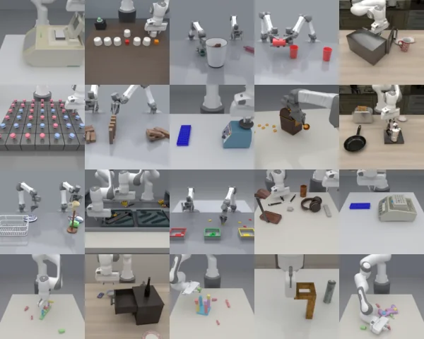

<!-- Generated by scripts/generate.py; edit data/works.json and data/media.json. -->

[← Back to the Awesome index](../../../README.md) · [Interactive website](https://chang-xinhai.github.io/Awesome-RGBDT-Manipulation/?collection=benchmark&item=roboarcade#library)

# RoboARCade

RoboARCade: Benchmarking Agentic Robot Control

**2026-11-05 · Preprint · Stanford University**

**[Paper](https://arxiv.org/abs/2611.08209)** · [Project](https://roboarcade.org)

A MuJoCo benchmark tests agentic control, in-context adaptation and reasoning across 22 manipulation tasks.

*RoboARCade authors · [Figure source](https://roboarcade.org) · Original rights retained.*

| Field | Reported value and source scope |
| :-- | :-- |
| Record type | benchmark |
| Simulator | MuJoCo [1](https://arxiv.org/html/2611.08209v1)  |
| Simulator version and scope | Not verified [1](https://arxiv.org/html/2611.08209v1)  |
| Task count and scope | 22 manipulation tasks [1](https://arxiv.org/html/2611.08209v1)  |
| Task-list scope | 22 total tasks; the paper figure shows 20. [1](https://arxiv.org/html/2611.08209v1)  |
| Capability dimensions | Long-horizon control, adaptation, memory and reasoning. [1](https://arxiv.org/html/2611.08209v1)  |
| Metrics | Task success, inference cost and calls. [1](https://arxiv.org/html/2611.08209v1)  |
| Robots | Three simulated embodiments. [1](https://arxiv.org/html/2611.08209v1)  |
| Sensors and observations | Multi-view RGB-D or vision interaction interface; robot state. [1](https://arxiv.org/html/2611.08209v1)  |
| Data collection method | Tasks derived from existing open-source benchmark sources with widened initial conditions. [1](https://arxiv.org/html/2611.08209v1)  |
| Demonstrations and data | Agent execution traces linked by project; access independently scoped. [1](https://arxiv.org/html/2611.08209v1)  |
| Evaluation protocol | 22 tasks with five seeds each; a separate five-task subset for adaptation experiments. [1](https://arxiv.org/html/2611.08209v1)  |
| Evaluated baselines | Agentic foundation-model controls with two visual interfaces. [1](https://arxiv.org/html/2611.08209v1)  |
| Observations / modalities | RGB · Depth · Proprioception · Language |
| Evaluation domain | Simulation |
| Embodiment |  |
| Release: code | Not verified |
| Release: weights | Not verified |
| Release: data | Not verified |
| Release: license | Not verified |
| Release: notes | Model, source and data availability are tracked separately. |

**Task names — 22 total tasks; the paper figure shows 20.:**

Task names not reported or not verified in the cited sources.

**Scope and qualifications**

- Three simulation embodiments do not imply physical deployment; agents access one of two visual interfaces.

**Primary evidence**

1. [Author paper and first submission](https://arxiv.org/html/2611.08209v1)
