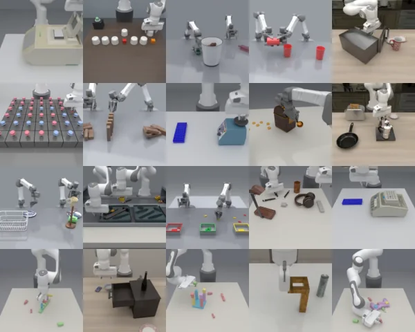

<!-- Generated by scripts/generate.py; edit data/works.json and data/media.json. -->

[← Back to the Awesome index](../../../README.md) · [Interactive website](https://chang-xinhai.github.io/Awesome-RGBDT-Manipulation/?collection=benchmark&item=roboarcade#library)

# RoboARCade

RoboARCade: Benchmarking Agentic Robot Control

**2026-11-05 · Preprint · Stanford University**

**[Paper](https://arxiv.org/abs/2611.08209)** · [Project](https://roboarcade.org) · [Code](https://github.com/Satvik1701/RoboARCade) · [Data](https://huggingface.co/datasets/roboarcade/roboarcade-assets) · [Leaderboard](https://roboarcade.org/)

A MuJoCo benchmark tests agentic control, in-context adaptation and reasoning across 22 manipulation tasks.

*RoboARCade authors · [Figure source](https://roboarcade.org) · Original rights retained.*

| Field | Reported value and source scope |
| :-- | :-- |
| Record type | benchmark |
| Simulator | MuJoCo [1](https://arxiv.org/html/2611.08209v1) [2](https://arxiv.org/html/2611.08209v2)  |
| Simulator version and scope | Not verified [1](https://arxiv.org/html/2611.08209v1) [2](https://arxiv.org/html/2611.08209v2)  |
| Task count and scope | 22 manipulation tasks [1](https://arxiv.org/html/2611.08209v1) [2](https://arxiv.org/html/2611.08209v2)  |
| Task-list scope | 22 total tasks; the paper figure shows 20. [1](https://arxiv.org/html/2611.08209v1) [2](https://arxiv.org/html/2611.08209v2)  |
| Capability dimensions | Long-horizon control, adaptation, memory and reasoning. [1](https://arxiv.org/html/2611.08209v1) [2](https://arxiv.org/html/2611.08209v2)  |
| Metrics | Task success, inference cost and calls. [1](https://arxiv.org/html/2611.08209v1) [2](https://arxiv.org/html/2611.08209v2)  |
| Robots | Three simulated embodiments. [1](https://arxiv.org/html/2611.08209v1) [2](https://arxiv.org/html/2611.08209v2)  |
| Sensors and observations | Direct multi-view simulated RGB-D images and camera calibration; VIA adds an interactive 3D point cloud and virtual target gripper with raw image feeds. [1](https://arxiv.org/html/2611.08209v1) [2](https://arxiv.org/html/2611.08209v2)  |
| Data collection method | Tasks derived from existing open-source benchmark sources with widened initial conditions. [1](https://arxiv.org/html/2611.08209v1) [2](https://arxiv.org/html/2611.08209v2)  |
| Demonstrations and data | Public author-hosted results, videos and traces; Hugging Face task, replay and simulator asset packs. [1](https://arxiv.org/html/2611.08209v1) [2](https://arxiv.org/html/2611.08209v2)  |
| Evaluation protocol | 22 tasks with five seeds each; a separate five-task subset for adaptation experiments. [1](https://arxiv.org/html/2611.08209v1) [2](https://arxiv.org/html/2611.08209v2)  |
| Evaluated baselines | Paper v2: VIA full-suite success rates are 49.8% Astra, 43.6% Fable and 14.0% Sol. The five-task subset tests trace-based ICL (53.5% to 73.0% for Astra) and agent-generated prompt refinement (72.0%). [1](https://arxiv.org/html/2611.08209v1) [2](https://arxiv.org/html/2611.08209v2)  |
| Observations / modalities | RGB · Depth · Point cloud · Proprioception |
| Evaluation domain | Simulation |
| Embodiment |  |
| Release: code | Available — benchmark, task packs and interchangeable agent interfaces [3](https://github.com/Satvik1701/RoboARCade) [4](https://huggingface.co/datasets/roboarcade/roboarcade-assets/tree/main)  |
| Release: weights | External agent access varies [3](https://github.com/Satvik1701/RoboARCade) [4](https://huggingface.co/datasets/roboarcade/roboarcade-assets/tree/main)  |
| Release: data | Available — downloadable simulation and replay assets, plus public task traces and videos [3](https://github.com/Satvik1701/RoboARCade) [4](https://huggingface.co/datasets/roboarcade/roboarcade-assets/tree/main)  |
| Release: license | MIT benchmark source; third-party assets carry their own terms [3](https://github.com/Satvik1701/RoboARCade) [4](https://huggingface.co/datasets/roboarcade/roboarcade-assets/tree/main)  |
| Release: notes | Benchmark task packs and rollout traces are separate artifacts; hosted models are external. [3](https://github.com/Satvik1701/RoboARCade) [4](https://huggingface.co/datasets/roboarcade/roboarcade-assets/tree/main)  |

**Task names — 22 total tasks; the paper figure shows 20.:**

Task names not reported or not verified in the cited sources.

**Scope and qualifications**

- The reported depth and point clouds are simulator outputs. The two agent interfaces have distinct tools and costs.
- The five-task adaptation subset reports separate results for an in-context successful task trace and iterative prompt revision. Model weights were not updated by those experiments.

**Primary evidence**

1. [Author paper and first submission](https://arxiv.org/html/2611.08209v1)
2. [Paper v2 — 23 November 2026](https://arxiv.org/html/2611.08209v2)
3. [Public benchmark code and license](https://github.com/Satvik1701/RoboARCade)
4. [Public task and replay assets](https://huggingface.co/datasets/roboarcade/roboarcade-assets/tree/main)
