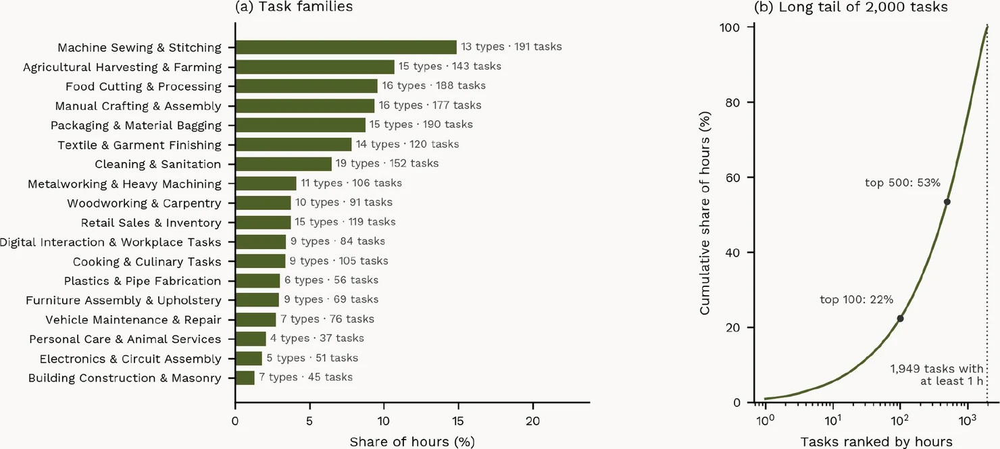

<!-- Generated by scripts/generate.py; edit data/works.json and data/media.json. -->

[← Back to the Awesome index](../../../README.md) · [Interactive website](https://chang-xinhai.github.io/Awesome-RGBDT-Manipulation/?collection=benchmark&item=robocap-10k#library)

# RoboCap-10k

RoboCap-10k: A Metrically Accurate Egocentric Dataset for Robot Learning

**2026-11-05 · Technical report and dataset · Grounded Superintelligence**

**[Project](https://www.gsi.company/blogs/robocap-10k)** · [Data](https://huggingface.co/datasets/groundedsi/RoboCap-10k) · [Report](https://www.gsi.company/blogs/robocap-10k/robocap_10k_a_metrically_accurate_egocentric_dataset_for_robot_learning.pdf) · [Visualizer](https://robocap10k.com/)

A large wearable daily-work corpus collects synchronized stereo-capable video and exposes camera and metric action labels in publisher-described formats.

*Grounded Superintelligence · [Figure source](https://www.gsi.company/blogs/robocap-10k) · Original rights retained.*

| Field | Reported value and source scope |
| :-- | :-- |
| Record type | dataset |
| Simulator | Not applicable [1](https://www.gsi.company/blogs/robocap-10k) [3](https://www.gsi.company/blogs/robocap-10k/robocap_10k_a_metrically_accurate_egocentric_dataset_for_robot_learning.pdf)  |
| Simulator version and scope | Not applicable [1](https://www.gsi.company/blogs/robocap-10k) [3](https://www.gsi.company/blogs/robocap-10k/robocap_10k_a_metrically_accurate_egocentric_dataset_for_robot_learning.pdf)  |
| Task count and scope | Supporting dataset or perception evaluation [1](https://www.gsi.company/blogs/robocap-10k) [3](https://www.gsi.company/blogs/robocap-10k/robocap_10k_a_metrically_accurate_egocentric_dataset_for_robot_learning.pdf)  |
| Task-list scope | Listed uses of the resource, with no closed-loop robot task count. [1](https://www.gsi.company/blogs/robocap-10k) [3](https://www.gsi.company/blogs/robocap-10k/robocap_10k_a_metrically_accurate_egocentric_dataset_for_robot_learning.pdf)  |
| Capability dimensions | Training and evaluation data [1](https://www.gsi.company/blogs/robocap-10k) [3](https://www.gsi.company/blogs/robocap-10k/robocap_10k_a_metrically_accurate_egocentric_dataset_for_robot_learning.pdf)  |
| Metrics | Not applicable [1](https://www.gsi.company/blogs/robocap-10k) [3](https://www.gsi.company/blogs/robocap-10k/robocap_10k_a_metrically_accurate_egocentric_dataset_for_robot_learning.pdf)  |
| Robots | Not applicable [1](https://www.gsi.company/blogs/robocap-10k) [3](https://www.gsi.company/blogs/robocap-10k/robocap_10k_a_metrically_accurate_egocentric_dataset_for_robot_learning.pdf)  |
| Sensors and observations | Hardware-synchronized global-shutter views including fisheye stereo pairs; IMU and calibrated hand/head trajectories. [1](https://www.gsi.company/blogs/robocap-10k) [3](https://www.gsi.company/blogs/robocap-10k/robocap_10k_a_metrically_accurate_egocentric_dataset_for_robot_learning.pdf)  |
| Data collection method | Same wearable hardware used across work sites; Grounded API produces calibration and pose enrichment. [1](https://www.gsi.company/blogs/robocap-10k) [3](https://www.gsi.company/blogs/robocap-10k/robocap_10k_a_metrically_accurate_egocentric_dataset_for_robot_learning.pdf)  |
| Demonstrations and data | Publisher reports over 10,000 hours and 412 LeRobot 3.0 shards; sample and full gated payload have distinct access. [1](https://www.gsi.company/blogs/robocap-10k) [2](https://huggingface.co/datasets/groundedsi/RoboCap-10k) [3](https://www.gsi.company/blogs/robocap-10k/robocap_10k_a_metrically_accurate_egocentric_dataset_for_robot_learning.pdf)  |
| Evaluation protocol | For stereo, check delivered video field names and episode calibration in the release. Model-estimated 3D hand trajectories are annotation outputs. [1](https://www.gsi.company/blogs/robocap-10k) [3](https://www.gsi.company/blogs/robocap-10k/robocap_10k_a_metrically_accurate_egocentric_dataset_for_robot_learning.pdf)  |
| Evaluated baselines | Not applicable [1](https://www.gsi.company/blogs/robocap-10k) [3](https://www.gsi.company/blogs/robocap-10k/robocap_10k_a_metrically_accurate_egocentric_dataset_for_robot_learning.pdf)  |
| Observations / modalities | RGB · IMU |
| Evaluation domain | Real world |
| Embodiment |  |
| Release: code | Dataset preparation details on author site [2](https://huggingface.co/datasets/groundedsi/RoboCap-10k)  |
| Release: weights | Not applicable [2](https://huggingface.co/datasets/groundedsi/RoboCap-10k)  |
| Release: data | Access request — the Hugging Face dataset uses manual approval; shard indexes are documented by the publisher. [2](https://huggingface.co/datasets/groundedsi/RoboCap-10k)  |
| Release: license | CC BY 4.0 per official data card; access approval still applies. [2](https://huggingface.co/datasets/groundedsi/RoboCap-10k)  |
| Release: notes | Distinguish the author’s full-corpus statement, the manually gated LeRobot payload, and the public browser preview. [2](https://huggingface.co/datasets/groundedsi/RoboCap-10k)  |

**Task names — Listed uses of the resource, with no closed-loop robot task count.:**

- Egocentric workplace capture
- Metric action-label pretraining
- Stereo reconstruction

**Scope and qualifications**

- The author’s hours do not quantify anonymously downloadable stereo footage. Raw calibrated depth labels and estimated 3D trajectories should not be conflated.

**Primary evidence**

1. [Original author paper or dataset description](https://www.gsi.company/blogs/robocap-10k)
2. [Publisher’s full data distribution with access request](https://huggingface.co/datasets/groundedsi/RoboCap-10k)
3. [Primary technical documentation and collection setup](https://www.gsi.company/blogs/robocap-10k/robocap_10k_a_metrically_accurate_egocentric_dataset_for_robot_learning.pdf)
