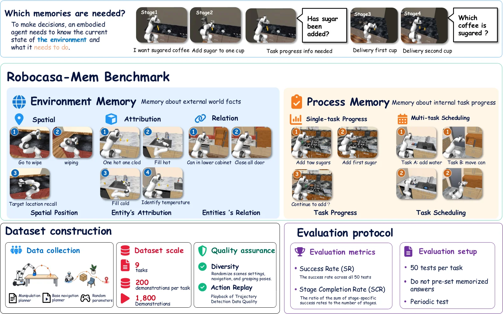

<!-- Generated by scripts/generate.py; edit data/works.json and data/media.json. -->

[← Back to the Awesome index](../../../README.md) · [Interactive website](https://chang-xinhai.github.io/Awesome-RGBDT-Manipulation/?collection=benchmark&item=robocasa-mem#library)

# RoboCasa-Mem

RoboCasa-Mem: Benchmarking Environment and Process Memory in Long-Horizon Mobile Manipulation

**2026-11-04 · Preprint · University of Science and Technology of China**

**[Paper](https://arxiv.org/abs/2611.06475)** · [Project](https://sihhangchen.github.io/RoboCasa-Mem/) · [Code](https://github.com/SiHhangChen/RoboCasa-Mem) · [Data](https://modelscope.cn/datasets/ouhebai/RoboCasa-Mem)

Nine mobile manipulation tasks and a hierarchical memory-augmented policy test decisions dependent on past observations and actions.

*RoboCasa-Mem authors · [Figure source](https://arxiv.org/abs/2611.06475) · Original rights retained.*

| Field | Reported value and source scope |
| :-- | :-- |
| Record type | benchmark |
| Simulator | RoboCasa [1](https://arxiv.org/abs/2611.06475)  |
| Simulator version and scope | Not verified [1](https://arxiv.org/abs/2611.06475)  |
| Task count and scope | 9 tasks [1](https://arxiv.org/abs/2611.06475)  |
| Task-list scope | All nine benchmark task identifiers in official repository. [1](https://arxiv.org/abs/2611.06475)  |
| Capability dimensions | Environment and process memory, long-horizon mobile manipulation. [1](https://arxiv.org/abs/2611.06475)  |
| Metrics | Task success and stage completion. [1](https://arxiv.org/abs/2611.06475)  |
| Robots | Simulated mobile manipulator; physical AgileX platform evaluated separately. [1](https://arxiv.org/abs/2611.06475)  |
| Sensors and observations | Multi-view RGB and robot state. [1](https://arxiv.org/abs/2611.06475)  |
| Data collection method | Successful demonstrations collected for simulation training; evaluation uses held-out task instances. [1](https://arxiv.org/abs/2611.06475)  |
| Demonstrations and data | 1,800 successful training demonstrations reported by authors. [1](https://arxiv.org/abs/2611.06475)  |
| Evaluation protocol | Behavior-conditioned evaluation derives later constraints from earlier agent actions. [1](https://arxiv.org/abs/2611.06475)  |
| Evaluated baselines | ACT, Diffusion Policy, Pi0.5 and HMAP. [1](https://arxiv.org/abs/2611.06475)  |
| Observations / modalities | RGB · Proprioception · Language |
| Evaluation domain | Simulation · Real world |
| Embodiment | Not reported |
| Release: code | Partial — simulation evaluation and configurations [2](https://github.com/SiHhangChen/RoboCasa-Mem)  |
| Release: weights | Not verified [2](https://github.com/SiHhangChen/RoboCasa-Mem)  |
| Release: data | Listed — simulator assets and demonstrations on ModelScope [2](https://github.com/SiHhangChen/RoboCasa-Mem)  |
| Release: license | MIT for code; asset and model licenses separate [2](https://github.com/SiHhangChen/RoboCasa-Mem)  |
| Release: notes | Repository version 0.1.0rc1 needs installed-wheel acceptance; real-robot integration removed. [2](https://github.com/SiHhangChen/RoboCasa-Mem)  |

**Task names — All nine benchmark task identifiers in official repository.:**

- PutBackCup
- SweetCup
- TempReport
- CanRecall
- MilkMatch
- DrawerSearch
- SugarCount
- HeatAndInspect
- FillAndRetrieve

**Scope and qualifications**

- The nine-task benchmark and 1,800 demonstrations are simulation; physical experiments are a separate setting.
- VGGT-derived geometry is inferred from images, not evidence of measured depth sensing.

**Primary evidence**

1. [Author paper or official project: methods and evaluation scope](https://arxiv.org/abs/2611.06475)
2. [Official repository: release inventory and scope](https://github.com/SiHhangChen/RoboCasa-Mem) — Release availability, assets and third-party licenses are independently scoped; no end-to-end reproduction is implied.
