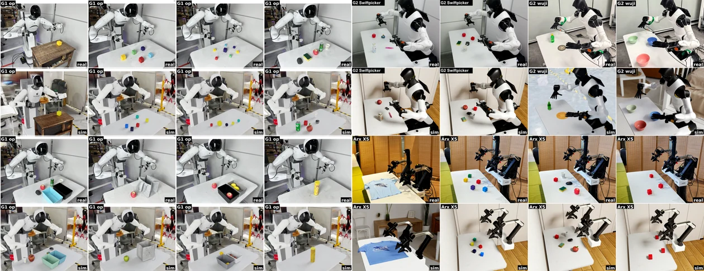

<!-- Generated by scripts/generate.py; edit data/works.json and data/media.json. -->

[← Back to the Awesome index](../../../README.md) · [Interactive website](https://chang-xinhai.github.io/Awesome-RGBDT-Manipulation/?collection=benchmark&item=robocoliseum#library)

# RoboColiseum

RoboColiseum: Co-evolution of Simulation, Evaluation, and Models

**2026-11-20 · Preprint · AgiBot and collaborators**

**[Paper](https://arxiv.org/abs/2611.27042)** · [Project](https://robocoliseum.ai/) · [Code](https://github.com/RoboColiseum/RoboColiseum) · [Data](https://huggingface.co/datasets/agibot-world/GenieSim3.0-Dataset/tree/main/task_suite) · [Weights](https://huggingface.co/datasets/agibot-world/GenieSim3.0-Dataset/tree/main/checkpoints) · [Leaderboard](https://robocoliseum.ai/leaderboard) · [Runtime](https://github.com/AgibotTech/genie_sim/tree/main/source/agent2act)

A calibrated simulator and leaderboard compare Agent and VLA execution across eight manipulation tracks, with a separate paired sim-to-real score validation.

*RoboColiseum authors · [Figure source](https://arxiv.org/html/2611.27042v2) · Original rights retained.*

| Field | Reported value and source scope |
| :-- | :-- |
| Record type | benchmark |
| Simulator | Genie Sim; PhysX, Newton and MuJoCo evaluated as physics backends [1](https://arxiv.org/html/2611.27042v2)  |
| Simulator version and scope | Not reported [1](https://arxiv.org/html/2611.27042v2)  |
| Task count and scope | Eight capability tracks across two seasons; 22 paired physical/simulation validation configurations [1](https://arxiv.org/html/2611.27042v2)  |
| Task-list scope | Track taxonomy. The 22 real/sim configurations form a separate validation experiment. [1](https://arxiv.org/html/2611.27042v2)  |
| Capability dimensions | Multi-embodiment manipulation, precision, generalization and agent control. [1](https://arxiv.org/html/2611.27042v2)  |
| Metrics | Task progress, resource use and completion reward; real–simulation score association in the paired experiment. [1](https://arxiv.org/html/2611.27042v2)  |
| Robots | AgiBot G2 and other evaluation embodiments. Season II adds robot configurations beyond the Season I setup. [1](https://arxiv.org/html/2611.27042v2)  |
| Sensors and observations | Observation interface depends on method and track; several Real2Sim validation diagnostics use RGB or RGB-D. [1](https://arxiv.org/html/2611.27042v2)  |
| Data collection method | Recorded robot commands and physical sensor traces for calibration/validation; hosted Agent and VLA systems generate evaluation trajectories. [1](https://arxiv.org/html/2611.27042v2)  |
| Demonstrations and data | Official repository links Genie Sim task suites and baseline checkpoints. [1](https://arxiv.org/html/2611.27042v2)  |
| Evaluation protocol | Season I foundational tracks and Season II specific capability tracks; each track sets execution limits and scores completion and resource use. [1](https://arxiv.org/html/2611.27042v2)  |
| Evaluated baselines | Paper v2 lists 12 selected Season I policies and all 11 Season II scored systems at its cutoff (eight Agent, three VLA). [1](https://arxiv.org/html/2611.27042v2) [4](https://robocoliseum.ai/leaderboard)  |
| Observations / modalities | RGB |
| Evaluation domain | Simulation · Real world |
| Embodiment |  |
| Release: code | Available — guides, Genie Sim and Agent2Act [2](https://robocoliseum.ai/) [3](https://github.com/RoboColiseum/RoboColiseum)  |
| Release: weights | Available — project-linked VLA baselines [2](https://robocoliseum.ai/) [3](https://github.com/RoboColiseum/RoboColiseum)  |
| Release: data | Available — project-linked training task suites [2](https://robocoliseum.ai/) [3](https://github.com/RoboColiseum/RoboColiseum)  |
| Release: license | Component-specific terms [2](https://robocoliseum.ai/) [3](https://github.com/RoboColiseum/RoboColiseum)  |
| Release: notes | The hosted scoring service and its complete evaluator assets have separate release scope. [2](https://robocoliseum.ai/) [3](https://github.com/RoboColiseum/RoboColiseum)  |

**Task names — Track taxonomy. The 22 real/sim configurations form a separate validation experiment.:**

- Instruction following
- Spatial reasoning
- General manipulation
- Robustness
- Dexterous manipulation
- Precision manipulation
- Whole-body coordination
- Cross-embodiment execution

**Scope and qualifications**

- Paper v2, 23 November: reported r = 0.9686 over 22 paired robot/task validation configurations. The Season II Agent rankings are simulation results.
- Agent2Act is one execution interface. Input channels and model release status vary across submissions.

**Primary evidence**

1. [Original author paper or dataset description](https://arxiv.org/html/2611.27042v2)
2. [Author source and artifact entry points](https://robocoliseum.ai/)
3. [Official guide and public artifacts](https://github.com/RoboColiseum/RoboColiseum)
4. [Official live ranked submissions](https://robocoliseum.ai/leaderboard) — Paper counts are frozen at revision v2.
