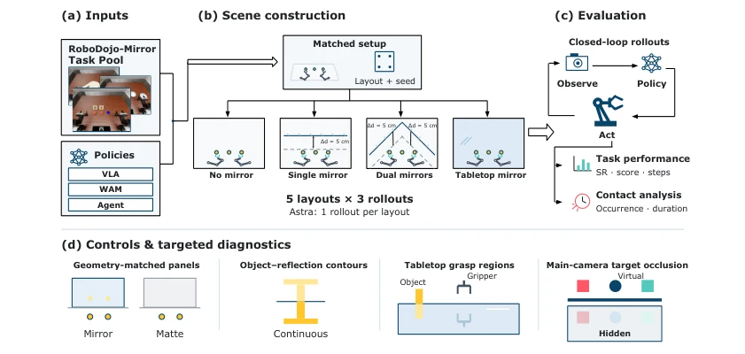

<!-- Generated by scripts/generate.py; edit data/works.json and data/media.json. -->

[← Back to the Awesome index](../../../README.md) · [Interactive website](https://chang-xinhai.github.io/Awesome-RGBDT-Manipulation/?collection=benchmark&item=robodojo-mirror#library)

# RoboDojo-Mirror

Embodied AI Fails the Mirror Test: How a Simple Mirror Breaks Robot Policies

**2026-11-24 · Preprint · Peking University**

**[Paper](https://arxiv.org/abs/2611.33010)** · [Project](https://ipplab.github.io/robodojo-mirror/) · [Code](https://github.com/iPPLab/robodojo-mirror)

Tests whether VLA, WAM and agent policies stay grounded in the real object when mirrors introduce plausible reflected targets.

*Xuanchen Liu and coauthors · [Figure source](https://arxiv.org/html/2611.33010v1) · Original rights retained.*

| Field | Reported value and source scope |
| :-- | :-- |
| Record type | benchmark |
| Simulator | RoboDojo / Isaac Sim [1](https://arxiv.org/html/2611.33010v1) [3](https://github.com/iPPLab/robodojo-mirror#readme)  |
| Simulator version and scope | Not reported [1](https://arxiv.org/html/2611.33010v1) [3](https://github.com/iPPLab/robodojo-mirror#readme)  |
| Task count and scope | Eight matched simulation tasks; distinct diagnostic subsets and four real robot tasks [1](https://arxiv.org/html/2611.33010v1) [3](https://github.com/iPPLab/robodojo-mirror#readme)  |
| Task-list scope | Representative physical and simulation targets. Protocol-specific subsets have different task sets. [1](https://arxiv.org/html/2611.33010v1) [3](https://github.com/iPPLab/robodojo-mirror#readme)  |
| Capability dimensions | Reflection robustness · Collision control · Target occlusion [1](https://arxiv.org/html/2611.33010v1) [3](https://github.com/iPPLab/robodojo-mirror#readme)  |
| Metrics | Native task success, scene-condition gaps, contact diagnostics and matched non-reflective panel comparisons. [1](https://arxiv.org/html/2611.33010v1) [3](https://github.com/iPPLab/robodojo-mirror#readme)  |
| Robots | RoboDojo benchmark embodiments and a separate physical tabletop robot setup. [1](https://arxiv.org/html/2611.33010v1) [3](https://github.com/iPPLab/robodojo-mirror#readme)  |
| Sensors and observations | Physical setup uses two 640×480 RGB streams and proprioception. Simulation policies use native RGB/state interfaces. [1](https://arxiv.org/html/2611.33010v1) [3](https://github.com/iPPLab/robodojo-mirror#readme)  |
| Data collection method | Replay matched tasks, layouts and seeds with fixed upstream checkpoints; benchmark adds mirrors and geometry-matched diffuse panels. [1](https://arxiv.org/html/2611.33010v1) [3](https://github.com/iPPLab/robodojo-mirror#readme)  |
| Demonstrations and data | Released mirror scene source, not a new training corpus; physical outcomes are paper-reported. [1](https://arxiv.org/html/2611.33010v1) [3](https://github.com/iPPLab/robodojo-mirror#readme)  |
| Evaluation protocol | Compare no mirror, single mirror, dual mirrors and mirrored tabletop. Hold geometry fixed in non-reflective control trials. [1](https://arxiv.org/html/2611.33010v1) [3](https://github.com/iPPLab/robodojo-mirror#readme)  |
| Evaluated baselines | π0.5, FastWAM, VPP2, Awomo-0.5 and WALL-OSS in simulation; π0.5 and FastWAM in physical tests. [1](https://arxiv.org/html/2611.33010v1) [3](https://github.com/iPPLab/robodojo-mirror#readme)  |
| Observations / modalities | RGB · Proprioception · Language |
| Evaluation domain | Simulation · Real world |
| Embodiment | Parallel-jaw gripper |
| Release: code | Available — mirror scene package, task-selection CLI and integration example [3](https://github.com/iPPLab/robodojo-mirror#readme)  |
| Release: weights | Use frozen upstream checkpoint versions |
| Release: data | Scene package is public; physical rollouts are not a verified data release |
| Release: license | MIT author repository; upstream assets separately licensed [4](https://raw.githubusercontent.com/iPPLab/robodojo-mirror/main/LICENSE)  |
| Release: notes | Paper or official project reviewed. Code, weights and data are tracked independently. |

**Task names — Representative physical and simulation targets. Protocol-specific subsets have different task sets.:**

- Produce placement
- Block stacking
- Switch interaction
- Target near a mirror

**Scope and qualifications**

- Mirror interactions are evaluated under matched visual and geometric interventions. Trajectory and contact diagnostics are simulator measurements, not observed tactile input.

**Primary evidence**

1. [Original paper and evaluation settings](https://arxiv.org/html/2611.33010v1)
2. [Official project with task and method examples](https://ipplab.github.io/robodojo-mirror/)
3. [Mirror scene package, controls and integration instructions](https://github.com/iPPLab/robodojo-mirror#readme)
4. [Author source license](https://raw.githubusercontent.com/iPPLab/robodojo-mirror/main/LICENSE)
