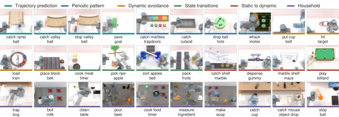

<!-- Generated by scripts/generate.py; edit data/works.json and data/media.json. -->

[← Back to the Awesome index](../../../README.md) · [Interactive website](https://chang-xinhai.github.io/Awesome-RGBDT-Manipulation/?collection=benchmark&item=robodyna#library)

# RoboDyna

RoboDyna: A Benchmark for Evaluating Robotic Manipulation under Physically Grounded Dynamics

**2026-11-20 · Preprint · RoboDyna authors**

**[Paper](https://arxiv.org/abs/2611.26969)** · [Project](https://robodyna.github.io/robodyna/) · [Code](https://github.com/robodyna/robodyna) · [Data](https://huggingface.co/datasets/RoboDyna/robodyna-benchmark-v2)

A fixed dual-arm platform tests whether manipulation policies handle independently moving objects and action latency under two scheduling protocols.

*RoboDyna authors · [Figure source](https://arxiv.org/html/2611.26969v1) · Original rights retained.*

| Field | Reported value and source scope |
| :-- | :-- |
| Record type | benchmark |
| Simulator | SAPIEN [1](https://arxiv.org/html/2611.26969v1)  |
| Simulator version and scope | 3.0.3 [1](https://arxiv.org/html/2611.26969v1)  |
| Task count and scope | 30 tasks: 20 conceptual and 10 household [1](https://arxiv.org/html/2611.26969v1)  |
| Task-list scope | Representative concepts and household scenes; each conceptual task has four difficulty settings. [1](https://arxiv.org/html/2611.26969v1)  |
| Capability dimensions | Control under physics-driven dynamics, contact, moving targets and inference delay. [1](https://arxiv.org/html/2611.26969v1)  |
| Metrics | Full success and partial completion, under synchronous and asynchronous scheduling. [1](https://arxiv.org/html/2611.26969v1)  |
| Robots | Simulated dual UR5 robot. [1](https://arxiv.org/html/2611.26969v1)  |
| Sensors and observations | Synchronized RGB from one head and two wrist cameras, plus proprioception. [1](https://arxiv.org/html/2611.26969v1)  |
| Data collection method | 3,500 expert demonstrations and author tools for collecting human data via direct teleoperation or scene-interactive control. [1](https://arxiv.org/html/2611.26969v1)  |
| Demonstrations and data | Project links its code and dataset organization. [1](https://arxiv.org/html/2611.26969v1)  |
| Evaluation protocol | Matched task conditions with either pause-during-inference or continuing simulation; difficulty composition varies the physical scene. [1](https://arxiv.org/html/2611.26969v1)  |
| Evaluated baselines | Two VLA baselines and one WAM plus human control modes; all three evaluated policies solve fewer than one in five episodes overall in the paper. [1](https://arxiv.org/html/2611.26969v1)  |
| Observations / modalities | RGB · Proprioception |
| Evaluation domain | Simulation |
| Embodiment |  |
| Release: code | Available — simulator and evaluation code [2](https://robodyna.github.io/robodyna/) [3](https://github.com/robodyna/robodyna) [4](https://huggingface.co/datasets/RoboDyna/robodyna-benchmark-v2)  |
| Release: weights | External baseline models [2](https://robodyna.github.io/robodyna/) [3](https://github.com/robodyna/robodyna) [4](https://huggingface.co/datasets/RoboDyna/robodyna-benchmark-v2)  |
| Release: data | Available — official demonstrations in HDF5 and LeRobot formats [2](https://robodyna.github.io/robodyna/) [3](https://github.com/robodyna/robodyna) [4](https://huggingface.co/datasets/RoboDyna/robodyna-benchmark-v2)  |
| Release: license | Apache-2.0 code and demonstration package; assets have their own license [2](https://robodyna.github.io/robodyna/) [3](https://github.com/robodyna/robodyna) [4](https://huggingface.co/datasets/RoboDyna/robodyna-benchmark-v2)  |
| Release: notes | Task implementations, demos and pre-trained external policies retain separate terms. [2](https://robodyna.github.io/robodyna/) [3](https://github.com/robodyna/robodyna) [4](https://huggingface.co/datasets/RoboDyna/robodyna-benchmark-v2)  |

**Task names — Representative concepts and household scenes; each conceptual task has four difficulty settings.:**

- Catch ramp ball
- Load train
- Dynamic target interception
- Contact-induced motion
- Boil milk
- Push target from shelf

**Scope and qualifications**

- The benchmark evaluates learned policies and humans. It is an adjacent closed-loop dynamics suite with no frontier coding-agent run in the paper.
- The reported policy observation uses RGB streams and robot state. The public release adds five tasks beyond the paper benchmark.

**Primary evidence**

1. [Original author paper or dataset description](https://arxiv.org/html/2611.26969v1)
2. [Author source and artifact entry points](https://robodyna.github.io/robodyna/)
3. [Official evaluation repository](https://github.com/robodyna/robodyna)
4. [Official demonstration dataset](https://huggingface.co/datasets/RoboDyna/robodyna-benchmark-v2)
