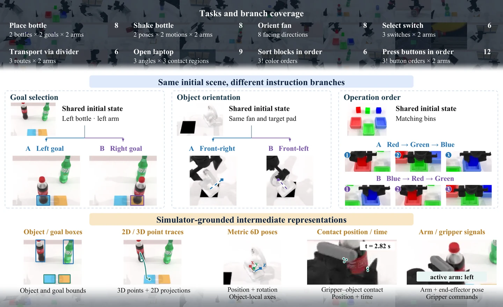

<!-- Generated by scripts/generate.py; edit data/works.json and data/media.json. -->

[← Back to the Awesome index](../../../README.md) · [Interactive website](https://chang-xinhai.github.io/Awesome-RGBDT-Manipulation/?collection=benchmark&item=roboinf#library)

# RoboInF

RoboInF: A Benchmark for Instruction Fidelity in Robotic Manipulation

**2026-11-23 · Preprint · Tongji University; Shanghai Jiao Tong University and collaborators**

**[Paper](https://arxiv.org/abs/2611.30555)** · [Project](https://sjtu-deepvisionlab.github.io/RoboInF/) · [Code](https://github.com/SJTU-DeepVisionLab/RoboInF) · [Data](https://huggingface.co/datasets/JGuo666/RoboInF-4K)

Measures instruction fidelity under same-start counterfactual task branches, checking how a manipulation succeeds as well as its outcome.

*Jiawei Guo and coauthors · [Figure source](https://arxiv.org/html/2611.30555v1) · Original rights retained.*

| Field | Reported value and source scope |
| :-- | :-- |
| Record type | benchmark |
| Simulator | RoboTwin 2.0 simulator [1](https://arxiv.org/html/2611.30555v1)  |
| Simulator version and scope | Not reported [1](https://arxiv.org/html/2611.30555v1)  |
| Task count and scope | Eight tasks; 6–12 branches per task setup; 4,242 expert demonstrations; 861 held-out clear episodes [1](https://arxiv.org/html/2611.30555v1)  |
| Task-list scope | Representative named task families. Branches and dataset episodes are separate units. [1](https://arxiv.org/html/2611.30555v1)  |
| Capability dimensions | Outcome completion · Procedure fidelity · Execution detail compliance [1](https://arxiv.org/html/2611.30555v1)  |
| Metrics | Task Success Rate and Instruction Fidelity Rate, plus matched appearance-factor comparisons. [1](https://arxiv.org/html/2611.30555v1)  |
| Robots | Bimanual manipulation robot with head and wrist cameras. [1](https://arxiv.org/html/2611.30555v1)  |
| Sensors and observations | Head plus two wrist RGB images and joint/gripper state for VLA baselines; RGB-D geometry in the separately scoped agent executor. [1](https://arxiv.org/html/2611.30555v1)  |
| Data collection method | Reusable task-branch programs are generated and refined using video plus execution diagnostics. Branch-complete scene groups are validated and kept together in splits. [1](https://arxiv.org/html/2611.30555v1) [5](https://huggingface.co/datasets/JGuo666/RoboInF-4K/tree/main)  |
| Demonstrations and data | 4,242 expert demonstrations with structured motion and simulator-reference contact annotations. [1](https://arxiv.org/html/2611.30555v1)  |
| Evaluation protocol | Hold initial state fixed across instruction branches. Split by scene, test appearance shifts separately and record both task completion and faithful execution. [1](https://arxiv.org/html/2611.30555v1)  |
| Evaluated baselines | π0.5 and OpenWAM in the main post-training comparison; GR00T and LingBot-VA in additional evaluations. GPT-6 Astra and Qwen3.8-Flash use a shared RGB-D executor in a separate experiment. [1](https://arxiv.org/html/2611.30555v1)  |
| Observations / modalities | RGB · Depth · Proprioception · Language |
| Evaluation domain | Simulation |
| Embodiment | Parallel-jaw gripper · Bimanual |
| Release: code | Available — evaluation runner and four separately scoped VLA interfaces [3](https://github.com/SJTU-DeepVisionLab/RoboInF#readme)  |
| Release: weights | Baseline models are external; fine-tuned weights not independently verified |
| Release: data | Available — RoboInF-4K demonstration, video and contact annotation shards [5](https://huggingface.co/datasets/JGuo666/RoboInF-4K/tree/main)  |
| Release: license | CC BY 4.0 author repository and dataset, third-party terms retained [4](https://github.com/SJTU-DeepVisionLab/RoboInF/blob/main/LICENSE)  |
| Release: notes | Paper or official project reviewed. Code, weights and data are tracked independently. |

**Task names — Representative named task families. Branches and dataset episodes are separate units.:**

- Place bottle
- Open laptop
- Select switch
- Transport via divider

**Scope and qualifications**

- Paper VLA baselines read RGB and state. The additional agent comparison separately uses an RGB-D geometric skill executor; simulated reference contacts do not establish a tactile observation stream.

**Primary evidence**

1. [Original paper and evaluation settings](https://arxiv.org/html/2611.30555v1)
2. [Official project with task and method examples](https://sjtu-deepvisionlab.github.io/RoboInF/)
3. [Author v1.0 evaluator and supported policy interfaces](https://github.com/SJTU-DeepVisionLab/RoboInF#readme)
4. [Repository license text](https://github.com/SJTU-DeepVisionLab/RoboInF/blob/main/LICENSE)
5. [Actual public demonstration and contact archives](https://huggingface.co/datasets/JGuo666/RoboInF-4K/tree/main)
