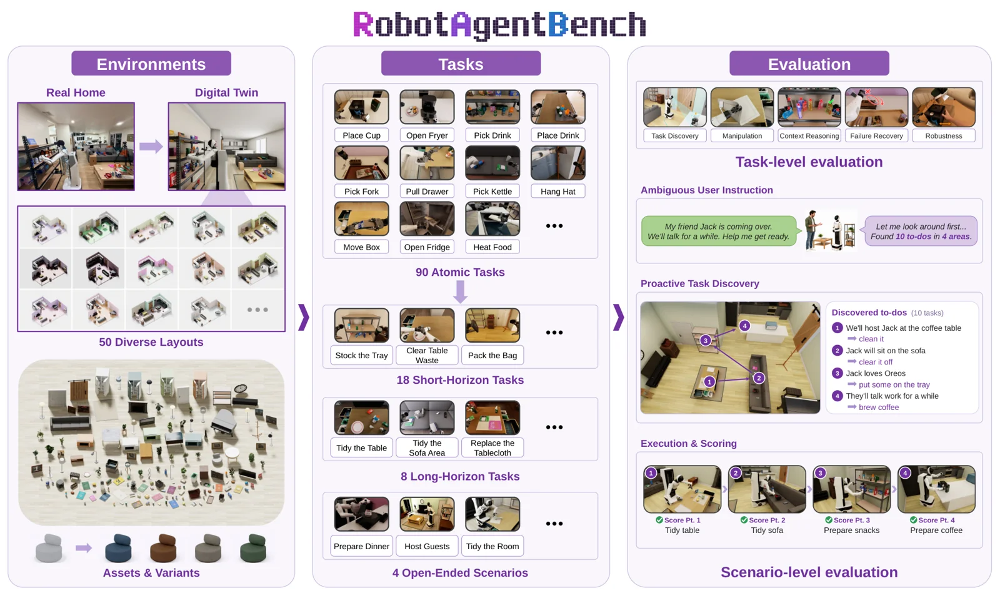

<!-- Generated by scripts/generate.py; edit data/works.json and data/media.json. -->

[← Back to the Awesome index](../../../README.md) · [Interactive website](https://chang-xinhai.github.io/Awesome-RGBDT-Manipulation/?collection=benchmark&item=robotagentbench#library)

# RobotAgentBench

RobotAgentBench: Towards Open-world Robot Autonomy

**2026-10-26 · Preprint · Aether AI**

**[Paper](https://arxiv.org/abs/2610.34649)** · [Project](https://aetherlabsai.github.io/RobotAgentBench/) · [Code](https://github.com/AetherLabsAI/RobotAgentBench) · [Data](https://huggingface.co/datasets/AetherLabs-AI/RobotAgentBench-assets)

A real-to-sim household benchmark evaluates robot-agent task discovery, reasoning, execution and recovery.

*RobotAgentBench authors · [Figure source](https://arxiv.org/abs/2610.34649) · Original rights retained.*

| Field | Reported value and source scope |
| :-- | :-- |
| Record type | benchmark |
| Simulator | Household simulation [1](https://arxiv.org/abs/2610.34649)  |
| Simulator version and scope | Not verified [1](https://arxiv.org/abs/2610.34649)  |
| Task count and scope | 90 atomic, 18 short-horizon, 8 long-horizon tasks; 4 open-ended scenarios [1](https://arxiv.org/abs/2610.34649)  |
| Task-list scope | Distinct author-reported task tiers and scenarios; they are not disjoint sums of episodes. [1](https://arxiv.org/abs/2610.34649)  |
| Capability dimensions | Task discovery, contextual reasoning, manipulation, recovery and robustness. [1](https://arxiv.org/abs/2610.34649)  |
| Metrics | Task-level capability scores and scenario-level success. [1](https://arxiv.org/abs/2610.34649)  |
| Robots | Household simulated manipulation agent. [1](https://arxiv.org/abs/2610.34649)  |
| Sensors and observations | Visual observations, robot state and task instructions. [1](https://arxiv.org/abs/2610.34649)  |
| Data collection method | Agent-assisted human-in-the-loop real-to-sim scene and task construction. [1](https://arxiv.org/abs/2610.34649)  |
| Demonstrations and data | 50 household layouts and interactive object assets reported. [1](https://arxiv.org/abs/2610.34649)  |
| Evaluation protocol | Standard planning-execution-verification evaluation of task and scenario levels. [1](https://arxiv.org/abs/2610.34649)  |
| Evaluated baselines | Standalone VLA/WAM and agent architectures. [1](https://arxiv.org/abs/2610.34649)  |
| Observations / modalities | RGB · Proprioception · Language |
| Evaluation domain | Simulation |
| Embodiment | Not reported |
| Release: code | Available — benchmark runtime, task backends and scoring [2](https://github.com/AetherLabsAI/RobotAgentBench)  |
| Release: weights | Not verified [2](https://github.com/AetherLabsAI/RobotAgentBench)  |
| Release: data | Available — separate official simulation assets [2](https://github.com/AetherLabsAI/RobotAgentBench)  |
| Release: license | Apache-2.0 code; third-party assets carry separate licenses [2](https://github.com/AetherLabsAI/RobotAgentBench)  |
| Release: notes | Author notes public saved configurations are not the same as the evaluation instances reported in the paper. [2](https://github.com/AetherLabsAI/RobotAgentBench)  |

**Task names — Distinct author-reported task tiers and scenarios; they are not disjoint sums of episodes.:**

Task names not reported or not verified in the cited sources.

**Scope and qualifications**

- Real-to-sim scene construction does not imply real-robot evaluation of all agents.
- Do not equate public saved configurations with the paper evaluation instances.

**Primary evidence**

1. [Author paper or official project: methods and evaluation scope](https://arxiv.org/abs/2610.34649)
2. [Official repository: release inventory and scope](https://github.com/AetherLabsAI/RobotAgentBench) — Release availability, assets and third-party licenses are independently scoped; no end-to-end reproduction is implied.
