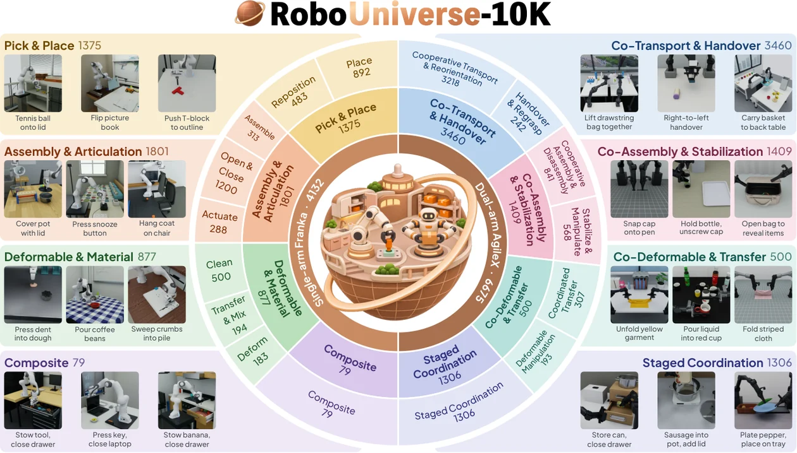

<!-- Generated by scripts/generate.py; edit data/works.json and data/media.json. -->

[← Back to the Awesome index](../../../README.md) · [Interactive website](https://chang-xinhai.github.io/Awesome-RGBDT-Manipulation/?collection=benchmark&item=robouniverse-10k#library)

# RoboUniverse-10K

RoboUniverse-10K: Toward the Scaling Era of Agentic Robotics via Real-to-Sim Environments

**2026-11-23 · Preprint · Tsinghua University, Einsia and collaborators**

**[Paper](https://arxiv.org/abs/2611.31002)** · [Project](https://lab.einsia.ai/robo-universe/) · [Code](https://github.com/Einsia/RoboUniverse-10K) · [Data](https://huggingface.co/datasets/Einsia/RoboUniverse-10K) · [Weights](https://huggingface.co/Einsia/RoboUniverse-35B-A3B)

An automated real-to-sim pipeline builds resettable manipulation environments for training and evaluating closed-loop coding agents, with a 500-task held-out suite.

*RoboUniverse-10K authors · [Figure source](https://arxiv.org/html/2611.31002v1) · Original rights retained.*

| Field | Reported value and source scope |
| :-- | :-- |
| Record type | benchmark |
| Simulator | Isaac Sim and isolated Harbor-compatible task runtime [1](https://arxiv.org/html/2611.31002v1)  |
| Simulator version and scope | Not reported [1](https://arxiv.org/html/2611.31002v1)  |
| Task count and scope | 10,807 released environments: 10,307 training and 500 held-out RoboUniverse-Verified tasks [1](https://arxiv.org/html/2611.31002v1)  |
| Task-list scope | Representative task types spanning the paper’s eight families. [1](https://arxiv.org/html/2611.31002v1)  |
| Capability dimensions | Real-to-sim task construction, closed-loop visual control, precision and contact. [1](https://arxiv.org/html/2611.31002v1)  |
| Metrics | Binary success from an independent verifier; reported per family and embodiment. [1](https://arxiv.org/html/2611.31002v1)  |
| Robots | 4,132 single-arm Franka and 6,675 dual-arm AgileX task environments. [1](https://arxiv.org/html/2611.31002v1)  |
| Sensors and observations | Rendered views and robot-control observations. Depth estimates and masks help reconstruct source scenes offline. [1](https://arxiv.org/html/2611.31002v1)  |
| Data collection method | Coding agents construct simulation scenes, reference controllers and verifiers from real robot videos. Runtime agents produce their own trajectories. [1](https://arxiv.org/html/2611.31002v1)  |
| Demonstrations and data | Public dataset repository links the task environments; physical source videos retain upstream terms. [1](https://arxiv.org/html/2611.31002v1)  |
| Evaluation protocol | The agent receives task instructions and sensor/action tools. The independently executed verifier keeps privileged state, intermediate grader output and grading logic hidden. [1](https://arxiv.org/html/2611.31002v1)  |
| Evaluated baselines | Frontier coding-agent baselines on 500 held-out environments. The paper separately evaluates a post-trained open model and demonstrates limited physical transfer. [1](https://arxiv.org/html/2611.31002v1)  |
| Observations / modalities | RGB · Proprioception |
| Evaluation domain | Simulation |
| Embodiment |  |
| Release: code | Available — environment and task tooling [2](https://lab.einsia.ai/robo-universe/) [3](https://github.com/Einsia/RoboUniverse-10K) [4](https://huggingface.co/datasets/Einsia/RoboUniverse-10K)  |
| Release: weights | Available — RoboUniverse-35B-A3B, 16 Safetensors shards [2](https://lab.einsia.ai/robo-universe/) [3](https://github.com/Einsia/RoboUniverse-10K) [4](https://huggingface.co/datasets/Einsia/RoboUniverse-10K)  |
| Release: data | Available — official environment dataset repo [2](https://lab.einsia.ai/robo-universe/) [3](https://github.com/Einsia/RoboUniverse-10K) [4](https://huggingface.co/datasets/Einsia/RoboUniverse-10K)  |
| Release: license | Apache-2.0 repository; simulator, model and third-party assets have separate terms [2](https://lab.einsia.ai/robo-universe/) [3](https://github.com/Einsia/RoboUniverse-10K) [4](https://huggingface.co/datasets/Einsia/RoboUniverse-10K)  |
| Release: notes | Simulator, benchmark packages, original videos and reported post-trained weights have separate release scopes. [2](https://lab.einsia.ai/robo-universe/) [3](https://github.com/Einsia/RoboUniverse-10K) [4](https://huggingface.co/datasets/Einsia/RoboUniverse-10K)  |

**Task names — Representative task types spanning the paper’s eight families.:**

- Franka single-arm tabletop manipulation
- AgileX dual-arm tabletop manipulation
- Grasping
- Precision placement
- Bimanual handover
- Cloth folding

**Scope and qualifications**

- The 10,807 count is environments, with 500 in the held-out tested set. The separate physical demonstrations are outside that tally.
- Predicted depth helps build simulated scenes from source video. That preprocessing does not establish a live measured-depth input to benchmark agents.

**Primary evidence**

1. [Original author paper or dataset description](https://arxiv.org/html/2611.31002v1)
2. [Author source and artifact entry points](https://lab.einsia.ai/robo-universe/)
3. [Official implementation](https://github.com/Einsia/RoboUniverse-10K)
4. [Official environment assets](https://huggingface.co/datasets/Einsia/RoboUniverse-10K)
5. [Original public model weights](https://huggingface.co/Einsia/RoboUniverse-35B-A3B/tree/main)
