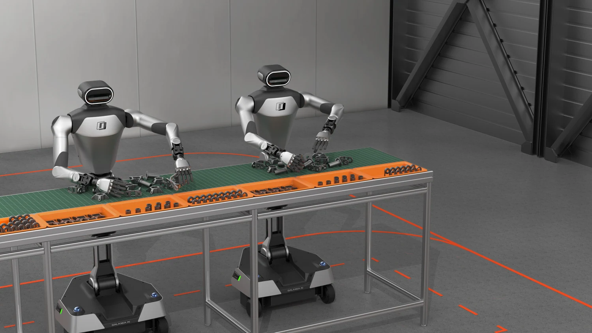

<!-- Generated by scripts/generate.py; edit data/works.json and data/media.json. -->

[← Back to the Awesome index](../../../README.md) · [Interactive website](https://chang-xinhai.github.io/Awesome-RGBDT-Manipulation/?collection=benchmark&item=roco-aaai-2026#library)

# RoCo AAAI 2026

RoCo Challenge at AAAI 2026: Benchmarking Robotic Collaborative Manipulation for Assembly Towards Industrial Automation

**2026-03-16 · AAAI 2026 challenge / technical report · Nanyang Technological University / A*STAR**

**[Paper](https://arxiv.org/abs/2603.15469)** · [Project](https://rocochallenge.github.io/RoCo-AAAI2026/) · [Code](https://github.com/rocochallenge/gearboxAssembly)

Gearbox assembly challenge with from-scratch, partial-state continuation and error-recovery scenarios, followed by physical robot competition.

*RoCo AAAI 2026 authors · [Figure source](https://rocochallenge.github.io/RoCo-AAAI2026/) · Original rights retained.*

| Field | Reported value and source scope |
| :-- | :-- |
| Record type | benchmark |
| Simulator | NVIDIA Isaac Sim [1](https://arxiv.org/abs/2603.15469) [2](https://rocochallenge.github.io/RoCo-AAAI2026/)  |
| Simulator version and scope | Current public README: Isaac Sim 5.1.0 / Isaac Lab 2.3.0 (submodule tag v2.3.0); paper original exact stack Not reported. [1](https://arxiv.org/abs/2603.15469) [2](https://rocochallenge.github.io/RoCo-AAAI2026/) [3](https://github.com/rocochallenge/gearboxAssembly)  |
| Task count and scope | 3 core scenario families around one planetary gearbox assembly workflow [1](https://arxiv.org/abs/2603.15469) [2](https://rocochallenge.github.io/RoCo-AAAI2026/)  |
| Task-list scope | Complete three scenario-family definitions; component-level stages are not three separate product families. [1](https://arxiv.org/abs/2603.15469) [2](https://rocochallenge.github.io/RoCo-AAAI2026/)  |
| Capability dimensions | Bimanual precision assembly · State recognition · Recovery from partial assembly · Human-like error correction [1](https://arxiv.org/abs/2603.15469) [2](https://rocochallenge.github.io/RoCo-AAAI2026/)  |
| Metrics | Stage/component completion and final assembly score under simulation/onsite rules. [1](https://arxiv.org/abs/2603.15469) [2](https://rocochallenge.github.io/RoCo-AAAI2026/)  |
| Robots | Galaxea R1 Lite physical platform; simulated bimanual assembly setup. [1](https://arxiv.org/abs/2603.15469) [2](https://rocochallenge.github.io/RoCo-AAAI2026/)  |
| Sensors and observations | RGB-D / robot state in simulation; physical sensor configuration defined by competition APIs. No optical tactile input established. [1](https://arxiv.org/abs/2603.15469) [2](https://rocochallenge.github.io/RoCo-AAAI2026/)  |
| Demonstrations and data | Simulation successful-attempt trajectories and about 300 hardware demonstrations described by report; exact split depends on stage. [1](https://arxiv.org/abs/2603.15469) [2](https://rocochallenge.github.io/RoCo-AAAI2026/)  |
| Evaluation protocol | Online qualification then onsite physical evaluation; varied initial states encode collaboration and recovery; common assembly plan and robot API. [1](https://arxiv.org/abs/2603.15469) [2](https://rocochallenge.github.io/RoCo-AAAI2026/)  |
| Evaluated baselines | ACT / diffusion / VLA-style policy baselines and challenge systems; exact table scope in report. [1](https://arxiv.org/abs/2603.15469) [2](https://rocochallenge.github.io/RoCo-AAAI2026/)  |
| Observations / modalities | RGB · Depth · Proprioception |
| Evaluation domain | Simulation · Real world |
| Embodiment | Bimanual · Parallel-jaw gripper |
| Release: code | Available [3](https://github.com/rocochallenge/gearboxAssembly)  |
| Release: weights | Not verified [3](https://github.com/rocochallenge/gearboxAssembly)  |
| Release: data | Partial [3](https://github.com/rocochallenge/gearboxAssembly)  |
| Release: license | Not verified [3](https://github.com/rocochallenge/gearboxAssembly)  |
| Release: notes | Official simulator code, task docs, onsite API references and leaderboards public. [3](https://github.com/rocochallenge/gearboxAssembly)  |

**Task names — Complete three scenario-family definitions; component-level stages are not three separate product families.:**

- Assembly from Scratch
- Resume from Partial State
- Error Detection and Recovery

**Scope and qualifications**

- The later IROS 2026 challenge is a separate edition; this entry covers AAAI 2026.
- Recovery scenarios share a gearbox task family rather than a broad general-purpose object set.

**Primary evidence**

1. [Paper](https://arxiv.org/abs/2603.15469) — Published paper / arXiv record and manuscript.
2. [Official project](https://rocochallenge.github.io/RoCo-AAAI2026/) — Public project page.
3. [Official repository](https://github.com/rocochallenge/gearboxAssembly) — Current public repository; implementation scope may differ from paper.
