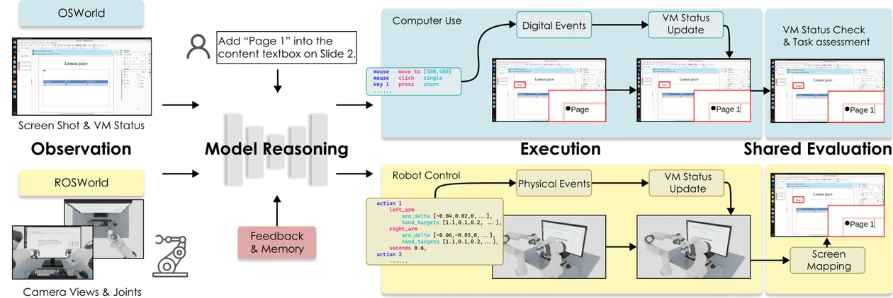

<!-- Generated by scripts/generate.py; edit data/works.json and data/media.json. -->

[← Back to the Awesome index](../../../README.md) · [Interactive website](https://chang-xinhai.github.io/Awesome-RGBDT-Manipulation/?collection=benchmark&item=rosworld#library)

# ROSWORLD

ROSWORLD: When Digital Task Competence Meets Physical Execution

**2026-11-20 · Preprint · University of Tokyo, JD.com and collaborators**

**[Paper](https://arxiv.org/abs/2611.27467)**

Agents use simulated robot contact to operate the keyboard and mouse of a live desktop VM, with paired direct-input baselines on the same software tasks.

*ROSWORLD authors · [Figure source](https://arxiv.org/html/2611.27467v1) · Original rights retained.*

| Field | Reported value and source scope |
| :-- | :-- |
| Record type | benchmark |
| Simulator | Simulated workstation with a live OSWorld virtual machine [1](https://arxiv.org/html/2611.27467v1)  |
| Simulator version and scope | Not reported [1](https://arxiv.org/html/2611.27467v1)  |
| Task count and scope | 40 OSWorld tasks across ten applications [1](https://arxiv.org/html/2611.27467v1)  |
| Task-list scope | Representative workflows in the official 40-task set. [1](https://arxiv.org/html/2611.27467v1)  |
| Capability dimensions | Long-horizon visual interaction, precise peripheral contact and recovery. [1](https://arxiv.org/html/2611.27467v1)  |
| Metrics | Official OSWorld task success; matched contact-level failure analysis. [1](https://arxiv.org/html/2611.27467v1)  |
| Robots | Single arm with a rigid probe; dual-arm dexterous hands. [1](https://arxiv.org/html/2611.27467v1)  |
| Sensors and observations | Oblique and top-down rendered workstation camera views; paired desktop baseline uses direct virtual inputs. [1](https://arxiv.org/html/2611.27467v1)  |
| Data collection method | No training corpus introduced. Agents generate trajectories by manipulating simulated keyboard and mouse. [1](https://arxiv.org/html/2611.27467v1)  |
| Demonstrations and data | Paper and aggregate results are public. [1](https://arxiv.org/html/2611.27467v1)  |
| Evaluation protocol | Same goals and success evaluators across direct OSWorld input and two contact-driven simulated embodiments. [1](https://arxiv.org/html/2611.27467v1)  |
| Evaluated baselines | Five frontier models; 31–39/40 direct, at most 23/40 with the probe and 28/40 with dexterous hands. [1](https://arxiv.org/html/2611.27467v1)  |
| Observations / modalities | RGB |
| Evaluation domain | Simulation |
| Embodiment |  |
| Release: code | Not verified |
| Release: weights | Not applicable |
| Release: data | Not verified |
| Release: license | Not verified |
| Release: notes | The manuscript provides task selection and methods. A runnable release was not verified. |

**Task names — Representative workflows in the official 40-task set.:**

- Document editing
- Spreadsheet editing
- File management
- Application configuration
- Keyboard shortcuts
- Mouse operations

**Scope and qualifications**

- The input devices are simulated while the desktop software runs in a live VM. No physical robot trial is reported.
- Counts are maxima by embodiment and are reported against the same 40 selected tasks.

**Primary evidence**

1. [Original author paper or dataset description](https://arxiv.org/html/2611.27467v1)
