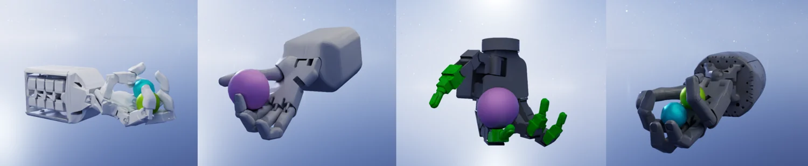

<!-- Generated by scripts/generate.py; edit data/works.json and data/media.json. -->

[← Back to the Awesome index](../../../README.md) · [Interactive website](https://chang-xinhai.github.io/Awesome-RGBDT-Manipulation/?collection=benchmark&item=roto#library)

# roto 2.0

roto 2.0: The Robot Tactile Olympiad

**2026-05-20 · ICRA 2026 ViTac workshop · University of Edinburgh**

**[Paper](https://arxiv.org/abs/2605.21429)** · [Project](https://elle-miller.github.io/roto/) · [Code](https://github.com/elle-miller/roto) · [Data](https://github.com/elle-miller/roto_paper_results)

GPU-parallel tactile reinforcement-learning tasks compare blind manipulation across multiple robot morphologies.

*roto 2.0 authors · [Figure source](https://github.com/elle-miller/roto) · Original rights retained.*

| Field | Reported value and source scope |
| :-- | :-- |
| Record type | benchmark |
| Simulator | Isaac Lab [1](https://arxiv.org/abs/2605.21429)  |
| Simulator version and scope | Not reported [1](https://arxiv.org/abs/2605.21429)  |
| Task count and scope | Three tasks in current repository; paper 2.0 adds four hand morphologies [1](https://arxiv.org/abs/2605.21429)  |
| Task-list scope | Complete three-task registry in current repository; not every robot is supported on each task. [1](https://arxiv.org/abs/2605.21429)  |
| Capability dimensions | Blind tactile RL · Object search · In-hand manipulation [1](https://arxiv.org/abs/2605.21429)  |
| Metrics | Task-specific speed and success [1](https://arxiv.org/abs/2605.21429)  |
| Robots | Franka; Allegro, ORCA, Shadow and Shadow Lite hands [1](https://arxiv.org/abs/2605.21429)  |
| Sensors and observations | Simulated tactile contact and proprioception for blind agents; full-state agents separately evaluated. [1](https://arxiv.org/abs/2605.21429)  |
| Data collection method | Parallel simulated RL interaction; checkpoints and logs saved separately. [1](https://arxiv.org/abs/2605.21429)  |
| Demonstrations and data | Training logs and checkpoints public; no physical demonstration set claimed. [1](https://arxiv.org/abs/2605.21429)  |
| Evaluation protocol | Blind and privileged-state agents have distinct observation settings. [1](https://arxiv.org/abs/2605.21429)  |
| Evaluated baselines | Full-state and proprioceptive-tactile RL baselines with tuned task/robot configurations. [1](https://arxiv.org/abs/2605.21429)  |
| Observations / modalities | Tactile · Proprioception |
| Evaluation domain | Simulation |
| Embodiment |  |
| Release: code | Available — environments and RL baselines [2](https://elle-miller.github.io/roto/) [3](https://github.com/elle-miller/roto) [4](https://github.com/elle-miller/roto_paper_results)  |
| Release: weights | Available — selected pretrained policies in results repository [2](https://elle-miller.github.io/roto/) [3](https://github.com/elle-miller/roto) [4](https://github.com/elle-miller/roto_paper_results)  |
| Release: data | Training logs and plots in separate results repository [2](https://elle-miller.github.io/roto/) [3](https://github.com/elle-miller/roto) [4](https://github.com/elle-miller/roto_paper_results)  |
| Release: license | BSD-3-Clause repository; assets and dependencies retain their own terms. [2](https://elle-miller.github.io/roto/) [3](https://github.com/elle-miller/roto) [4](https://github.com/elle-miller/roto_paper_results)  |
| Release: notes | Current repository extends original NeurIPS 2025 benchmark to roto 2.0. [2](https://elle-miller.github.io/roto/) [3](https://github.com/elle-miller/roto) [4](https://github.com/elle-miller/roto_paper_results)  |

**Task names — Complete three-task registry in current repository; not every robot is supported on each task.:**

- Find
- Bounce
- Baoding

**Scope and qualifications**

- The 2.0 paper evaluates four dexterous hand morphologies; the repository also retains a Franka Find task from 1.0.
- Simulation only; binary contact sensing is not a physical optical tactile image.

**Primary evidence**

1. [Author paper and first submission](https://arxiv.org/abs/2605.21429)
2. [Official project and artifact scope](https://elle-miller.github.io/roto/)
3. [Official code and artifact scope](https://github.com/elle-miller/roto)
4. [Official data and artifact scope](https://github.com/elle-miller/roto_paper_results)
