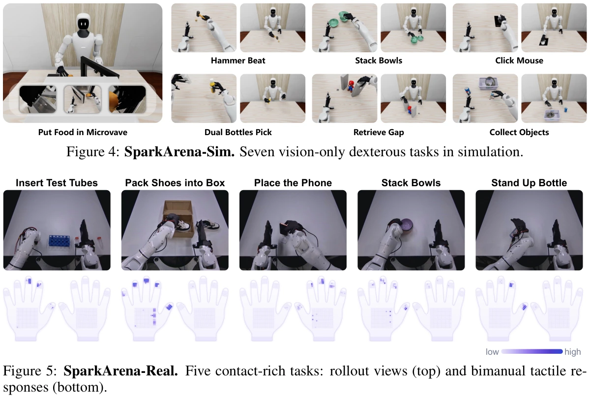

<!-- Generated by scripts/generate.py; edit data/works.json and data/media.json. -->

[← Back to the Awesome index](../../../README.md) · [Interactive website](https://chang-xinhai.github.io/Awesome-RGBDT-Manipulation/?collection=benchmark&item=spark-0#library)

# SparkArena

Spark-0: Scaling Spatially Aligned Tactile Pretraining for Robot Dexterous Manipulation

**2026-10-15 · Preprint · Xspark AI / Tsinghua University / MMLab, HKU / HKUST (Guangzhou) / Peking University**

**[Paper](https://arxiv.org/abs/2610.22342)** · [Project](https://xsparkai.com/Spark-0/) · [Code](https://github.com/XPolicyLab/XPolicyLab/tree/main/policy/Spark_0) · [Weights](https://huggingface.co/TianxingChen/Spark-0)

Spatially aligned VTLA pretraining uses human touch as visual supervision and as an optional action-expert input; Spark Arena separates vision-only simulation from real tactile control.

*Spark-0: Scaling Spatially Aligned Tactile Pretraining for Robot Dexterous Manipulation authors · [Figure source](https://arxiv.org/abs/2610.22342) · Original rights retained.*

| Field | Reported value and source scope |
| :-- | :-- |
| Record type | benchmark |
| Simulator | Not reported in the inspected paper; Spark Arena-Sim reproduces the Gen1Prototype kinematics/cameras. [1](https://arxiv.org/abs/2610.22342)  |
| Simulator version and scope | Not reported [1](https://arxiv.org/abs/2610.22342)  |
| Task count and scope | 12 track-specific task settings: 7 simulation + 5 real; Stack Bowls occurs in both tracks. [1](https://arxiv.org/abs/2610.22342)  |
| Task-list scope | Complete Spark Arena Table 7 registry, with track prefixes; not 12 unique semantic task families. [1](https://arxiv.org/abs/2610.22342)  |
| Capability dimensions | Vision-only dexterity after tactile pretraining · Contact-conditioned precision control · Bimanual grasping · Insertion · Compliant packing · Object reorientation [1](https://arxiv.org/abs/2610.22342)  |
| Metrics | Success rate: all task goals reached / score 100 · Completion score: highest attained subgoal stage; binary on tasks without intermediate stages [1](https://arxiv.org/abs/2610.22342)  |
| Robots | Gen1Prototype: two Marvin M6 S CCS-696 arms and two WUJI Hand 2 dexterous hands [1](https://arxiv.org/abs/2610.22342)  |
| Sensors and observations | Orbbec 336 head RGB camera · Two Orbbec 305 wrist RGB cameras · Moxian tactile gloves on real hands; 320 retained taxels/hand; no tactile input in simulation [1](https://arxiv.org/abs/2610.22342)  |
| Data collection method | Benchmark task-demonstration collector Not reported. Human Touch pretraining uses egocentric human motion/tactile capture and is separate from SparkArena task demonstrations. [1](https://arxiv.org/abs/2610.22342) [6](https://arxiv.org/abs/2610.22342)  |
| Demonstrations and data | Human Touch 1,000 h is pretraining data, not the Spark Arena evaluation episode count. Benchmark-specific downstream demonstrations are separate; their exact count Not reported. [1](https://arxiv.org/abs/2610.22342)  |
| Evaluation protocol | Held-out evaluated tasks absent from pretraining. Per policy/task: 50 simulated rollouts, 10 real rollouts; real methods share paired initial conditions. [1](https://arxiv.org/abs/2610.22342)  |
| Evaluated baselines | π0.5 · GR00T-N1.7 · StarVLA · RDT-1 B · X-VLA · EgoVLA · H-RDT · VITRA · UniT (human-action policy) · FastWAM · ACT · FTP-1 · Spark-0 Scratch / Visual PT / 100 H / 1000 H [1](https://arxiv.org/abs/2610.22342)  |
| Observations / modalities | RGB · Tactile · Proprioception · Language |
| Evaluation domain | Simulation · Real world |
| Embodiment | Dexterous hand · Bimanual |
| Release: code | Not released [2](https://xsparkai.com/Spark-0/) [3](https://github.com/XPolicyLab/XPolicyLab) [4](https://github.com/XPolicyLab/XPolicyLab/blob/main/policy/Spark_0/scripts/download_spark0_pretrained_ckpt.sh)  |
| Release: weights | Not applicable [2](https://xsparkai.com/Spark-0/) [3](https://github.com/XPolicyLab/XPolicyLab) [4](https://github.com/XPolicyLab/XPolicyLab/blob/main/policy/Spark_0/scripts/download_spark0_pretrained_ckpt.sh)  |
| Release: data | Not verified [2](https://xsparkai.com/Spark-0/) [3](https://github.com/XPolicyLab/XPolicyLab) [4](https://github.com/XPolicyLab/XPolicyLab/blob/main/policy/Spark_0/scripts/download_spark0_pretrained_ckpt.sh)  |
| Release: license | Not verified [2](https://xsparkai.com/Spark-0/) [3](https://github.com/XPolicyLab/XPolicyLab) [4](https://github.com/XPolicyLab/XPolicyLab/blob/main/policy/Spark_0/scripts/download_spark0_pretrained_ckpt.sh)  |
| Release: notes | SparkArena-Sim code button says Coming soon; paper release claims are not substituted for retrievable assets. [2](https://xsparkai.com/Spark-0/) [3](https://github.com/XPolicyLab/XPolicyLab) [4](https://github.com/XPolicyLab/XPolicyLab/blob/main/policy/Spark_0/scripts/download_spark0_pretrained_ckpt.sh)  |

**Task names — Complete Spark Arena Table 7 registry, with track prefixes; not 12 unique semantic task families.:**

- Sim: Click Mouse
- Sim: Collect Objects
- Sim: Dual Bottles Pick
- Sim: Hammer Beat
- Sim: Put Food in Microwave
- Sim: Retrieve Gap
- Sim: Stack Bowls
- Real: Insert Test Tubes
- Real: Pack Shoes into Box
- Real: Place the Phone
- Real: Stack Bowls
- Real: Stand Up Bottle

**Scope and qualifications**

- Depth Anything 3 and contact-map heads supervise visual tokens only during training; inferred teacher geometry is not runtime RGB-D sensing.
- Spark Arena-Sim and Ego Humanoid deploy without touch; Spark Arena-Real deploys with tactile gloves.
- The paper claims released Spark Arena assets, but the live project labels Spark Arena-Sim code Coming soon. Artifact availability is verified separately from paper prose.

**Primary evidence**

1. [Original paper and supplementary implementation details](https://arxiv.org/abs/2610.22342) — Primary full text reviewed; dataset, deployment modalities and training-only privileges are scoped separately.
2. [Official author project](https://xsparkai.com/Spark-0/) — Live artifact status reviewed separately from paper claims.
3. [Official released implementation and LICENSE](https://github.com/XPolicyLab/XPolicyLab) — Repository metadata,README and actualLICENSE inspected; availability scoped to the listed component.
4. [Official adapter checkpoint download script](https://github.com/XPolicyLab/XPolicyLab/blob/main/policy/Spark_0/scripts/download_spark0_pretrained_ckpt.sh) — Explicit author checkpoint identity TianxingChen/Spark-0; public pretrain_spark_0 tensor-file inventory verified.
5. [Public Spark-0 pretraining checkpoint](https://huggingface.co/TianxingChen/Spark-0) — Model repository contains pretraining tensors; this does not establish task-finetuned checkpoints or benchmark assets.
6. [Data collection method and scope](https://arxiv.org/abs/2610.22342) — Original method/data protocol reviewed for the collection mechanism. Data volume, evaluation rollouts and downstream training remain separate; undisclosed or unresolved interfaces are labeled explicitly.
