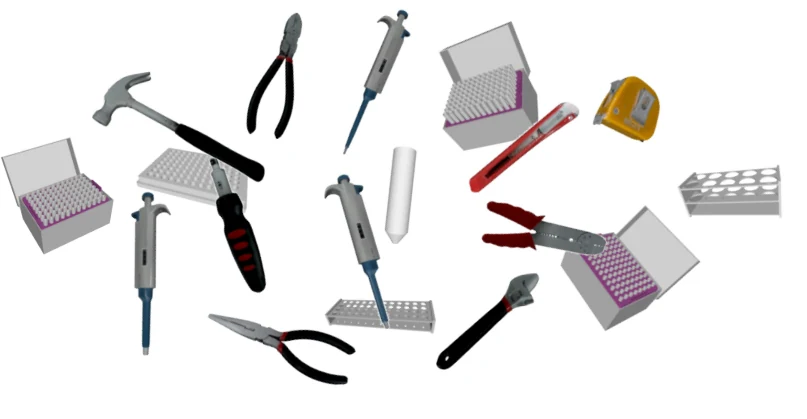

<!-- Generated by scripts/generate.py; edit data/works.json and data/media.json. -->

[← Back to the Awesome index](../../../README.md) · [Interactive website](https://chang-xinhai.github.io/Awesome-RGBDT-Manipulation/?collection=benchmark&item=stereobj-1m#library)

# StereOBJ-1M

StereOBJ-1M: Large-scale Stereo Image Dataset for 6D Object Pose Estimation

**2021-09-21 · ICCV 2021 · Carnegie Mellon University**

**[Paper](https://arxiv.org/abs/2109.10115)** · [Project](https://github.com/xingyul/stereobj-1m) · [Code](https://github.com/xingyul/stereobj-1m) · [Data](https://github.com/xingyul/stereobj-1m#data-download)

Large-scale real stereo RGB captures of held and placed objects including transparent, reflective and occluded instances.

*StereOBJ-1M authors · [Figure source](https://arxiv.org/html/2109.10115v1) · Original rights retained.*

| Field | Reported value and source scope |
| :-- | :-- |
| Record type | dataset |
| Simulator | Not applicable [1](https://arxiv.org/html/2109.10115v1)  |
| Simulator version and scope | Not applicable [1](https://arxiv.org/html/2109.10115v1)  |
| Task count and scope | Supporting dataset or perception evaluation [1](https://arxiv.org/html/2109.10115v1)  |
| Task-list scope | Listed uses of the resource, with no closed-loop robot task count. [1](https://arxiv.org/html/2109.10115v1)  |
| Capability dimensions | Training and evaluation data [1](https://arxiv.org/html/2109.10115v1)  |
| Metrics | 6D object pose metrics in the paper. [1](https://arxiv.org/html/2109.10115v1)  |
| Robots | Not applicable [1](https://arxiv.org/html/2109.10115v1)  |
| Sensors and observations | Stereo RGB with calibrated cameras and object pose/mask annotations. [1](https://arxiv.org/html/2109.10115v1) [3](https://github.com/xingyul/stereobj-1m#data-download)  |
| Data collection method | Record known objects across physical environments and human interaction conditions; use multiview annotation for precise 6D pose. [1](https://arxiv.org/html/2109.10115v1)  |
| Demonstrations and data | 393K+ stereo frames; the 1.5M scale describes 6D object pose annotations. [1](https://arxiv.org/html/2109.10115v1) [3](https://github.com/xingyul/stereobj-1m#data-download)  |
| Evaluation protocol | Object pose and cross-environment generalization; paired RGB are useful as difficult stereo imagery. [1](https://arxiv.org/html/2109.10115v1)  |
| Evaluated baselines | Not applicable [1](https://arxiv.org/html/2109.10115v1)  |
| Observations / modalities | RGB |
| Evaluation domain | Real world |
| Embodiment |  |
| Release: code | Available — official scripts and pose baseline [2](https://github.com/xingyul/stereobj-1m) [3](https://github.com/xingyul/stereobj-1m#data-download)  |
| Release: weights | Not verified [2](https://github.com/xingyul/stereobj-1m) [3](https://github.com/xingyul/stereobj-1m#data-download)  |
| Release: data | Author-located stereo images, annotations and splits [2](https://github.com/xingyul/stereobj-1m) [3](https://github.com/xingyul/stereobj-1m#data-download)  |
| Release: license | MIT for code; check dataset-specific terms at the release. [2](https://github.com/xingyul/stereobj-1m) [3](https://github.com/xingyul/stereobj-1m#data-download)  |
| Release: notes | Paired stereo images are independently usable from the pose annotations. [2](https://github.com/xingyul/stereobj-1m) [3](https://github.com/xingyul/stereobj-1m#data-download)  |

**Task names — Listed uses of the resource, with no closed-loop robot task count.:**

- 6D object pose
- Reflective and transparent stereo imagery

**Scope and qualifications**

- Do not treat pose labels as measured dense stereo disparity.

**Primary evidence**

1. [Original author paper or dataset description](https://arxiv.org/html/2109.10115v1)
2. [Author source and artifact entry points](https://github.com/xingyul/stereobj-1m)
3. [Official paired files and annotation payload](https://github.com/xingyul/stereobj-1m#data-download)
