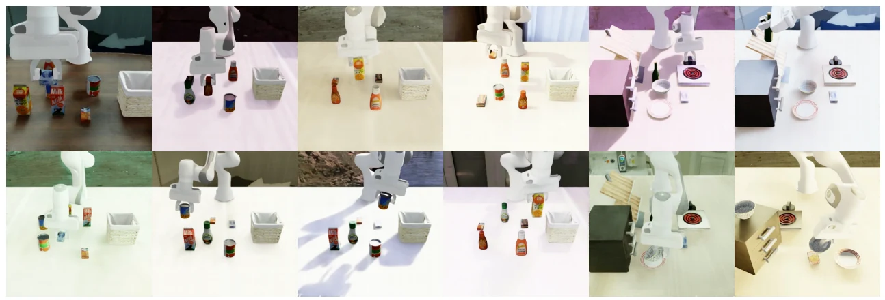

<!-- Generated by scripts/generate.py; edit data/works.json and data/media.json. -->

[← Back to the Awesome index](../../../README.md) · [Interactive website](https://chang-xinhai.github.io/Awesome-RGBDT-Manipulation/?collection=benchmark&item=tacinf#library)

# Tacinf-Tabero / Taco

Tacinf: A Unified Tactile Infrastructure for Robot Manipulation

**2026-11-22 · Preprint · NVIDIA; HKUST (Guangzhou); University of Cambridge**

**[Paper](https://arxiv.org/abs/2611.29240)** · [Project](https://tacinf.github.io/) · [Code](https://github.com/NathanWu7/T2-VLA) · [Data](https://huggingface.co/datasets/xiangxin0923/taco_pick_and_place_umi_current) · [Weights](https://huggingface.co/NathanWu7/pi0_lora_tacfield_tabero) · [Tabero Simulator](https://github.com/NathanWu7/Tabero)

Force-aware tasks pair optical tactile simulation with scoped real xArm comparisons and independent policy and dataset releases.

*Qiwei Wu and coauthors · [Figure source](https://arxiv.org/html/2611.29240v1) · Original rights retained.*

| Field | Reported value and source scope |
| :-- | :-- |
| Record type | policy |
| Simulator | Isaac Sim / Isaac Lab (Tabero) [1](https://arxiv.org/html/2611.29240v1)  |
| Simulator version and scope | Not reported [1](https://arxiv.org/html/2611.29240v1)  |
| Task count and scope | 18 Tabero requirements, counting force levels separately; six Taco base tasks plus variants [1](https://arxiv.org/html/2611.29240v1)  |
| Task-list scope | Representative task types only. Simulation curriculum, data replay variants and the physical subset are separate. [1](https://arxiv.org/html/2611.29240v1)  |
| Capability dimensions | Force-modulated manipulation in simulated reconstructed LIBERO scenes and matched physical task subsets. [1](https://arxiv.org/html/2611.29240v1)  |
| Metrics | Task success, force magnitude tracking and success-rank correspondence across matched settings. [1](https://arxiv.org/html/2611.29240v1)  |
| Robots | Parallel-jaw tactile hybrid gripper in Tabero and xArm hardware in physical experiments [1](https://arxiv.org/html/2611.29240v1)  |
| Sensors and observations | Tabero stores multi-view scene RGB-D, robot state and simulated touch including marker motion and contact force; task-specific VTLA uses camera RGB and tactile. [1](https://arxiv.org/html/2611.29240v1)  |
| Data collection method | Replay and augment scripted/sourced trajectories in rendered scenes. Robot teleop and Tacumi uses distinct acquisition protocols. [1](https://arxiv.org/html/2611.29240v1)  |
| Demonstrations and data | Author-released simulator assets and individual teleoperation, UMI and replay splits; not a monolithic dataset release. [1](https://arxiv.org/html/2611.29240v1)  |
| Evaluation protocol | Simulation and physical tests are compared using matched task conditions and separate per-setting trial counts. [1](https://arxiv.org/html/2611.29240v1) [6](https://github.com/NathanWu7/Tabero#readme)  |
| Evaluated baselines | Vision-only, optical tactile, tactile motion field and force features, with separate backbone and data-mixture variants. [1](https://arxiv.org/html/2611.29240v1)  |
| Observations / modalities | RGB · Tactile · Proprioception · Language |
| Evaluation domain | Simulation · Real world |
| Embodiment | Parallel-jaw gripper |
| Release: code | Available — Tabero simulator and public task code [3](https://github.com/NathanWu7/T2-VLA)  |
| Release: weights | Partial — simulation VTLA example checkpoint [4](https://huggingface.co/NathanWu7/pi0_lora_tacfield_tabero/tree/main)  |
| Release: data | Partial — public assets and selected Tacumi/Taco data series [5](https://huggingface.co/datasets/xiangxin0923/taco_pick_and_place_umi_current/tree/main)  |
| Release: license | Apache-2.0 simulator; independent data and weight terms. |
| Release: notes | Public paper verified. Code, task weights and data are tracked separately. |

**Task names — Representative task types only. Simulation curriculum, data replay variants and the physical subset are separate.:**

- Pick-and-place with force instruction
- Force-sensitive grasping
- Surface wiping

**Scope and qualifications**

- Tabero dataset RGB-D coverage is distinct from deployed policy modalities. VTLA branches do not consume a measured depth map in the reported setup.
- Fingertip contact readout and tool/wrench targets are reported by sensor and controller configuration.

**Primary evidence**

1. [Original author paper with methods, evaluation and scope](https://arxiv.org/html/2611.29240v1)
2. [Public author project with method and evaluation examples](https://tacinf.github.io/)
3. [Public tactile policy repository](https://github.com/NathanWu7/T2-VLA)
4. [Files for released simulation checkpoint](https://huggingface.co/NathanWu7/pi0_lora_tacfield_tabero/tree/main)
5. [Public parquet recording split](https://huggingface.co/datasets/xiangxin0923/taco_pick_and_place_umi_current/tree/main)
6. [Public Isaac Lab benchmark and separate release artifacts](https://github.com/NathanWu7/Tabero#readme)
