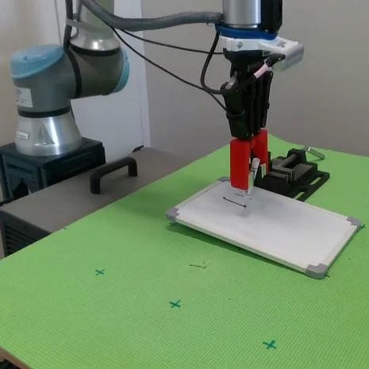

<!-- Generated by scripts/generate.py; edit data/works.json and data/media.json. -->

[← Back to the Awesome index](../../../README.md) · [Interactive website](https://chang-xinhai.github.io/Awesome-RGBDT-Manipulation/?collection=benchmark&item=taclat-il#library)

# Tactile foundation models for IL

Evaluating Tactile Foundation Models for End-to-End Imitation Learning in Contact-Rich Manipulation

**2026-10-31 · Preprint · National Institute of Advanced Industrial Science and Technology**

**[Paper](https://arxiv.org/abs/2611.00957)** · [Project](https://mmurooka.github.io/tfm4il-project-page/) · [Code](https://github.com/isri-aist/TacLatentIL)

A controlled study compares pretrained tactile encoders and adaptation in contact-rich imitation learning.

*Tactile foundation models for IL authors · [Figure source](https://arxiv.org/html/2611.00957) · Original rights retained.*

| Field | Reported value and source scope |
| :-- | :-- |
| Record type | evaluation-tool |
| Simulator | Not reported [1](https://arxiv.org/abs/2611.00957)  |
| Simulator version and scope | Not reported [1](https://arxiv.org/abs/2611.00957)  |
| Task count and scope | Five real tasks and two simulation tasks [1](https://arxiv.org/abs/2611.00957)  |
| Task-list scope | Paper lists five physical tasks and two simulated tasks, with SpoonSorting appearing in both settings. [1](https://arxiv.org/abs/2611.00957)  |
| Capability dimensions | Pretrained tactile features · Imitation learning · Contact-rich insertion [1](https://arxiv.org/abs/2611.00957)  |
| Metrics | Task success; 5,136 physical policy rollouts across study conditions [1](https://arxiv.org/abs/2611.00957)  |
| Robots | UR5e with Robotiq 2F-140 in physical study [1](https://arxiv.org/abs/2611.00957)  |
| Sensors and observations | GelSight Mini tactile images or hand-mounted camera images in separate baseline configurations, with proprioception. [1](https://arxiv.org/abs/2611.00957)  |
| Data collection method | 32 human-teleoperated demonstrations per task using a 3D mouse in both real and simulation; observations/actions recorded at 100 ms. [1](https://arxiv.org/abs/2611.00957)  |
| Demonstrations and data | Not verified [1](https://arxiv.org/abs/2611.00957)  |
| Evaluation protocol | Compare frozen, fine-tuned and mid-trained tactile encoders under matched experiment-specific conditions. [1](https://arxiv.org/abs/2611.00957)  |
| Evaluated baselines | Diffusion Policy with ResNet, Sparsh, T3, AnyTouch and UniT variants. [1](https://arxiv.org/abs/2611.00957)  |
| Observations / modalities | Tactile · Proprioception · RGB |
| Evaluation domain | Simulation · Real world |
| Embodiment |  |
| Release: code | Available — TacLatentIL implementation [2](https://mmurooka.github.io/tfm4il-project-page/) [3](https://github.com/isri-aist/TacLatentIL)  |
| Release: weights | External tactile pretrained models have separate release terms [2](https://mmurooka.github.io/tfm4il-project-page/) [3](https://github.com/isri-aist/TacLatentIL)  |
| Release: data | Not independently verified [2](https://mmurooka.github.io/tfm4il-project-page/) [3](https://github.com/isri-aist/TacLatentIL)  |
| Release: license | BSD-2-Clause original code; third-party submodules have independent licenses. [2](https://mmurooka.github.io/tfm4il-project-page/) [3](https://github.com/isri-aist/TacLatentIL)  |
| Release: notes | Code integrates pretrained tactile models and Diffusion Policy; datasets and weights are separate. [2](https://mmurooka.github.io/tfm4il-project-page/) [3](https://github.com/isri-aist/TacLatentIL)  |

**Task names — Paper lists five physical tasks and two simulated tasks, with SpoonSorting appearing in both settings.:**

- MarkerDrawing
- HeavyBoxSorting
- PaperBoxHandling
- SpoonSorting
- PenInsertion
- PlateInsertion

**Scope and qualifications**

- Object sets differ across some experimental subsections; success rates should be compared within the stated setting.
- Visual-only and tactile-only input variants are evaluated as alternatives; RGB is not an additional input to every tactile policy.

**Primary evidence**

1. [Author paper and first submission](https://arxiv.org/abs/2611.00957)
2. [Official project and artifact scope](https://mmurooka.github.io/tfm4il-project-page/)
3. [Official code and artifact scope](https://github.com/isri-aist/TacLatentIL)
