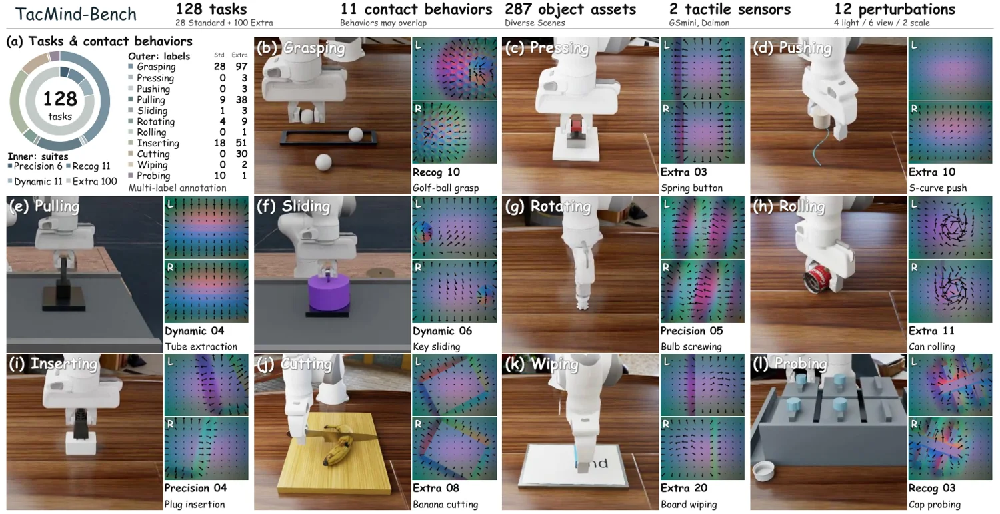

<!-- Generated by scripts/generate.py; edit data/works.json and data/media.json. -->

[← Back to the Awesome index](../../../README.md) · [Interactive website](https://chang-xinhai.github.io/Awesome-RGBDT-Manipulation/?collection=benchmark&item=tacmind#library)

# TacMind

TacMind: Benchmarking and Modeling Tactile Interaction States for Robotic Manipulation

**2026-10-30 · Preprint · Shanghai Jiao Tong University; Daimon Robotics**

**[Paper](https://arxiv.org/abs/2611.00455)** · [Project](https://tacmind-bench.github.io/) · [Code](https://github.com/Tacmind-Bench/TacMind) · [Data](https://huggingface.co/datasets/JiaxinShi/TacMind-Bench)

A tactile benchmark and streaming visuotactile policy for contact-rich manipulation.

*tacmind authors · [Figure source](https://arxiv.org/abs/2611.00455) · Original rights retained.*

| Field | Reported value and source scope |
| :-- | :-- |
| Record type | benchmark |
| Simulator | Isaac-based simulation [1](https://arxiv.org/html/2611.00455v1)  |
| Simulator version and scope | Not verified [1](https://arxiv.org/html/2611.00455v1)  |
| Task count and scope | 28 standard plus 100 extra tasks [1](https://arxiv.org/html/2611.00455v1)  |
| Task-list scope | Counts cover author-defined standard and extra suites; task names not transcribed. [1](https://arxiv.org/html/2611.00455v1)  |
| Capability dimensions | Precision, ambiguous-contact recognition, dynamic interaction and robustness. [1](https://arxiv.org/html/2611.00455v1)  |
| Metrics | Task success and tactile prediction metrics. [1](https://arxiv.org/html/2611.00455v1)  |
| Robots | Simulated manipulators with tactile fingertips. [1](https://arxiv.org/html/2611.00455v1)  |
| Sensors and observations | Simulated GelSight Mini and Daimon tactile sensors; RGB and proprioception. [1](https://arxiv.org/html/2611.00455v1)  |
| Data collection method | Agentic generated and debugged scripted action experts in simulation; real demonstrations contribute separately to tactile model pretraining. [1](https://arxiv.org/html/2611.00455v1)  |
| Demonstrations and data | Published tactile manipulation episodes and benchmark assets. [1](https://arxiv.org/html/2611.00455v1)  |
| Evaluation protocol | Controlled tactile tasks and perturbations; physical transfer is reported separately. [1](https://arxiv.org/html/2611.00455v1)  |
| Evaluated baselines | Visuotactile action models and tactile representation ablations. [1](https://arxiv.org/html/2611.00455v1)  |
| Observations / modalities | RGB · Tactile · Proprioception · Language |
| Evaluation domain | Simulation · Real world |
| Embodiment | Not reported |
| Release: code | Available — official benchmark and implementation [2](https://tacmind-bench.github.io/)  |
| Release: weights | Not verified [2](https://tacmind-bench.github.io/)  |
| Release: data | Available — official tactile benchmark episode archives [2](https://tacmind-bench.github.io/)  |
| Release: license | MIT for repository; dataset and component licenses are separate. [2](https://tacmind-bench.github.io/)  |
| Release: notes | Official repository contains source and assets; published dataset lists episode archives. Model checkpoint release has not been verified. [2](https://tacmind-bench.github.io/)  |

**Task names — Counts cover author-defined standard and extra suites; task names not transcribed.:**

Task names not reported or not verified in the cited sources.

**Scope and qualifications**

- The 28 standard and 100 extra tasks are simulation benchmark counts; real-world evaluation is separate.
- Predictive tactile state and measured tactile observations are distinct.

**Primary evidence**

1. [Author paper: methods, scope, and evaluation](https://arxiv.org/html/2611.00455v1)
2. [Official project and linked releases](https://tacmind-bench.github.io/)
