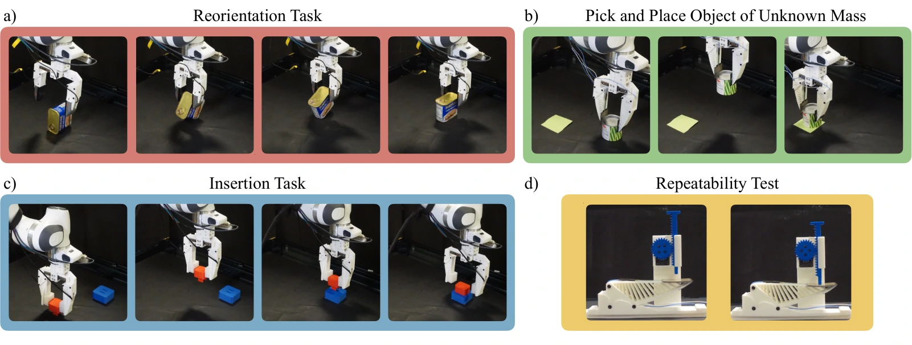

<!-- Generated by scripts/generate.py; edit data/works.json and data/media.json. -->

[← Back to the Awesome index](../../../README.md) · [Interactive website](https://chang-xinhai.github.io/Awesome-RGBDT-Manipulation/?collection=benchmark&item=taco-sensor-benchmark#library)

# TacO

TacO: Benchmarking Tactile Sensors for Object Manipulation

**2026-05-21 · Preprint · University of California San Diego / Carnegie Mellon University / Seoul National University**

**[Paper](https://arxiv.org/abs/2605.21976)** · [Project](https://anyazorin.com/projects/taco) · [Code](https://github.com/TacObench/TacO)

Real-robot task-driven comparison of optical, acoustic, magnetic and resistive tactile hardware under a shared imitation-learning setup.

*TacO authors · [Figure source](https://arxiv.org/abs/2605.21976) · Original rights retained.*

| Field | Reported value and source scope |
| :-- | :-- |
| Record type | benchmark |
| Simulator | Not applicable — physical robot sensor benchmark [1](https://arxiv.org/abs/2605.21976) [2](https://anyazorin.com/projects/taco)  |
| Simulator version and scope | Not applicable [1](https://arxiv.org/abs/2605.21976) [2](https://anyazorin.com/projects/taco) [3](https://github.com/TacObench/TacO)  |
| Task count and scope | 3 physical manipulation tasks [1](https://arxiv.org/abs/2605.21976) [2](https://anyazorin.com/projects/taco)  |
| Task-list scope | Complete three-task paper evaluation; sensor/task combinations vary. [1](https://arxiv.org/abs/2605.21976) [2](https://anyazorin.com/projects/taco)  |
| Capability dimensions | Mass-adaptive grasping · In-hand reorientation · Insertion · Sensor selection [1](https://arxiv.org/abs/2605.21976) [2](https://anyazorin.com/projects/taco)  |
| Metrics | Policy task success; analysis of spatial resolution, shear, sensor representation, friction and sensor durability. [1](https://arxiv.org/abs/2605.21976) [2](https://anyazorin.com/projects/taco)  |
| Robots | Franka Panda 7-DoF arms; experiments distributed across institutions. [1](https://arxiv.org/abs/2605.21976) [2](https://anyazorin.com/projects/taco)  |
| Sensors and observations | Four tactile modalities: optical, acoustic, magnetic, resistive. Named devices include FlexiTac, eGain, Daimon, eFlesh and FSR configurations; consult paper sensor matrix for tested combinations. [1](https://arxiv.org/abs/2605.21976) [2](https://anyazorin.com/projects/taco)  |
| Demonstrations and data | GELLO teleoperation; paper specifies task-dependent demonstration budgets (e.g., 60 demonstrations for pick-and-place, 50 per sensor for plug insertion). [1](https://arxiv.org/abs/2605.21976) [2](https://anyazorin.com/projects/taco)  |
| Evaluation protocol | Train separate ACT policies per sensor, task and modality configuration; compare outcomes under matched task setup with sensor material properties documented. [1](https://arxiv.org/abs/2605.21976) [2](https://anyazorin.com/projects/taco)  |
| Evaluated baselines | ACT with sensor-specific tactile representations and vision-only comparisons. [1](https://arxiv.org/abs/2605.21976) [2](https://anyazorin.com/projects/taco)  |
| Observations / modalities | RGB · Tactile · Proprioception |
| Evaluation domain | Real world |
| Embodiment | Parallel-jaw gripper |
| Release: code | Available [3](https://github.com/TacObench/TacO)  |
| Release: weights | Not verified [3](https://github.com/TacObench/TacO)  |
| Release: data | Not verified [3](https://github.com/TacObench/TacO)  |
| Release: license | Not verified [3](https://github.com/TacObench/TacO)  |
| Release: notes | Official ACT training/deployment code public; author project page still describes forthcoming sensor, hardware and data release. [3](https://github.com/TacObench/TacO)  |

**Task names — Complete three-task paper evaluation; sensor/task combinations vary.:**

- Pick-and-place with unknown mass
- Object reorientation
- Plug insertion

**Scope and qualifications**

- Measures complete sensor-plus-material systems; differences cannot always be attributed to transduction alone.
- TacO is unrelated to TACO (CVPR 2024 human tool-action-object dataset).

**Primary evidence**

1. [Paper](https://arxiv.org/abs/2605.21976) — Published paper / arXiv record and manuscript.
2. [Official project](https://anyazorin.com/projects/taco) — Public project page.
3. [Official repository](https://github.com/TacObench/TacO) — Current public repository; implementation scope may differ from paper.
