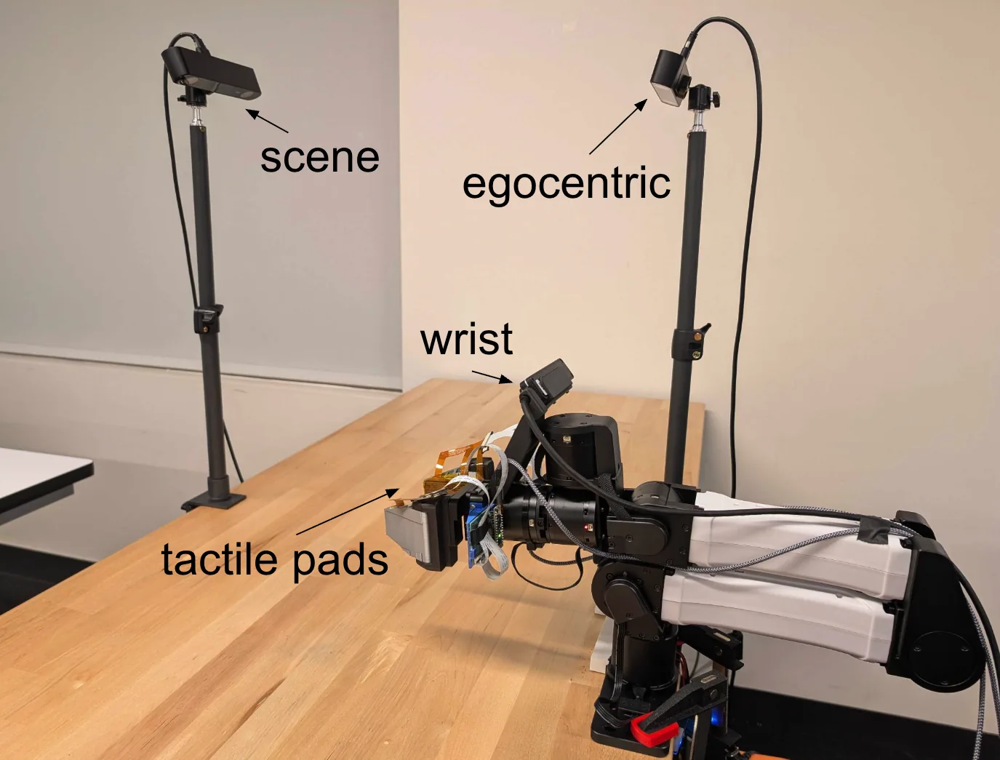

<!-- Generated by scripts/generate.py; edit data/works.json and data/media.json. -->

[← Back to the Awesome index](../../../README.md) · [Interactive website](https://chang-xinhai.github.io/Awesome-RGBDT-Manipulation/?collection=benchmark&item=tactile-versus-wrist#library)

# Tactile vs wrist cameras

Tactile Sensors Are an Effective Substitute for Wrist Cameras in Contact-Rich or Occluded Manipulation

**2026-11-07 · Preprint · Toyota Research Institute**

**[Paper](https://arxiv.org/abs/2611.10490)** · [Project](https://annieyaj.github.io/tactile-vs-vision/)

A controlled real-robot study compares tactile arrays and wrist views in contact-rich tasks.

*Tactile vs wrist cameras authors · [Figure source](https://arxiv.org/abs/2611.10490) · Original rights retained.*

| Field | Reported value and source scope |
| :-- | :-- |
| Record type | evaluation-tool |
| Simulator | Not applicable [1](https://arxiv.org/abs/2611.10490)  |
| Simulator version and scope | Not reported [1](https://arxiv.org/abs/2611.10490)  |
| Task count and scope | Six real-world task families [1](https://arxiv.org/abs/2611.10490)  |
| Task-list scope | Six paper-reported task families; controlled wrist/tactile comparisons apply to a subset. [1](https://arxiv.org/abs/2611.10490)  |
| Capability dimensions | Occluded retrieval · Insertion · Contact-rich tool use [1](https://arxiv.org/abs/2611.10490)  |
| Metrics | Task success across sensor ablations. [1](https://arxiv.org/abs/2611.10490)  |
| Robots | YAM arm with gripper [1](https://arxiv.org/abs/2611.10490)  |
| Sensors and observations | Scene and egocentric cameras, optional wrist camera, two FlexiTac tactile arrays. [1](https://arxiv.org/abs/2611.10490)  |
| Data collection method | Real-robot demonstrations with tactile arrays and visual cameras. [1](https://arxiv.org/abs/2611.10490)  |
| Demonstrations and data | Not verified [1](https://arxiv.org/abs/2611.10490)  |
| Evaluation protocol | Controlled camera/tactile ablations and physical task trials. [1](https://arxiv.org/abs/2611.10490)  |
| Evaluated baselines | ACT policies with and without wrist-camera and tactile observations. [1](https://arxiv.org/abs/2611.10490)  |
| Observations / modalities | RGB · Tactile · Proprioception |
| Evaluation domain | Real world |
| Embodiment |  |
| Release: code | Not verified [2](https://annieyaj.github.io/tactile-vs-vision/)  |
| Release: weights | Not verified [2](https://annieyaj.github.io/tactile-vs-vision/)  |
| Release: data | Not verified [2](https://annieyaj.github.io/tactile-vs-vision/)  |
| Release: license | Not verified [2](https://annieyaj.github.io/tactile-vs-vision/)  |
| Release: notes | Availability is distinguished for source, data and model weights. [2](https://annieyaj.github.io/tactile-vs-vision/)  |

**Task names — Six paper-reported task families; controlled wrist/tactile comparisons apply to a subset.:**

- Tight clearance
- Rigid / soft placement
- Straw insertion
- Occluded retrieval
- Plug insertion
- Whiteboard wiping

**Scope and qualifications**

- Conclusions are limited to the tested tasks and sensor combinations, not an unconditional equivalence between touch and vision.

**Primary evidence**

1. [Original paper and first submission](https://arxiv.org/abs/2611.10490)
2. [Official project and release scope](https://annieyaj.github.io/tactile-vs-vision/)
