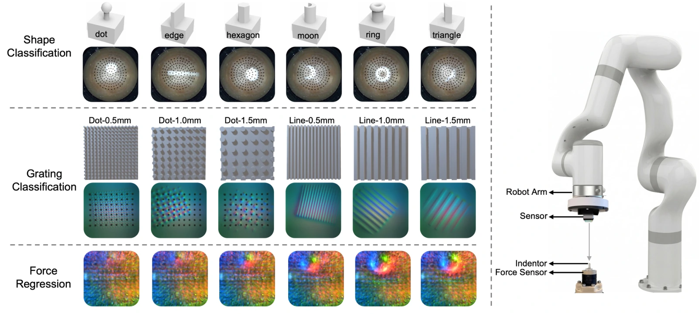

<!-- Generated by scripts/generate.py; edit data/works.json and data/media.json. -->

[← Back to the Awesome index](../../../README.md) · [Interactive website](https://chang-xinhai.github.io/Awesome-RGBDT-Manipulation/?collection=benchmark&item=tacverse#library)

# TacVerse

TacVerse: A Multi-Sensor Dataset and Benchmark for Cross-Sensor Vision-Based Tactile Perception

**2026-06-24 · Advanced Robotics Research 2026 · Imperial College London**

**[Paper](https://arxiv.org/abs/2606.25877)** · [Project](https://lannwei.github.io/Tactile_Database/) · [Code](https://github.com/LannWei/Tactile_Database) · [Data](https://huggingface.co/datasets/Lan-2025/Tactile)

Controlled tactile perception dataset assessing within-sensor learning, zero-shot sensor transfer and few-shot adaptation across seven optical sensor designs.

*TacVerse authors · [Figure source](https://arxiv.org/abs/2606.25877) · Original rights retained.*

| Field | Reported value and source scope |
| :-- | :-- |
| Record type | dataset |
| Simulator | Not applicable — measured tactile image dataset [1](https://arxiv.org/abs/2606.25877) [2](https://lannwei.github.io/Tactile_Database/)  |
| Simulator version and scope | Not applicable [1](https://arxiv.org/abs/2606.25877) [2](https://lannwei.github.io/Tactile_Database/) [3](https://github.com/LannWei/Tactile_Database)  |
| Task count and scope | 3 perception tasks, not closed-loop manipulation tasks [1](https://arxiv.org/abs/2606.25877) [2](https://lannwei.github.io/Tactile_Database/)  |
| Task-list scope | Complete three-task perception benchmark. [1](https://arxiv.org/abs/2606.25877) [2](https://lannwei.github.io/Tactile_Database/)  |
| Capability dimensions | Sensor-shift robustness · Tactile shape/texture recognition · Force estimation · Few-shot adaptation [1](https://arxiv.org/abs/2606.25877) [2](https://lannwei.github.io/Tactile_Database/)  |
| Metrics | Classification accuracy and force-regression error under within-sensor / cross-sensor / few-shot splits. [1](https://arxiv.org/abs/2606.25877) [2](https://lannwei.github.io/Tactile_Database/)  |
| Robots | Sensor data collection rigs; no common robot manipulation embodiment. [1](https://arxiv.org/abs/2606.25877) [2](https://lannwei.github.io/Tactile_Database/)  |
| Sensors and observations | GelSightNoMarker, GelSightMarker, MagicGripper, MagicTac, TacTip, ViTac, ViTacTip. [1](https://arxiv.org/abs/2606.25877) [2](https://lannwei.github.io/Tactile_Database/)  |
| Data collection method | Robot-controlled indenter contacts and orientation sweeps collect tactile images; synchronized six-axis force measurements label force-regression samples. This is perception data, not policy demonstrations. [1](https://arxiv.org/abs/2606.25877) [2](https://lannwei.github.io/Tactile_Database/) [5](https://arxiv.org/abs/2606.25877)  |
| Demonstrations and data | 106,800 tactile images from seven vision-based tactile sensors. [1](https://arxiv.org/abs/2606.25877) [2](https://lannwei.github.io/Tactile_Database/)  |
| Evaluation protocol | Trial/trajectory-disjoint chronological 60/20/20 train/validation/test split after near-duplicate filtering. Exhaustive 7×7 source-target shape transfer; fixed-source grating and force transfer. Few-shot target adaptation is force-regression only: 0.5%, 1%, 2.5%, 5% and 10% of target training samples, with untouched target test set. [1](https://arxiv.org/abs/2606.25877) [2](https://lannwei.github.io/Tactile_Database/) [4](https://advanced.onlinelibrary.wiley.com/doi/10.1002/adrr.70169)  |
| Evaluated baselines | Transfer study: fixed ImageNet-initialized ViT. Representation study: ResNet-18, ViT from scratch, ImageNet ViT and MAE-initialized ViT; up to 30 epochs, batch128; reported server has four H200 GPUs, not a per-run allocation/time claim. [1](https://arxiv.org/abs/2606.25877) [2](https://lannwei.github.io/Tactile_Database/) [4](https://advanced.onlinelibrary.wiley.com/doi/10.1002/adrr.70169)  |
| Observations / modalities | Tactile |
| Evaluation domain | Real world |
| Embodiment | Sensor-level resource |
| Release: code | Available [3](https://github.com/LannWei/Tactile_Database)  |
| Release: weights | Not verified [3](https://github.com/LannWei/Tactile_Database)  |
| Release: data | Available [3](https://github.com/LannWei/Tactile_Database)  |
| Release: license | Not verified [3](https://github.com/LannWei/Tactile_Database)  |
| Release: notes | Project/data public; code and per-dataset terms should be inspected separately. [3](https://github.com/LannWei/Tactile_Database)  |

**Task names — Complete three-task perception benchmark.:**

- 9-way shape classification
- 30-way grating classification
- Force regression

**Scope and qualifications**

- Perception benchmark supports encoder evaluation; does not measure manipulation policy success.
- TacVerse in this entry is the Lan Wei multi-sensor perception resource, not an unrelated commercial data workbench.

**Primary evidence**

1. [Paper](https://arxiv.org/abs/2606.25877) — Published paper / arXiv record and manuscript.
2. [Official project](https://lannwei.github.io/Tactile_Database/) — Public project page.
3. [Official repository](https://github.com/LannWei/Tactile_Database) — Current public repository; implementation scope may differ from paper.
4. [Publisher full text](https://advanced.onlinelibrary.wiley.com/doi/10.1002/adrr.70169) — Advanced Robotics Research, first published 25 September 2026. Section4 gives leakage-controlled chronological split, fixed-source transfer, force-only few-shot protocol and backbone study. Entry date retains arXiv v1.
5. [Data collection method and scope](https://arxiv.org/abs/2606.25877) — Original method/data protocol reviewed for the collection mechanism. Data volume, evaluation rollouts and downstream training remain separate; undisclosed or unresolved interfaces are labeled explicitly.
