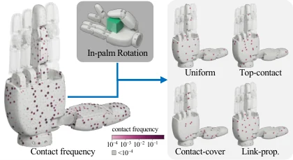

<!-- Generated by scripts/generate.py; edit data/works.json and data/media.json. -->

[← Back to the Awesome index](../../../README.md) · [Interactive website](https://chang-xinhai.github.io/Awesome-RGBDT-Manipulation/?collection=benchmark&item=taxel-placement#library)

# Taxel placement study

Which Taxels, Not How Many: Tactile Sensor Placement for Dexterous Policies

**2026-11-07 · Preprint · NAVER LABS**

**[Paper](https://arxiv.org/abs/2611.10647)**

Controlled simulation compares tactile sensor placements and input layouts for dexterous policies.

*Taxel placement study authors · [Figure source](https://arxiv.org/html/2611.10647) · Original rights retained.*

| Field | Reported value and source scope |
| :-- | :-- |
| Record type | evaluation-tool |
| Simulator | Genesis [1](https://arxiv.org/abs/2611.10647)  |
| Simulator version and scope | Not reported [1](https://arxiv.org/abs/2611.10647)  |
| Task count and scope | Two dexterous task families across three hand models [1](https://arxiv.org/abs/2611.10647)  |
| Task-list scope | Two task families in the paper; evaluated hand-task combinations differ. [1](https://arxiv.org/abs/2611.10647)  |
| Capability dimensions | Tactile sensor placement · Contact-frequency ablation · Dexterous grasping [1](https://arxiv.org/abs/2611.10647)  |
| Metrics | Task success and rotation metrics under matched training [1](https://arxiv.org/abs/2611.10647)  |
| Robots | XHand1, Sharpa and Allegro [1](https://arxiv.org/abs/2611.10647)  |
| Sensors and observations | Simulated candidate contact taxels and proprioception. [1](https://arxiv.org/abs/2611.10647)  |
| Data collection method | A common teacher generates simulation contact statistics; placement and encoder representation are varied under controlled training. [1](https://arxiv.org/abs/2611.10647)  |
| Demonstrations and data | Not verified [1](https://arxiv.org/abs/2611.10647)  |
| Evaluation protocol | Contact-informed placement, uniform placement and representation ablations under held-constant teacher and candidate taxels. [1](https://arxiv.org/abs/2611.10647)  |
| Evaluated baselines | Uniform, top-contact, contact-cover, link-proportional and no-tactile configurations. [1](https://arxiv.org/abs/2611.10647)  |
| Observations / modalities | Tactile · Proprioception |
| Evaluation domain | Simulation |
| Embodiment |  |
| Release: code | Not verified |
| Release: weights | Not verified |
| Release: data | Not verified |
| Release: license | Not verified |
| Release: notes | Source, model weights and data availability are tracked separately. |

**Task names — Two task families in the paper; evaluated hand-task combinations differ.:**

- In-Palm Rotation
- Grasping

**Scope and qualifications**

- Findings concern the paper’s simulated hand-task configurations; no physical sensor array was evaluated.

**Primary evidence**

1. [Author paper and first submission](https://arxiv.org/abs/2611.10647)
