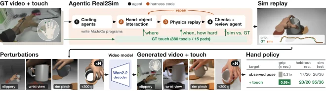

<!-- Generated by scripts/generate.py; edit data/works.json and data/media.json. -->

[← Back to the Awesome index](../../../README.md) · [Interactive website](https://chang-xinhai.github.io/Awesome-RGBDT-Manipulation/?collection=benchmark&item=touchtwin#library)

# TouchTwin

TouchTwin: Scaling Human Touch Data via Real-to-Sim-to-Real

**2026-11-13 · Preprint · Stanford University and collaborators**

**[Paper](https://arxiv.org/abs/2611.17619)** · [Project](https://touchtwin.github.io/)

Rebuilds human RGB-D and glove-touch recordings in MuJoCo, then perturbs tactile replays to generate force-labeled demonstrations.

*TouchTwin authors · [Figure source](https://arxiv.org/html/2611.17619v1) · Original rights retained.*

| Field | Reported value and source scope |
| :-- | :-- |
| Record type | evaluation-tool |
| Simulator | MuJoCo [1](https://arxiv.org/html/2611.17619)  |
| Simulator version and scope | Not reported [1](https://arxiv.org/html/2611.17619)  |
| Task count and scope | Not a fixed manipulation suite [1](https://arxiv.org/html/2611.17619)  |
| Task-list scope | Reported applications of a data generation pipeline. [1](https://arxiv.org/html/2611.17619)  |
| Capability dimensions | Tactile real-to-sim replay and synthetic perturbations [1](https://arxiv.org/html/2611.17619)  |
| Metrics | Grip force ratio, task success and missed contact frames. [1](https://arxiv.org/html/2611.17619)  |
| Robots | Subject-specific simulated hand [1](https://arxiv.org/html/2611.17619)  |
| Sensors and observations | Head and wrist RGB-D and 880-taxel glove in human capture. [1](https://arxiv.org/html/2611.17619)  |
| Data collection method | Selected TouchScale recordings are reconstructed with subject-specific hand and object geometry; recorded touch drives the closing force of simulated fingers. [1](https://arxiv.org/html/2611.17619)  |
| Demonstrations and data | Original selected recordings, physics-labeled replays and generated re-renderings have separate scope. [1](https://arxiv.org/html/2611.17619)  |
| Evaluation protocol | Tested on 20 held-out recordings and 36 unseen perturbations. Real contact frames provide separate validation. [1](https://arxiv.org/html/2611.17619)  |
| Evaluated baselines | Pose imitation and vision-based replay baselines. [1](https://arxiv.org/html/2611.17619)  |
| Observations / modalities | RGB · Depth · Tactile · Proprioception |
| Evaluation domain | Simulation · Real world |
| Embodiment | Subject-specific MuJoCo tactile hand |
| Release: code | Not verified [2](https://touchtwin.github.io/)  |
| Release: weights | Not verified for the evaluated policy, contact predictor or video renderer [2](https://touchtwin.github.io/)  |
| Release: data | Not verified [2](https://touchtwin.github.io/)  |
| Release: license | Not verified [2](https://touchtwin.github.io/)  |
| Release: notes | Paper, replay examples and project videos are public. Separate downloadable TouchTwin artifacts were not verified. [2](https://touchtwin.github.io/)  |

**Task names — Reported applications of a data generation pipeline.:**

- Held-out recording replays
- Perturbed replays
- Real contact-frame prediction

**Scope and qualifications**

- The reported hand-policy outcomes are simulated. Evaluation against real contact frames applies to the contact predictor.
- Generated RGB clips are conditioned on simulated interaction; the perturbation labels are not measurements from physical robot trials.

**Primary evidence**

1. [Primary paper and evaluated setting](https://arxiv.org/html/2611.17619)
2. [Author project and artifact status](https://touchtwin.github.io/)
