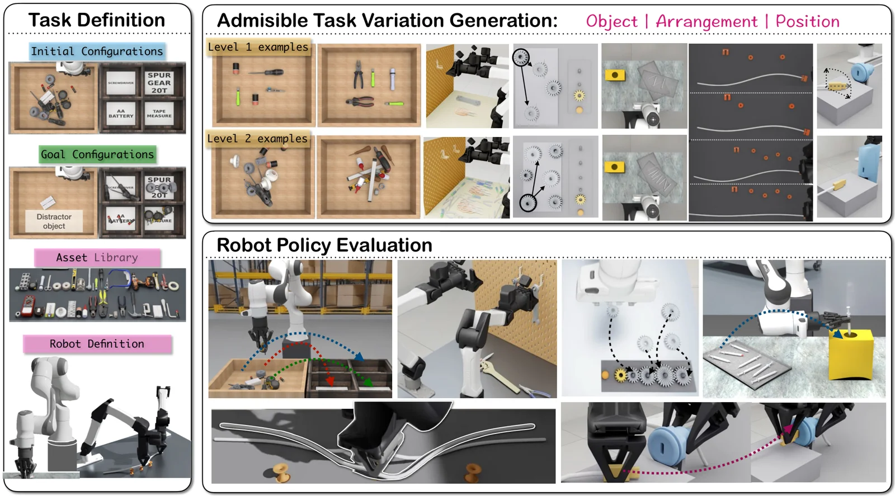

<!-- Generated by scripts/generate.py; edit data/works.json and data/media.json. -->

[← Back to the Awesome index](../../../README.md) · [Interactive website](https://chang-xinhai.github.io/Awesome-RGBDT-Manipulation/?collection=benchmark&item=vabar#library)

# VABAR

VABAR: A Variational Automation Benchmark for Agentic Robotics

**2026-11-04 · Preprint · UC Berkeley**

**[Paper](https://arxiv.org/abs/2611.06881)** · [Project](https://berkeleyautomation.github.io/vabar-website/)

An industrially motivated simulation benchmark evaluates agentic robot programs under structured object, pose and layout variations.

*VABAR authors · [Figure source](https://arxiv.org/abs/2611.06881) · Original rights retained.*

| Field | Reported value and source scope |
| :-- | :-- |
| Record type | benchmark |
| Simulator | Newton physics engine [1](https://arxiv.org/abs/2611.06881)  |
| Simulator version and scope | Not verified [1](https://arxiv.org/abs/2611.06881)  |
| Task count and scope | 6 task classes [1](https://arxiv.org/abs/2611.06881)  |
| Task-list scope | The six task classes described by the authors; variation instances are separate. [1](https://arxiv.org/abs/2611.06881)  |
| Capability dimensions | Structured task variation, physical realizability and programmatic skills. [1](https://arxiv.org/abs/2611.06881)  |
| Metrics | Task completion and execution outcomes. [1](https://arxiv.org/abs/2611.06881)  |
| Robots | Manipulation arms described in original benchmark. [1](https://arxiv.org/abs/2611.06881)  |
| Sensors and observations | Visual observations and robot state; exact interface varies by harness. [1](https://arxiv.org/abs/2611.06881)  |
| Data collection method | Author-specified simulation scenes, task instances and human-authored programmatic reference solutions. [1](https://arxiv.org/abs/2611.06881)  |
| Demonstrations and data | 33 described reusable skills and reference solutions; current public download not verified. [1](https://arxiv.org/abs/2611.06881)  |
| Evaluation protocol | Tiered object, arrangement and position variations; benchmark baseline in simulation. [1](https://arxiv.org/abs/2611.06881)  |
| Evaluated baselines | Graph-as-Policy and Isaac Lab Arena. [1](https://arxiv.org/abs/2611.06881)  |
| Observations / modalities | RGB · Proprioception · Language |
| Evaluation domain | Simulation |
| Embodiment | Not reported |
| Release: code | Not verified — linked VABAR repository unavailable at review |
| Release: weights | Not verified |
| Release: data | Not verified |
| Release: license | Not verified |
| Release: notes | The linked official GitHub repository returned 404; do not infer public implementation from the paper. |

**Task names — The six task classes described by the authors; variation instances are separate.:**

- Tool sorting
- Tool hanging
- Gear meshing
- Syringe packing
- Cable insertion
- Cable routing

**Scope and qualifications**

- Six task classes and their variations are simulated; these do not demonstrate physical deployment.

**Primary evidence**

1. [Author paper or official project: methods and evaluation scope](https://arxiv.org/abs/2611.06881)
