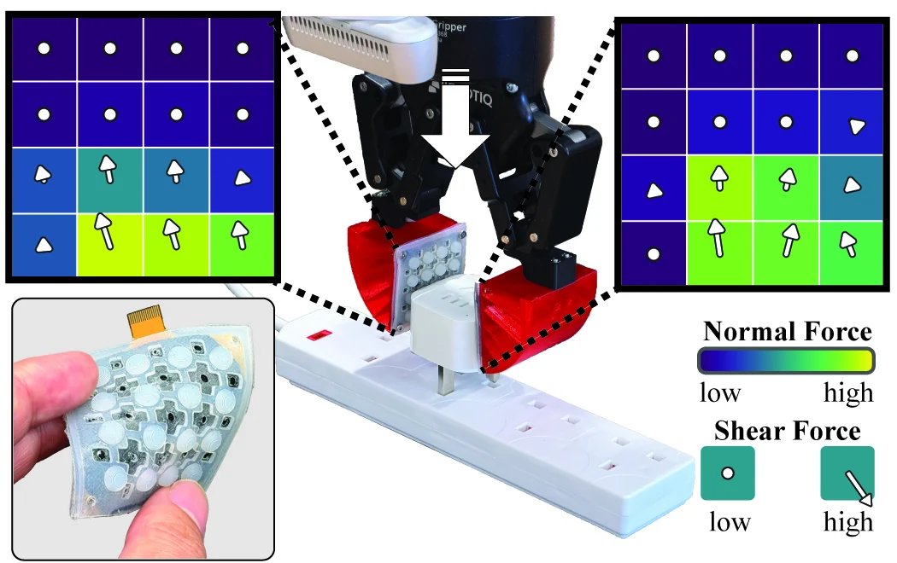

<!-- Generated by scripts/generate.py; edit data/works.json and data/media.json. -->

[← Back to the Awesome index](../../../README.md) · [Interactive website](https://chang-xinhai.github.io/Awesome-RGBDT-Manipulation/?collection=benchmark&item=vectile#library)

# VecTile

VecTile: A Low-Cost Flexible Tactile Array for 3-DoF Force Sensing

**2026-10-22 · Preprint · Imperial College London**

**[Paper](https://arxiv.org/abs/2610.31472)**

A low-cost flexible three-axis tactile array measures normal and shear contact through a modular force-sensitive construction.

*VecTile authors · [Figure source](https://arxiv.org/abs/2610.31472) · Original rights retained.*

| Field | Reported value and source scope |
| :-- | :-- |
| Record type | evaluation-tool |
| Simulator | Not applicable [1](https://arxiv.org/abs/2610.31472)  |
| Simulator version and scope | Not applicable [1](https://arxiv.org/abs/2610.31472)  |
| Task count and scope | Not a closed-loop benchmark [1](https://arxiv.org/abs/2610.31472)  |
| Task-list scope | Sensor/tool characterization and downstream demonstrations, not a standard policy task suite. [1](https://arxiv.org/abs/2610.31472)  |
| Capability dimensions | Contact sensing · Force estimation [1](https://arxiv.org/abs/2610.31472)  |
| Metrics | Sensor calibration, force/response accuracy and scoped downstream demonstrations. [1](https://arxiv.org/abs/2610.31472)  |
| Robots | Fin-Ray-type fingers in plug-insertion demonstrations. [1](https://arxiv.org/abs/2610.31472)  |
| Sensors and observations | Flexible arrays measure normal/shear contact response. [1](https://arxiv.org/abs/2610.31472)  |
| Data collection method | Sensor calibration and physical contact trials; downstream policy demonstrations are described separately. [1](https://arxiv.org/abs/2610.31472)  |
| Demonstrations and data | Not verified — no complete sensor-characterization or policy-training corpus established. [1](https://arxiv.org/abs/2610.31472)  |
| Evaluation protocol | Hardware characterization and scoped robot demonstrations; not a common cross-policy leaderboard. [1](https://arxiv.org/abs/2610.31472)  |
| Evaluated baselines | Sensor/component comparisons, not a roster of standardized robot policies. [1](https://arxiv.org/abs/2610.31472)  |
| Observations / modalities | Tactile |
| Evaluation domain | Real world |
| Embodiment |  |
| Release: code | Not released |
| Release: weights | Not applicable |
| Release: data | Not verified |
| Release: license | Not verified |
| Release: notes | Paper promises designs/code upon acceptance; no actual released hardware files, implementation or calibration corpus is verified. |

**Task names — Sensor/tool characterization and downstream demonstrations, not a standard policy task suite.:**

Task names not reported or not verified in the cited sources.

**Scope and qualifications**

- Submitted to ICRA2027 is not accepted.
- A sensor demonstration is not a new executable policy or standardized manipulation benchmark.

**Primary evidence**

1. [Primary manuscript and first-submission history](https://arxiv.org/abs/2610.31472) — Current primary manuscript reviewed; first-public date uses arXiv v1. Observations, training privileges and deployed interfaces retain their separate scopes.
