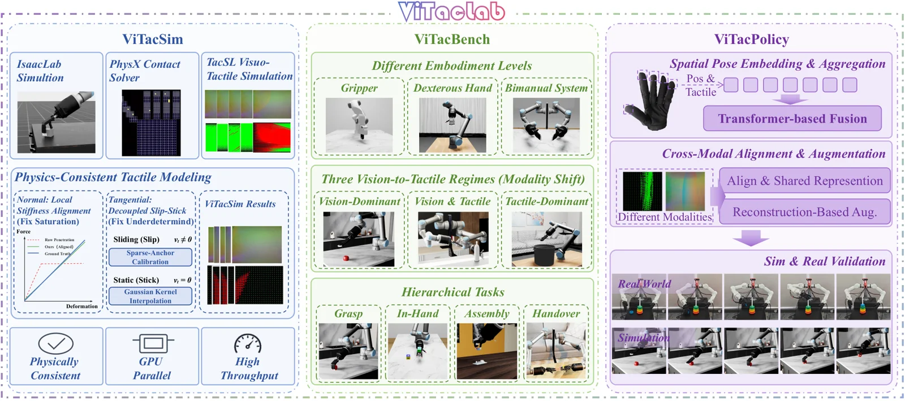

<!-- Generated by scripts/generate.py; edit data/works.json and data/media.json. -->

[← Back to the Awesome index](../../../README.md) · [Interactive website](https://chang-xinhai.github.io/Awesome-RGBDT-Manipulation/?collection=benchmark&item=vitaclab#library)

# ViTacLab

ViTacLab: Physically Consistent Visuo-Tactile Simulation, Benchmarking, and Representation Learning for Robotic Manipulation

**Undated · Not reported · Not reported**

**[Project](https://youlj109.github.io/ViTacLab/)** · [Code](https://github.com/youlj109/ViTacLab) · [Data](https://huggingface.co/datasets/Yanlj/ViTacLab-assets)

An Isaac Lab extension provides tactile simulation and environment code for visuotactile manipulation research.

*ViTacLab authors · [Figure source](https://youlj109.github.io/ViTacLab/) · Original rights retained.*

| Field | Reported value and source scope |
| :-- | :-- |
| Record type | simulator |
| Simulator | Isaac Lab / PhysX [1](https://youlj109.github.io/ViTacLab/)  |
| Simulator version and scope | Not verified [1](https://youlj109.github.io/ViTacLab/)  |
| Task count and scope | 15 tasks described in project [1](https://youlj109.github.io/ViTacLab/)  |
| Task-list scope | Fifteen is the stated design scope, not a verified count of runnable registered environments. [1](https://youlj109.github.io/ViTacLab/)  |
| Capability dimensions | Sparse contact force, dense tactile arrays and tactile-image simulation. [1](https://youlj109.github.io/ViTacLab/)  |
| Metrics | Project reports contact validation; check setting and checkpoints per task. [1](https://youlj109.github.io/ViTacLab/)  |
| Robots | Parallel grippers, dexterous hands and bimanual systems in the design. [1](https://youlj109.github.io/ViTacLab/)  |
| Sensors and observations | Simulated RGB, contact forces and tactile images. [1](https://youlj109.github.io/ViTacLab/)  |
| Data collection method | Contact data generated by simulation, anchored to PhysX solver interactions. [1](https://youlj109.github.io/ViTacLab/)  |
| Demonstrations and data | Some runtime assets distributed separately; most paper-scale tasks require additional assets. [1](https://youlj109.github.io/ViTacLab/)  |
| Evaluation protocol | Run installed environment listing and task-specific validation; no complete end-to-end reproduction packaged. [1](https://youlj109.github.io/ViTacLab/)  |
| Evaluated baselines | TacSL simulation comparison in author documentation. [1](https://youlj109.github.io/ViTacLab/)  |
| Observations / modalities | RGB · Tactile · Proprioception |
| Evaluation domain | Simulation |
| Embodiment | Not reported |
| Release: code | Partial — simulator and task configurations plus selected policy code [2](https://github.com/youlj109/ViTacLab)  |
| Release: weights | Not released — pretraining code and checkpoints absent [2](https://github.com/youlj109/ViTacLab)  |
| Release: data | Partial — external asset bundle; task-dependent assets still needed [2](https://github.com/youlj109/ViTacLab)  |
| Release: license | Apache-2.0 for repository; assets and dependencies separate [2](https://github.com/youlj109/ViTacLab)  |
| Release: notes | Author calls public release an advisor/calibration snapshot; full paper reproduction is not packaged. [2](https://github.com/youlj109/ViTacLab)  |

**Task names — Fifteen is the stated design scope, not a verified count of runnable registered environments.:**

Task names not reported or not verified in the cited sources.

**Scope and qualifications**

- No public paper or citation metadata at review; date is intentionally undated.
- Fifteen tasks describe the project design; registration and runtime support must be checked in the installed checkout.

**Primary evidence**

1. [Author paper or official project: methods and evaluation scope](https://youlj109.github.io/ViTacLab/)
2. [Official repository: release inventory and scope](https://github.com/youlj109/ViTacLab) — Release availability, assets and third-party licenses are independently scoped; no end-to-end reproduction is implied.
