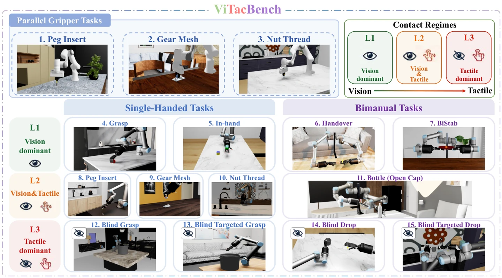

<!-- Generated by scripts/generate.py; edit data/works.json and data/media.json. -->

[← Back to the Awesome index](../../../README.md) · [Interactive website](https://chang-xinhai.github.io/Awesome-RGBDT-Manipulation/?collection=benchmark&item=vitaclab#library)

# ViTacBench

ViTacLab: Physically Consistent Visuo-Tactile Simulation, Benchmarking, and Representation Learning for Robotic Manipulation

**2026-11-24 · Preprint · University of Hong Kong; Ant Group and collaborators**

**[Paper](https://arxiv.org/abs/2611.32476)** · [Project](https://youlj109.github.io/ViTacLab/) · [Code](https://github.com/youlj109/ViTacLab) · [Data](https://huggingface.co/datasets/Yanlj/ViTacLab-assets)

Fifteen manipulation tasks span three embodiments and three tiers of reliance on touch.

*Linjing You and coauthors · [Figure source](https://arxiv.org/html/2611.32476v1) · Original rights retained.*

| Field | Reported value and source scope |
| :-- | :-- |
| Record type | policy |
| Simulator | Isaac Sim / Isaac Lab [1](https://arxiv.org/html/2611.32476v1)  |
| Simulator version and scope | Not reported [1](https://arxiv.org/html/2611.32476v1)  |
| Task count and scope | 15 tasks [1](https://arxiv.org/html/2611.32476v1)  |
| Task-list scope | Representative tasks from Figure 3; benchmark covers 15 total. [1](https://arxiv.org/html/2611.32476v1)  |
| Capability dimensions | Vision-dominant, cooperative vision and touch, and tactile-dominant control with varying embodiments. [1](https://arxiv.org/html/2611.32476v1)  |
| Metrics | Task success by sensing regime; separate calibrated normal and tangential tactile-force error. [1](https://arxiv.org/html/2611.32476v1)  |
| Robots | Parallel-jaw gripper, one dexterous hand or two dexterous hands [1](https://arxiv.org/html/2611.32476v1)  |
| Sensors and observations | Wrist and scene RGB, proprioception, virtual force-array and touch-image observations. [1](https://arxiv.org/html/2611.32476v1)  |
| Data collection method | Simulated trajectories derive from the benchmark collection pipeline; real measurements calibrate contact simulation. [1](https://arxiv.org/html/2611.32476v1)  |
| Demonstrations and data | Tasks and configs in GitHub; external robot, object and calibration assets can be required. [1](https://arxiv.org/html/2611.32476v1)  |
| Evaluation protocol | Separate baselines per sensing regime; simulator validation does not count as policy deployment. [1](https://arxiv.org/html/2611.32476v1)  |
| Evaluated baselines | Diffusion policies with different tactile fusion and feature variants. [1](https://arxiv.org/html/2611.32476v1)  |
| Observations / modalities | RGB · Tactile · Proprioception |
| Evaluation domain | Simulation |
| Embodiment | Parallel-jaw gripper · Dexterous hand · Bimanual |
| Release: code | Available — simulator and environment/task source [3](https://github.com/youlj109/ViTacLab#readme)  |
| Release: weights | Not applicable [3](https://github.com/youlj109/ViTacLab#readme)  |
| Release: data | Partial — some paper-scale assets are external [3](https://github.com/youlj109/ViTacLab#readme) [4](https://huggingface.co/datasets/Yanlj/ViTacLab-assets)  |
| Release: license | Apache-2.0 source; asset licenses vary. [3](https://github.com/youlj109/ViTacLab#readme)  |
| Release: notes | Public paper verified. Code, task weights and data are tracked separately. [3](https://github.com/youlj109/ViTacLab#readme)  |

**Task names — Representative tasks from Figure 3; benchmark covers 15 total.:**

- Peg insertion
- Gear mesh
- Plug insertion
- Handover
- Blind grasp
- Blind targeted drop

**Scope and qualifications**

- Real-sensor touching and sliding experiments validate simulation. Policy results in ViTacBench are simulated.

**Primary evidence**

1. [Original author paper with methods, evaluation and scope](https://arxiv.org/html/2611.32476v1)
2. [Public author project with method and evaluation examples](https://youlj109.github.io/ViTacLab/)
3. [Public checkout and release table](https://github.com/youlj109/ViTacLab#readme)
4. [External asset bundle](https://huggingface.co/datasets/Yanlj/ViTacLab-assets)
