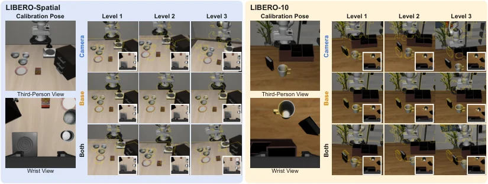

<!-- Generated by scripts/generate.py; edit data/works.json and data/media.json. -->

[← Back to the Awesome index](../../../README.md) · [Interactive website](https://chang-xinhai.github.io/Awesome-RGBDT-Manipulation/?collection=benchmark&item=waco#library)

# LIBERO-PoseShift

Towards Pose-Robust Few-Shot Vision-Language-Action Models

**2026-11-18 · Preprint · Shandong University and Shenzhen Loop Area Institute**

**[Paper](https://arxiv.org/abs/2611.24360)** · [Project](https://peacelwh.github.io/WACO/) · [Code](https://github.com/peacelwh/WACO) · [Data](https://huggingface.co/datasets/Bluexxx/LIBERO-PoseShift) · [Weights](https://huggingface.co/Bluexxx/WACO-pi05-LIBERO)

Canonicalizes camera/base shifts before passing observations to the manipulation VLA. LIBERO-PoseShift applies controlled shifts to test robustness.

*Wenhao Li and coauthors · [Figure source](https://arxiv.org/html/2611.24360v1) · Original rights retained.*

| Field | Reported value and source scope |
| :-- | :-- |
| Record type | policy |
| Simulator | MuJoCo via robosuite and LeRobot [1](https://arxiv.org/html/2611.24360v1)  |
| Simulator version and scope | MuJoCo via robosuite; released LeRobot plugin targets LeRobot 0.6.1. [1](https://arxiv.org/html/2611.24360v1)  |
| Task count and scope | Three perturbation tracks. The 1,599-task LIBERO-Plus camera track is a separately reported scope. [1](https://arxiv.org/html/2611.24360v1)  |
| Task-list scope | Perturbation families for LIBERO-PoseShift; variation severities and task selections are scoped per paper. [1](https://arxiv.org/html/2611.24360v1)  |
| Capability dimensions | Training and evaluation data [1](https://arxiv.org/html/2611.24360v1)  |
| Metrics | Episode success per perturbation type and severity; separate pose estimation error. [1](https://arxiv.org/html/2611.24360v1)  |
| Robots | UR5e real evaluation; LIBERO simulation [1](https://arxiv.org/html/2611.24360v1)  |
| Sensors and observations | Rendered RGB/depth in simulation, calibrated physical RGB-D for the tabletop hardware arm. [1](https://arxiv.org/html/2611.24360v1)  |
| Data collection method | Perturbations are scripted at reset. Clean demonstrations and released depth estimates have separately described provenance. [1](https://arxiv.org/html/2611.24360v1)  |
| Demonstrations and data | Benchmark plugin, calibration bundles, and optional training-depth artifact on the author card. [1](https://arxiv.org/html/2611.24360v1) [4](https://huggingface.co/datasets/Bluexxx/LIBERO-PoseShift)  |
| Evaluation protocol | Compare unmodified or fine-tuned VLAs under fixed camera and base perturbation severities. [1](https://arxiv.org/html/2611.24360v1)  |
| Evaluated baselines | π0.5 standard few-shot fine-tuning and ablations of the alignment and correction components. [1](https://arxiv.org/html/2611.24360v1)  |
| Observations / modalities | RGB · Depth · Proprioception · Language |
| Evaluation domain | Simulation · Real world |
| Embodiment | UR5e |
| Release: code | Available — simulator perturbation plugin and benchmark scripts. [2](https://peacelwh.github.io/WACO/) [3](https://github.com/peacelwh/WACO)  |
| Release: weights | Not applicable to the benchmark. [2](https://peacelwh.github.io/WACO/) [5](https://huggingface.co/Bluexxx/WACO-pi05-LIBERO)  |
| Release: data | Available — LIBERO-PoseShift calibration and training-depth assets. [2](https://peacelwh.github.io/WACO/) [4](https://huggingface.co/datasets/Bluexxx/LIBERO-PoseShift)  |
| Release: license | Apache-2.0 source and assets; derived training data preserve upstream terms. [2](https://peacelwh.github.io/WACO/) [4](https://huggingface.co/datasets/Bluexxx/LIBERO-PoseShift) [5](https://huggingface.co/Bluexxx/WACO-pi05-LIBERO)  |
| Release: notes | Recorded simulated perturbation and separately tested real pose-shift protocols have independent scope. [2](https://peacelwh.github.io/WACO/)  |

**Task names — Perturbation families for LIBERO-PoseShift; variation severities and task selections are scoped per paper.:**

- Camera shift
- Base shift
- Joint camera/base shift

**Scope and qualifications**

- Provided depth targets for one training configuration come from DA-V2 and must not be described as sensor measurements.
- LIBERO-Plus camera-track results are narrower than BASE/MIXED protocols.

**Primary evidence**

1. [Original author paper or dataset description](https://arxiv.org/html/2611.24360v1)
2. [Author source and artifact entry points](https://peacelwh.github.io/WACO/)
3. [Official runtime and licensed implementation](https://github.com/peacelwh/WACO)
4. [Published dataset guide and depth provenance](https://huggingface.co/datasets/Bluexxx/LIBERO-PoseShift)
5. [Public checkpoint and scoped license](https://huggingface.co/Bluexxx/WACO-pi05-LIBERO)
