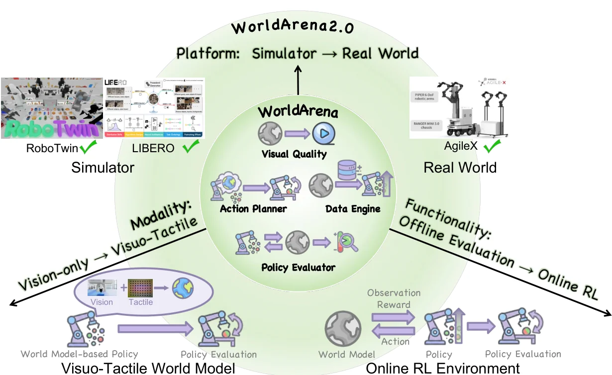

<!-- Generated by scripts/generate.py; edit data/works.json and data/media.json. -->

[← Back to the Awesome index](../../../README.md) · [Interactive website](https://chang-xinhai.github.io/Awesome-RGBDT-Manipulation/?collection=benchmark&item=worldarena-2#library)

# WorldArena 2.0

WorldArena 2.0: Extending Embodied World Model Benchmarking on Modality, Functionality and Platform

**2026-05-18 · Preprint · Tsinghua University**

**[Paper](https://arxiv.org/abs/2605.17912)** · [Project](https://world-arena.ai/) · [Code](https://github.com/WorldArena2/WorldArena-2.0) · [Data](https://huggingface.co/datasets/WorldArena/WorldArena2.0)

A benchmark assesses visual-tactile world models, their use as online RL environments and cross-platform manipulation utility.

*WorldArena 2.0 authors · [Figure source](https://arxiv.org/abs/2605.17912) · Original rights retained.*

| Field | Reported value and source scope |
| :-- | :-- |
| Record type | benchmark |
| Simulator | RoboTwin 2.0, LIBERO and UniVTAC [1](https://arxiv.org/abs/2605.17912)  |
| Simulator version and scope | Not verified [1](https://arxiv.org/abs/2605.17912)  |
| Task count and scope | Multiple track-specific tasks [1](https://arxiv.org/abs/2605.17912)  |
| Task-list scope | Task counts and models vary by evaluation track; no combined task count inferred. [1](https://arxiv.org/abs/2605.17912)  |
| Capability dimensions | Visuotactile prediction, online RL utility and sim-to-real world-model evaluation. [1](https://arxiv.org/abs/2605.17912)  |
| Metrics | Prediction quality, task success and model-specific evaluation metrics. [1](https://arxiv.org/abs/2605.17912)  |
| Robots | Simulated manipulators; physical AgileX split-type ALOHA separately. [1](https://arxiv.org/abs/2605.17912)  |
| Sensors and observations | RGB and tactile observations in the tactile track; other tracks vary. [1](https://arxiv.org/abs/2605.17912)  |
| Data collection method | Simulation and real-world observations assembled for track-specific world-model evaluation. [1](https://arxiv.org/abs/2605.17912)  |
| Demonstrations and data | Official project links dataset and challenge materials; validate access per track. [1](https://arxiv.org/abs/2605.17912)  |
| Evaluation protocol | Compare tactile, online RL and real-world tracks under their individual protocols. [1](https://arxiv.org/abs/2605.17912)  |
| Evaluated baselines | Visuotactile world models and video world model baselines. [1](https://arxiv.org/abs/2605.17912)  |
| Observations / modalities | RGB · Tactile · Proprioception |
| Evaluation domain | Simulation · Real world |
| Embodiment | Not reported |
| Release: code | Partial — evaluation pipelines and third-party components in official repository [2](https://github.com/WorldArena2/WorldArena-2.0)  |
| Release: weights | Not verified [2](https://github.com/WorldArena2/WorldArena-2.0)  |
| Release: data | Dataset link listed by official site; availability should be checked per artifact [2](https://github.com/WorldArena2/WorldArena-2.0)  |
| Release: license | MIT root repository; vendored models, assets and code have separate licenses [2](https://github.com/WorldArena2/WorldArena-2.0)  |
| Release: notes | Repository contains multiple evaluation pipelines and vendored code; completeness varies by track. [2](https://github.com/WorldArena2/WorldArena-2.0)  |

**Task names — Task counts and models vary by evaluation track; no combined task count inferred.:**

Task names not reported or not verified in the cited sources.

**Scope and qualifications**

- This is an evaluation benchmark for world models, not itself an action policy.
- Vision-only, visuotactile, simulated and real-robot tracks have different protocols and must not be pooled.

**Primary evidence**

1. [Author paper or official project: methods and evaluation scope](https://arxiv.org/abs/2605.17912)
2. [Official repository: release inventory and scope](https://github.com/WorldArena2/WorldArena-2.0) — Release availability, assets and third-party licenses are independently scoped; no end-to-end reproduction is implied.
