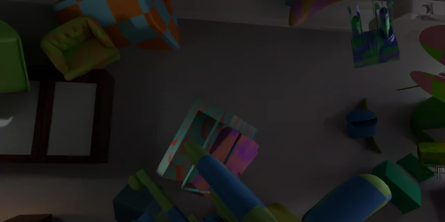

<!-- Generated by scripts/generate.py; edit data/works.json and data/media.json. -->

[← Back to the Awesome index](../../../README.md) · [Interactive website](https://chang-xinhai.github.io/Awesome-RGBDT-Manipulation/?collection=benchmark&item=xrstereo-stereosplat#library)

# XRStereo

XRStereo: Synthetic Stereo Video Training Data for StereoSplat

**2026-09-29 · NeurIPS 2026 · Meta and University of Amsterdam**

**[Paper](https://arxiv.org/abs/2610.35902)** · [Project](https://vladimiryugay.github.io/stereosplat/) · [Code](https://github.com/facebookresearch/stereo-splat) · [Data](https://huggingface.co/datasets/facebook/xrstereo)

Synthetic, rectified RGB video pairs with disparity for each eye, camera intrinsics, baseline and pose for varied virtual head-mounted rigs.

*StereoSplat authors · [Figure source](https://arxiv.org/html/2610.35902v1) · Original rights retained.*

| Field | Reported value and source scope |
| :-- | :-- |
| Record type | dataset |
| Simulator | Blender camera coordinate convention for the release. [1](https://arxiv.org/html/2610.35902v1) [3](https://huggingface.co/datasets/facebook/xrstereo/raw/main/README.md)  |
| Simulator version and scope | Not reported [1](https://arxiv.org/html/2610.35902v1) [3](https://huggingface.co/datasets/facebook/xrstereo/raw/main/README.md)  |
| Task count and scope | Supporting dataset or perception evaluation [1](https://arxiv.org/html/2610.35902v1) [3](https://huggingface.co/datasets/facebook/xrstereo/raw/main/README.md)  |
| Task-list scope | Listed uses of the resource, with no closed-loop robot task count. [1](https://arxiv.org/html/2610.35902v1) [3](https://huggingface.co/datasets/facebook/xrstereo/raw/main/README.md)  |
| Capability dimensions | Training and evaluation data [1](https://arxiv.org/html/2610.35902v1) [3](https://huggingface.co/datasets/facebook/xrstereo/raw/main/README.md)  |
| Metrics | Not applicable [1](https://arxiv.org/html/2610.35902v1) [3](https://huggingface.co/datasets/facebook/xrstereo/raw/main/README.md)  |
| Robots | Not applicable [1](https://arxiv.org/html/2610.35902v1) [3](https://huggingface.co/datasets/facebook/xrstereo/raw/main/README.md)  |
| Sensors and observations | Rectified RGB pairs; dense disparity and calibration for both views. [1](https://arxiv.org/html/2610.35902v1) [3](https://huggingface.co/datasets/facebook/xrstereo/raw/main/README.md)  |
| Data collection method | Synthetic camera trajectories through static scenes. The rig varies horizontal field of view and baseline. [1](https://arxiv.org/html/2610.35902v1) [3](https://huggingface.co/datasets/facebook/xrstereo/raw/main/README.md)  |
| Demonstrations and data | 17,922 sequences × 5 stereo frames at 1024 × 1024; official card lists 372.8 GB in 72 shards. [1](https://arxiv.org/html/2610.35902v1) [3](https://huggingface.co/datasets/facebook/xrstereo/raw/main/README.md)  |
| Evaluation protocol | Training split for metric-scale novel-view synthesis; poses, intrinsics and baseline permit reuse for stereo geometry research. [1](https://arxiv.org/html/2610.35902v1) [3](https://huggingface.co/datasets/facebook/xrstereo/raw/main/README.md)  |
| Evaluated baselines | Not applicable [1](https://arxiv.org/html/2610.35902v1) [3](https://huggingface.co/datasets/facebook/xrstereo/raw/main/README.md)  |
| Observations / modalities | RGB |
| Evaluation domain | Simulation |
| Embodiment |  |
| Release: code | StereoSplat implementation linked [2](https://vladimiryugay.github.io/stereosplat/) [3](https://huggingface.co/datasets/facebook/xrstereo/raw/main/README.md) [4](https://huggingface.co/datasets/facebook/xrstereo/blob/main/manifest.json)  |
| Release: weights | See model repository for its separately scoped releases. [2](https://vladimiryugay.github.io/stereosplat/) [3](https://huggingface.co/datasets/facebook/xrstereo/raw/main/README.md) [4](https://huggingface.co/datasets/facebook/xrstereo/blob/main/manifest.json)  |
| Release: data | Available — 72 public tar shards and checksum manifest [2](https://vladimiryugay.github.io/stereosplat/) [3](https://huggingface.co/datasets/facebook/xrstereo/raw/main/README.md) [4](https://huggingface.co/datasets/facebook/xrstereo/blob/main/manifest.json)  |
| Release: license | CC BY-NC 4.0 for the data. [2](https://vladimiryugay.github.io/stereosplat/) [3](https://huggingface.co/datasets/facebook/xrstereo/raw/main/README.md) [4](https://huggingface.co/datasets/facebook/xrstereo/blob/main/manifest.json)  |
| Release: notes | This is the StereoSplat training split. [2](https://vladimiryugay.github.io/stereosplat/) [3](https://huggingface.co/datasets/facebook/xrstereo/raw/main/README.md) [4](https://huggingface.co/datasets/facebook/xrstereo/blob/main/manifest.json)  |

**Task names — Listed uses of the resource, with no closed-loop robot task count.:**

- Static-scene stereo geometry
- Stereo novel-view synthesis

**Scope and qualifications**

- Disparity through glass refers to surfaces behind the transparent layer per the data card. Moving cameras observe static scenes.

**Primary evidence**

1. [Original author paper or dataset description](https://arxiv.org/html/2610.35902v1)
2. [Author source and artifact entry points](https://vladimiryugay.github.io/stereosplat/)
3. [Author data card and NPZ schema](https://huggingface.co/datasets/facebook/xrstereo/raw/main/README.md)
4. [Release SHA-256 shard manifest](https://huggingface.co/datasets/facebook/xrstereo/blob/main/manifest.json)
