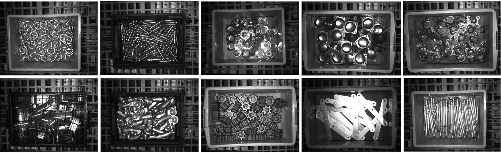

<!-- Generated by scripts/generate.py; edit data/works.json and data/media.json. -->

[← Back to the Awesome index](../../../README.md) · [Interactive website](https://chang-xinhai.github.io/Awesome-RGBDT-Manipulation/?collection=benchmark&item=xyz-ibd#library)

# XYZ-IBD

XYZ-IBD: Benchmarking Robust 6D Object Pose Estimation under Real-World Industrial Complexity

**2025-05-31 · ECCV 2026 · Technical University of Munich and collaborators**

**[Paper](https://arxiv.org/abs/2506.00599)** · [Project](https://xyz-ibd.github.io/) · [Code](https://github.com/demianhj/XYZ-IBD) · [Data](https://huggingface.co/datasets/bop-benchmark/xyzibd) · [Nbs Stereo Supplement](https://intrinsic-experimental.github.io/nbs-website/static/data/NBS_No_Bias_Stereo_Supplementary_Material.zip)

Multi-view industrial bin-picking dataset with reflective parts, calibrated cameras and geometric reference scans.

*XYZ-IBD authors · [Figure source](https://xyz-ibd.github.io/) · Original rights retained.*

| Field | Reported value and source scope |
| :-- | :-- |
| Record type | dataset |
| Simulator | Not applicable [1](https://arxiv.org/html/2506.00599v1)  |
| Simulator version and scope | Not applicable [1](https://arxiv.org/html/2506.00599v1)  |
| Task count and scope | Supporting dataset or perception evaluation [1](https://arxiv.org/html/2506.00599v1)  |
| Task-list scope | Listed uses of the resource, with no closed-loop robot task count. [1](https://arxiv.org/html/2506.00599v1)  |
| Capability dimensions | Training and evaluation data [1](https://arxiv.org/html/2506.00599v1)  |
| Metrics | BOP pose/AP and task-specific depth/disparity errors. [1](https://arxiv.org/html/2506.00599v1)  |
| Robots | FANUC arm for acquisition. [1](https://arxiv.org/html/2506.00599v1)  |
| Sensors and observations | Per-view color/grayscale/depth; structured-light and laser reference systems and a RealSense D415. [1](https://arxiv.org/html/2506.00599v1)  |
| Data collection method | Arm-mounted sensors capture calibrated industrial parts with material treatment and multi-view fusion. A BlenderProc set provides synthetic training. [1](https://arxiv.org/html/2506.00599v1)  |
| Demonstrations and data | 75 physical multi-view scenes, 15 reflective parts and 50K+ synthetic training images per author site. [1](https://arxiv.org/html/2506.00599v1)  |
| Evaluation protocol | Original BOP-Industrial/pose and TRICKY depth evaluation; NBS selects and rectifies two views and fuses reference scans for a separate 55-pair protocol. [1](https://arxiv.org/html/2506.00599v1) [4](https://arxiv.org/html/2608.28933v1#S4.SS1.SSS2)  |
| Evaluated baselines | Not applicable [1](https://arxiv.org/html/2506.00599v1)  |
| Observations / modalities | RGB · Depth |
| Evaluation domain | Simulation · Real world |
| Embodiment |  |
| Release: code | Available — official BlenderProc recipe [2](https://xyz-ibd.github.io/) [3](https://huggingface.co/datasets/bop-benchmark/xyzibd)  |
| Release: weights | Not verified [2](https://xyz-ibd.github.io/) [3](https://huggingface.co/datasets/bop-benchmark/xyzibd)  |
| Release: data | Available — BOP original distributions; separate NBS stereo adaptation [2](https://xyz-ibd.github.io/) [3](https://huggingface.co/datasets/bop-benchmark/xyzibd)  |
| Release: license | CC BY-NC-SA 4.0 for the BOP dataset. [2](https://xyz-ibd.github.io/) [3](https://huggingface.co/datasets/bop-benchmark/xyzibd)  |
| Release: notes | Original physical and synthetic releases and NBS’s 55-pair derivative are independent payloads. [2](https://xyz-ibd.github.io/) [3](https://huggingface.co/datasets/bop-benchmark/xyzibd)  |

**Task names — Listed uses of the resource, with no closed-loop robot task count.:**

- Industrial 6D pose
- Industrial depth estimation
- NBS stereo disparity

**Scope and qualifications**

- The BOP original files are not the 55-pair rectified NBS derivative.

**Primary evidence**

1. [Original author paper or dataset description](https://arxiv.org/html/2506.00599v1)
2. [Author source and artifact entry points](https://xyz-ibd.github.io/)
3. [BOP-hosted downloadable files and data license](https://huggingface.co/datasets/bop-benchmark/xyzibd)
4. [NBS §4.1.2, derived stereo test scope](https://arxiv.org/html/2608.28933v1#S4.SS1.SSS2)
