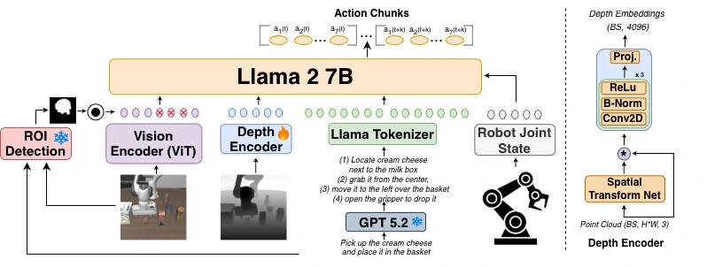

<!-- Generated by scripts/generate.py; edit data/works.json and data/media.json. -->

[← Back to the Awesome index](../../../README.md) · [Interactive website](https://chang-xinhai.github.io/Awesome-RGBDT-Manipulation/?collection=policy&item=3d-cavla#library)

# 3D-CAVLA

3D CAVLA: Leveraging Depth and 3D Context to Generalize Vision Language Action Models for Unseen Tasks

**2025-05-09 · 3D LLM/VLA Workshop at CVPR 2025 · New York University**

**[Paper](https://arxiv.org/abs/2505.05800)** · [Project](https://3d-cavla.github.io/) · [Code](https://github.com/vineet2104/3dcavla) · [Data](https://huggingface.co/datasets/bhatvineet/modified_libero_rlds_cotdep)

Depth encoding, task-oriented ROI pooling and prompted decomposition add 3D context to an OpenVLA-derived policy.

*3D-CAVLA authors · [Figure source](https://arxiv.org/html/2505.05800) · Original rights retained.*

| Field | Reported value and source scope |
| :-- | :-- |
| Record type | policy |
| Policy family | VLA [1](https://arxiv.org/abs/2505.05800)  |
| Base model and architecture | OpenVLA/OFT backbone, compact point-cloud encoder and offline reasoning/ROI modules. [1](https://arxiv.org/abs/2505.05800)  |
| Model size and component | ~1M-parameter depth encoder; VLA backbone counted separately [1](https://arxiv.org/abs/2505.05800)  |
| Deployment inputs | RGB, depth-derived points, language/CoT context and proprioception. [1](https://arxiv.org/abs/2505.05800)  |
| Action outputs and horizon | Action chunks for tabletop manipulation. [1](https://arxiv.org/abs/2505.05800)  |
| Training method | LoRA imitation finetuning with precomputed reasoning and ROI masks. [1](https://arxiv.org/abs/2505.05800)  |
| Training data | LIBERO demonstrations with depth; physical Franka: ten tasks × 50 demonstrations. [1](https://arxiv.org/abs/2505.05800)  |
| Training duration | Not reported in the inspected primary-source sections [1](https://arxiv.org/abs/2505.05800)  |
| Training hardware | Single NVIDIA A100, batch size eight [1](https://arxiv.org/abs/2505.05800)  |
| Inference and control rates | Approximately 4.3–4.4 Hz on A100; offline CoT/ROI preprocessing excluded. [1](https://arxiv.org/abs/2505.05800)  |
| Evaluation scope | LIBERO seen/unseen task splits and physical unseen-task/compounded-instruction evaluation. [1](https://arxiv.org/abs/2505.05800)  |
| Observations / modalities | RGB · Depth · Point cloud · Proprioception |
| Evaluation domain | Simulation · Real world |
| Embodiment | Parallel-jaw gripper |
| Release: code | Available [2](https://3d-cavla.github.io/) [3](https://github.com/vineet2104/3dcavla) [4](https://github.com/vineet2104/3dcavla/tree/main)  |
| Release: weights | Not verified [2](https://3d-cavla.github.io/) [3](https://github.com/vineet2104/3dcavla)  |
| Release: data | Not verified [2](https://3d-cavla.github.io/) [3](https://github.com/vineet2104/3dcavla) [5](https://huggingface.co/datasets/bhatvineet/modified_libero_rlds_cotdep)  |
| Release: license | Not verified [2](https://3d-cavla.github.io/) [3](https://github.com/vineet2104/3dcavla)  |
| Release: notes | Code, data and weights are checked independently; an upstream pretrained model is not a released task policy. [2](https://3d-cavla.github.io/) [3](https://github.com/vineet2104/3dcavla)  |

**Scope and qualifications**

- Reasoning/ROI computation is precomputed once; it is not recurrent online replanning.

**Primary evidence**

1. [Original manuscript and first submission history](https://arxiv.org/abs/2505.05800) — Full author HTML method/evaluation/appendix inspected; depth observations, pseudo-labels and generated outputs retain distinct roles.
2. [Official author project](https://3d-cavla.github.io/) — Public author-linked project; figure and downstream scope verified separately.
3. [Official implementation and release scope](https://github.com/vineet2104/3dcavla) — Availability of research implementation does not establish public task-policy checkpoints.
4. [Actual repository content inventory](https://github.com/vineet2104/3dcavla/tree/main) — 1409 tracked paths inspected; code release is distinguished from a README/project/figure-only repository.
5. [Official data release destination](https://huggingface.co/datasets/bhatvineet/modified_libero_rlds_cotdep) — Destination linked by the official project/repository; component release scope is retained in release notes.
