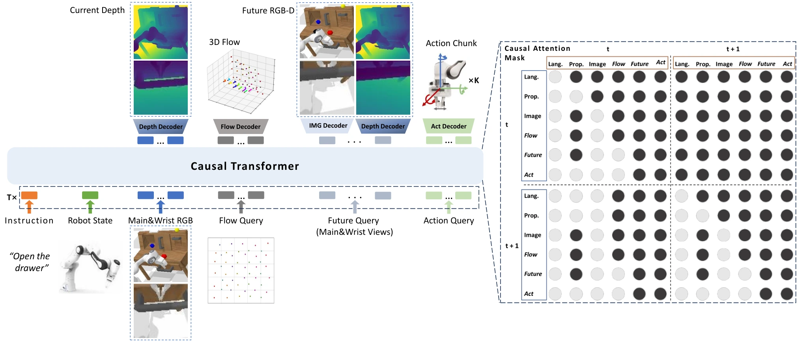

<!-- Generated by scripts/generate.py; edit data/works.json and data/media.json. -->

[← Back to the Awesome index](../../../README.md) · [Interactive website](https://chang-xinhai.github.io/Awesome-RGBDT-Manipulation/?collection=policy&item=3d-foresight#library)

# 3D Foresight

3D Dynamics-Aware Manipulation: Endowing Manipulation Policies with 3D Foresight

**2025-02-14 · ICRA 2026 · Hong Kong University of Science and Technology (Guangzhou); JAKA Robotics**

**[Paper](https://arxiv.org/abs/2502.10028)** · [Code](https://github.com/Stardust-hyx/3D-Foresight)

Auxiliary current depth, future RGB-D and 3D-flow learning improves an RGB policy while avoiding sensor depth at rollout.

*3D Foresight authors · [Figure source](https://arxiv.org/html/2502.10028) · Original rights retained.*

| Field | Reported value and source scope |
| :-- | :-- |
| Record type | policy |
| Policy family | World-action model [1](https://arxiv.org/abs/2502.10028)  |
| Base model and architecture | GR-MG-initialized causal transformer with geometric auxiliary queries and action chunks. [1](https://arxiv.org/abs/2502.10028)  |
| Model size and component | Not reported in the inspected primary-source sections [1](https://arxiv.org/abs/2502.10028)  |
| Deployment inputs | Main/wrist RGB, language and proprioception. [1](https://arxiv.org/abs/2502.10028)  |
| Action outputs and horizon | Action chunks; depth/future-RGB-D/flow are auxiliary outputs during learning. [1](https://arxiv.org/abs/2502.10028)  |
| Training method | Cross-embodiment pretraining then task finetuning; auxiliary decoding heads removed or offloaded at inference. [1](https://arxiv.org/abs/2502.10028)  |
| Training data | 44K trajectories from RH20T, Bridge, Berkeley UR5, Mutex, LIBERO; 60 real demonstrations per task. [1](https://arxiv.org/abs/2502.10028)  |
| Training duration | Pretraining: 35 epochs, approximately three days [1](https://arxiv.org/abs/2502.10028)  |
| Training hardware | 4 NVIDIA RTX 4090 GPUs for pretraining [1](https://arxiv.org/abs/2502.10028)  |
| Inference and control rates | 112 ms policy inference in reported comparison; not a measured closed-loop robot rate. [1](https://arxiv.org/abs/2502.10028)  |
| Evaluation scope | CALVIN, LIBERO, real JAKA K-1 cup stacking and drawer/tape manipulation. [1](https://arxiv.org/abs/2502.10028)  |
| Observations / modalities | RGB · Language · Proprioception |
| Evaluation domain | Simulation · Real world |
| Embodiment | Parallel-jaw gripper |
| Release: code | Available [2](https://github.com/Stardust-hyx/3D-Foresight) [4](https://github.com/Stardust-hyx/3D-Foresight/tree/main)  |
| Release: weights | Not verified [2](https://github.com/Stardust-hyx/3D-Foresight)  |
| Release: data | Not verified [2](https://github.com/Stardust-hyx/3D-Foresight)  |
| Release: license | MIT for repository code; pretrained models, data and figure rights remain separate [2](https://github.com/Stardust-hyx/3D-Foresight) [3](https://github.com/Stardust-hyx/3D-Foresight/blob/main/LICENSE)  |
| Release: notes | Code, data and weights are checked independently; an upstream pretrained model is not a released task policy. [2](https://github.com/Stardust-hyx/3D-Foresight)  |

**Scope and qualifications**

- Depth labels are measured in CALVIN and estimated in LIBERO/real data; the policy does not require a measured depth stream.

**Primary evidence**

1. [Original manuscript and first submission history](https://arxiv.org/abs/2502.10028) — Full author HTML method/evaluation/appendix inspected; depth observations, pseudo-labels and generated outputs retain distinct roles.
2. [Official implementation and release scope](https://github.com/Stardust-hyx/3D-Foresight) — Availability of research implementation does not establish public task-policy checkpoints.
3. [Actual license file in released source](https://github.com/Stardust-hyx/3D-Foresight/blob/main/LICENSE) — Only source code covered by this file; not a blanket license for paper figures or upstream weights.
4. [Actual repository content inventory](https://github.com/Stardust-hyx/3D-Foresight/tree/main) — 133 tracked paths inspected; code release is distinguished from a README/project/figure-only repository.
