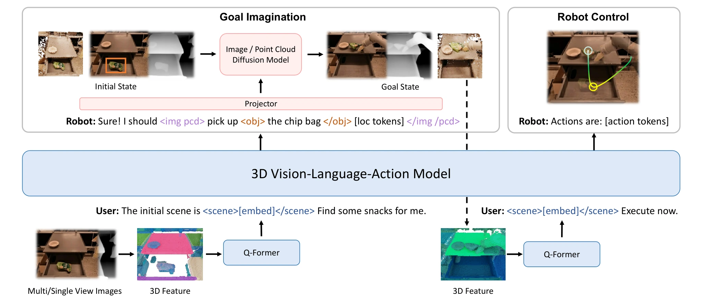

<!-- Generated by scripts/generate.py; edit data/works.json and data/media.json. -->

[← Back to the Awesome index](../../../README.md) · [Interactive website](https://chang-xinhai.github.io/Awesome-RGBDT-Manipulation/?collection=policy&item=3d-vla#library)

# 3D-VLA

3D-VLA: A 3D Vision-Language-Action Generative World Model

**2024-03-14 · ICML 2024 · UMass Amherst; SJTU; SCUT; Wuhan University; MIT; UCLA; MIT-IBM**

**[Paper](https://arxiv.org/abs/2403.09631)** · [Project](https://vis-www.cs.umass.edu/3dvla/) · [Code](https://github.com/UMass-Embodied-AGI/3D-VLA)

A 3D language model aligns interaction tokens with goal-image and goal-point-cloud generators.

*3D-VLA authors · [Figure source](https://arxiv.org/html/2403.09631) · Original rights retained.*

| Field | Reported value and source scope |
| :-- | :-- |
| Record type | model |
| Model role and downstream interface | 3D multimodal reasoning, goal generation and action representation [1](https://arxiv.org/abs/2403.09631)  |
| Model family | Geometry representation [1](https://arxiv.org/abs/2403.09631)  |
| Model architecture | BLIP2-FlanT5-XL / 3D-LLM-style features and embodied diffusion goal decoders. [1](https://arxiv.org/abs/2403.09631)  |
| Model size and component | Not reported in the inspected primary-source sections [1](https://arxiv.org/abs/2403.09631)  |
| Model inputs | 3D scene features from multi-view observations plus language; dataset may use measured or estimated depth. [1](https://arxiv.org/abs/2403.09631)  |
| Model outputs | Language/localization/action tokens, goal RGB-D images and point clouds. [1](https://arxiv.org/abs/2403.09631)  |
| Training method | 3D instruction tuning and language-to-diffusion alignment. [1](https://arxiv.org/abs/2403.09631)  |
| Training data and scale | Approximately 2M 3D language/action data pairs extracted from heterogeneous embodied datasets. [1](https://arxiv.org/abs/2403.09631)  |
| Training duration | Not reported in the inspected primary-source sections [1](https://arxiv.org/abs/2403.09631)  |
| Training hardware | Paper reports 6×32 V100 pretraining and 6×64 V100 alignment configurations; separate goal decoders have their own budgets. [1](https://arxiv.org/abs/2403.09631)  |
| Inference setting and runtime | Not reported in the inspected primary-source sections [1](https://arxiv.org/abs/2403.09631)  |
| Downstream evaluation and scope | Held-in embodied reasoning, goal generation and offline action prediction; physical closed-loop manipulation is not established. [1](https://arxiv.org/abs/2403.09631)  |
| Observations / modalities | RGB · Depth · Point cloud · Language |
| Evaluation domain | Simulation · Real world |
| Embodiment |  |
| Release: code | Partial [2](https://vis-www.cs.umass.edu/3dvla/) [3](https://github.com/UMass-Embodied-AGI/3D-VLA) [4](https://github.com/UMass-Embodied-AGI/3D-VLA/tree/main)  |
| Release: weights | Partial [2](https://vis-www.cs.umass.edu/3dvla/) [3](https://github.com/UMass-Embodied-AGI/3D-VLA)  |
| Release: data | Not verified [2](https://vis-www.cs.umass.edu/3dvla/) [3](https://github.com/UMass-Embodied-AGI/3D-VLA)  |
| Release: license | Not verified [2](https://vis-www.cs.umass.edu/3dvla/) [3](https://github.com/UMass-Embodied-AGI/3D-VLA)  |
| Release: notes | Released goal diffusion models; official model card labels unified LLM/full 3D-VLA checkpoints coming soon. [2](https://vis-www.cs.umass.edu/3dvla/) [3](https://github.com/UMass-Embodied-AGI/3D-VLA)  |

**Scope and qualifications**

- Action-token prediction and goal generation do not by themselves demonstrate an executable closed-loop robot policy.

**Primary evidence**

1. [Original manuscript and first submission history](https://arxiv.org/abs/2403.09631) — Full author HTML method/evaluation/appendix inspected; depth observations, pseudo-labels and generated outputs retain distinct roles.
2. [Official author project](https://vis-www.cs.umass.edu/3dvla/) — Public author-linked project; figure and downstream scope verified separately.
3. [Official implementation and release scope](https://github.com/UMass-Embodied-AGI/3D-VLA) — Availability of research implementation does not establish public task-policy checkpoints.
4. [Actual repository content inventory](https://github.com/UMass-Embodied-AGI/3D-VLA/tree/main) — 127 tracked paths inspected; code release is distinguished from a README/project/figure-only repository.
