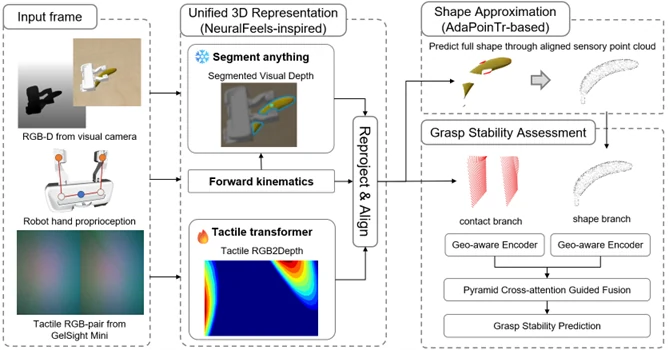

<!-- Generated by scripts/generate.py; edit data/works.json and data/media.json. -->

[← Back to the Awesome index](../../../README.md) · [Interactive website](https://chang-xinhai.github.io/Awesome-RGBDT-Manipulation/?collection=policy&item=3da-vtg#library)

# 3DA-VTG / SGA-GSN

3DA-VTG: An Explicitly Aligned Visuo-Tactile Grasp Dataset and Dual-Branch Fusion Method for Robotic Stable Grasp

**2026-03-30 · Chinese Journal of Mechanical Engineering (2026) · Beihang University; Beijing University of Posts and Telecommunications**

**[Paper](https://doi.org/10.1016/j.cjme.2026.100283)** · [Project](https://github.com/Yiju1213/3DA-VTG) · [Code](https://github.com/Yiju1213/SGA-GSN) · [Data](https://huggingface.co/datasets/robotic-vt-grasp-project/3DA-VTG) · [Weights](https://huggingface.co/robotic-vt-grasp-project/SGA-GSN)

Spatially registers scene RGB-D and GelSight contact images to complete grasped-object geometry and score binary stability.

*Yong Tao and coauthors · [Figure source](https://github.com/Yiju1213/3DA-VTG) · Original rights retained.*

| Field | Reported value and source scope |
| :-- | :-- |
| Record type | model |
| Model role and downstream interface | Grasp stability prediction and visuo-tactile reconstruction [1](https://doi.org/10.1016/j.cjme.2026.100283)  |
| Model family | 3DA-VTG / SGA-GSN [1](https://doi.org/10.1016/j.cjme.2026.100283)  |
| Model architecture | SAM-based visual masking, learned tactile depth, AdaPoinTr shape completion, and dual-branch SGA-GSN stability estimation. [1](https://doi.org/10.1016/j.cjme.2026.100283)  |
| Model size and component | Not reported [1](https://doi.org/10.1016/j.cjme.2026.100283)  |
| Model inputs | Calibrated external RGB-D observations and dual simulated optical fingertip images with extrinsics. Tactile depth is inferred in the model. [1](https://doi.org/10.1016/j.cjme.2026.100283)  |
| Model outputs | A completed 3D point cloud and stable/unstable probability. No robot actions are generated by SGA-GSN. [1](https://doi.org/10.1016/j.cjme.2026.100283)  |
| Training method | Supervised geometry and tactile fusion followed by a grasp stability classification objective. [1](https://doi.org/10.1016/j.cjme.2026.100283)  |
| Training data and scale | 440,000 simulated grasp trials across 88 objects; paper reports about 5,000 grasps per object. [1](https://doi.org/10.1016/j.cjme.2026.100283)  |
| Training duration | Not reported [1](https://doi.org/10.1016/j.cjme.2026.100283)  |
| Training hardware | Not reported [1](https://doi.org/10.1016/j.cjme.2026.100283)  |
| Inference setting and runtime | Not reported [1](https://doi.org/10.1016/j.cjme.2026.100283)  |
| Downstream evaluation and scope | Comparison across vision-only, tactile-only and spatially aligned visuo-tactile grasp stability conditions on the simulated corpus. [1](https://doi.org/10.1016/j.cjme.2026.100283)  |
| Observations / modalities | RGB · Depth · Point cloud · Tactile |
| Evaluation domain | Simulation |
| Embodiment | Parallel-jaw gripper |
| Release: code | Available — dedicated SGA-GSN training/inference implementation [5](https://github.com/Yiju1213/SGA-GSN#readme)  |
| Release: weights | Available — binary classifier and shape-completion checkpoints [3](https://huggingface.co/robotic-vt-grasp-project/SGA-GSN/tree/main)  |
| Release: data | Available — numbered dataset archives and metadata [4](https://huggingface.co/datasets/robotic-vt-grasp-project/3DA-VTG/tree/main)  |
| Release: license | MIT model release; CC BY-NC-SA 4.0 dataset [3](https://huggingface.co/robotic-vt-grasp-project/SGA-GSN/tree/main)  |
| Release: notes | Verified code resides in the dedicated SGA-GSN repository; the umbrella project README contains older planned-release text. |

**Scope and qualifications**

- The paired streams and grasp outcomes are simulated. Tactile depth is local surface geometry, distinct from external scene RGB-D. This evaluates a grasp scorer, not a closing/regrasping policy.

**Primary evidence**

1. [Original paper and evaluation settings](https://doi.org/10.1016/j.cjme.2026.100283)
2. [Official project with task and method examples](https://github.com/Yiju1213/3DA-VTG)
3. [Actual classifier, baseline and shape-completion checkpoint files](https://huggingface.co/robotic-vt-grasp-project/SGA-GSN/tree/main)
4. [Numbered dataset archives, metadata and license](https://huggingface.co/datasets/robotic-vt-grasp-project/3DA-VTG/tree/main)
5. [Author public release configurations and executable source](https://github.com/Yiju1213/SGA-GSN#readme)
