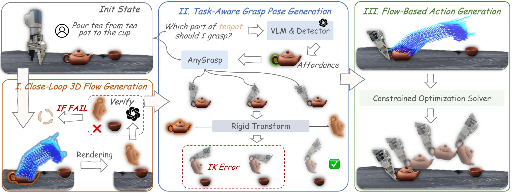

<!-- Generated by scripts/generate.py; edit data/works.json and data/media.json. -->

[← Back to the Awesome index](../../../README.md) · [Interactive website](https://chang-xinhai.github.io/Awesome-RGBDT-Manipulation/?collection=policy&item=3dflowaction#library)

# 3DFlowAction

3DFlowAction: Learning Cross-Embodiment Manipulation from 3D Flow World Model

**2025-06-06 · arXiv preprint · South China University of Technology; Tencent Robotics X; HKUST; Pazhou Laboratory**

**[Paper](https://arxiv.org/abs/2506.06199)** · [Code](https://github.com/Hoyyyaard/3DFlowAction)

Language-conditioned 3D object-flow generation guides a constrained optimizer, with rendered-plan checking by GPT-4o.

*3DFlowAction authors · [Figure source](https://arxiv.org/html/2506.06199) · Original rights retained.*

| Field | Reported value and source scope |
| :-- | :-- |
| Record type | policy |
| Policy family | Planning / hybrid [1](https://arxiv.org/abs/2506.06199)  |
| Base model and architecture | Stable-Diffusion/AnimateDiff flow world model, flow-guided renderer and SciPy action optimizer. [1](https://arxiv.org/abs/2506.06199)  |
| Model size and component | Not reported in the inspected primary-source sections [1](https://arxiv.org/abs/2506.06199)  |
| Deployment inputs | Calibrated RGB-D scene, language and selected object geometry. [1](https://arxiv.org/abs/2506.06199)  |
| Action outputs and horizon | Constrained SE(3) end-effector pose chunks. [1](https://arxiv.org/abs/2506.06199)  |
| Training method | Video-flow pretraining and human-video adaptation; robot actions recovered through optimization. [1](https://arxiv.org/abs/2506.06199)  |
| Training data | ManiFlow-110K; 30 human demonstrations per target task. [1](https://arxiv.org/abs/2506.06199)  |
| Training duration | Approximately two days of pretraining [1](https://arxiv.org/abs/2506.06199)  |
| Training hardware | Manuscript reports an 8 × 8 V100 setup for pretraining [1](https://arxiv.org/abs/2506.06199)  |
| Inference and control rates | Not reported in the inspected primary-source sections [1](https://arxiv.org/abs/2506.06199)  |
| Evaluation scope | Four real tasks across XTrainer and Franka, with unseen object/background tests. [1](https://arxiv.org/abs/2506.06199)  |
| Observations / modalities | RGB · Depth · Point cloud · Language |
| Evaluation domain | Simulation · Real world |
| Embodiment | Parallel-jaw gripper |
| Release: code | Available [2](https://github.com/Hoyyyaard/3DFlowAction) [3](https://github.com/Hoyyyaard/3DFlowAction/tree/main)  |
| Release: weights | Not verified [2](https://github.com/Hoyyyaard/3DFlowAction)  |
| Release: data | Not verified [2](https://github.com/Hoyyyaard/3DFlowAction)  |
| Release: license | Not verified [2](https://github.com/Hoyyyaard/3DFlowAction)  |
| Release: notes | Code, data and weights are checked independently; an upstream pretrained model is not a released task policy. [2](https://github.com/Hoyyyaard/3DFlowAction)  |

**Scope and qualifications**

- The planning checker uses GPT-4o; an optimization policy is distinct from a directly trained action decoder.

**Primary evidence**

1. [Original manuscript and first submission history](https://arxiv.org/abs/2506.06199) — Full author HTML method/evaluation/appendix inspected; depth observations, pseudo-labels and generated outputs retain distinct roles.
2. [Official implementation and release scope](https://github.com/Hoyyyaard/3DFlowAction) — Availability of research implementation does not establish public task-policy checkpoints.
3. [Actual repository content inventory](https://github.com/Hoyyyaard/3DFlowAction/tree/main) — 1530 tracked paths inspected; code release is distinguished from a README/project/figure-only repository.
